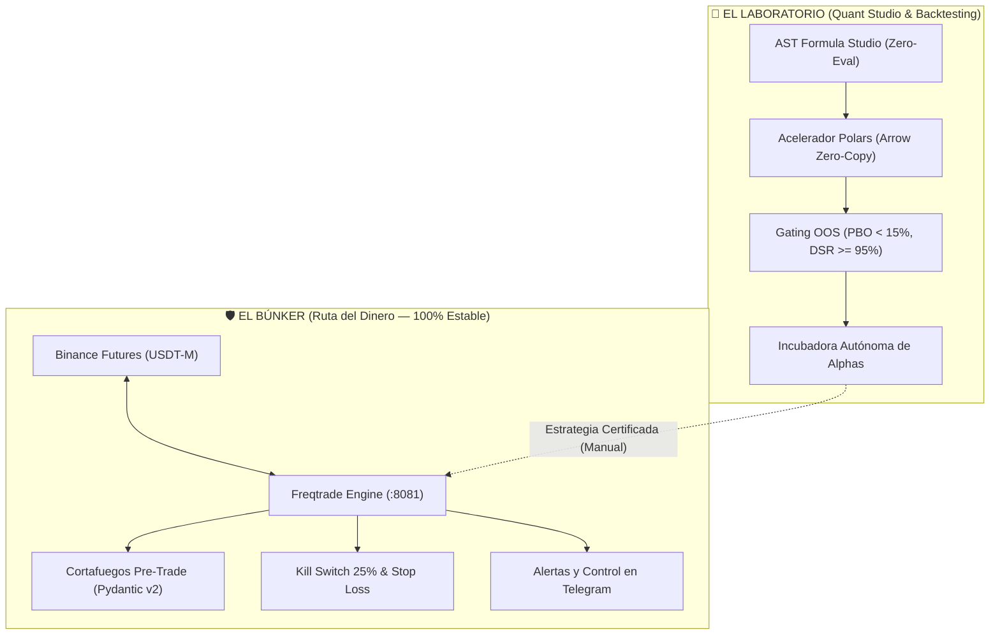

# 🏹 Meme Hunter — Estación Cuantitativa Personal & Laboratorio de Estrategias

[](https://www.docker.com/)
[](https://www.python.org/)
[](https://vuejs.org/)
[](https://vitejs.dev/)
[](https://pola.rs/)
[](https://docs.pytest.org/)
[](LICENSE)

**Meme Hunter** es una estación de trading cuantitativo y centro de mando autohospedado (*self-hosted*) diseñado para operar de forma autónoma en **Binance Futures**, investigar y validar estrategias con rigor matemático institucional y supervisar toda la operativa desde una **consola web unificada en FreqUI (`:8081`)** con telemetría en **Telegram**.

---

## ⚡ Inicio Rápido en 3 Pasos (Time-to-Value < 3 minutos)

El despliegue está completamente dockerizado y unificado en un solo comando:

### 1. Clonar el repositorio
```bash
git clone https://github.com/tu-usuario/meme-hunter.git
cd meme-hunter
```

### 2. Configurar variables de entorno
```bash
cp .env.example .env
```
*(Opcional: configura tus claves de Binance si deseas operar en vivo o tu token de Telegram para recibir alertas en el móvil. Por defecto corre en modo seguro de simulación).*

### 3. Iniciar la estación
```bash
docker compose up -d
```

¡Listo! Abre tu navegador en **[http://localhost:8081](http://localhost:8081)**
* **Usuario:** `admin`
* **Contraseña:** `MemeHunter2026!`

---

## 🏛️ Arquitectura Bimodal: El Búnker vs. El Laboratorio

Para garantizar que los experimentos nunca pongan en riesgo el capital real, el sistema está desacoplado en dos zonas operativas:



### 🛡️ 1. El Búnker (Ejecución y Gestión de Riesgo)
* **Motor Asíncrono de Futuros:** Ejecución bidireccional Long/Short sobre contratos perpetuos de alta liquidez.
* **Cortafuegos Pre-Trade (`pre_trade_profitability.py`):** Exige que el target de rebote supere el costo friccional (comisiones + spread + slippage) en al menos $\ge 2.5\times$ o aborta la orden silenciosamente.
* **Kill Switch Absoluto:** Liquidación inmediata a mercado y modo `STANDBY` ante drawdown intradía $\ge 5.0\%$.

### 🔬 2. El Laboratorio (Investigación y Validación Matemática)
* **Compuertas Anti-Sobreajuste (Marcos López de Prado):**
  * **PBO (*Probability of Backtest Overfitting*):** Exige $< 15\%$.
  * **DSR (*Deflated Sharpe Ratio*):** Exige $\ge 95\%$.
  * **CPCV (*Combinatorial Purged Cross-Validation*):** Validación cruzada combinatoria purgada sin filtrado de datos (*lookahead bias*).
* **Compilador AST Zero-Eval:** Validación y compilación sintáctica segura de expresiones matemáticas hacia código ejecutable sin usar el peligroso `eval()`.
* **Aceleración con Polars y Arrow IPC:** Ingesta vectorizada de alta velocidad y diferenciación fraccionaria FFD ($d=0.40$).

---

## 🖥️ Consola Web Unificada FreqUI (`:8081`)

Toda la operativa se gestiona desde una única aplicación SPA construida con Vue 3, Vite, Pinia y Tailwind:

* **`/` y `/trade`:** Monitor de operaciones en tiempo real, cartera, balance de margen, órdenes límite y libros de órdenes L2.
* **`/dag`:** Visualizador de la topología multi-agente en Grafo Acíclico Dirigido con controles *Human-in-the-Loop* (HITL).
* **`/studio`:** Editor y probador de fórmulas de alphas con análisis de distribución sintáctica.
* **`/incubator`:** Estado del ciclo de vida de estrategias candidatas hacia producción.
* **`/help`:** Centro de documentación interna y atajos de teclado para traders.

---

## 🛠️ Comandos de Operaciones y Diagnóstico

El proyecto incluye herramientas CLI integradas para verificar el estado del sistema en menos de 3 segundos:

```bash
# Diagnóstico integral de salud operativa
uv run python scripts/ops/check_health.py

# Ver estado de posiciones abiertas en la base de datos
docker compose exec meme_hunter freqtrade status

# Ver logs de operaciones en vivo
docker compose logs -f meme_hunter

# Detener el sistema
docker compose down
```

---

## 🧪 Suite de Pruebas Automatizadas

El código base cuenta con certificación de pruebas unitarias tanto en backend como en frontend:

```bash
# Pruebas unitarias de Python (FastAPI, CLI, Riesgo, Configuración)
uv run pytest tests/unit/

# Pruebas del frontend FreqUI (Vitest)
cd web/frequi && npx vitest run
```

---

## 📚 Documentación Técnica Detallada (`docs/`)

Para profundizar en la teoría matemática, manuales de desarrollo y especificaciones de sprints:

* **[Manual Estándar del Proyecto:](docs/MANUAL_ESTANDAR_DEL_PROYECTO.md)** Guía canónica de ingeniería, arquitectura modular y testing.
* **[Manual Unificado del Sistema:](docs/MANUAL_UNIFICADO_DEL_SISTEMA.md)** Referencia integral técnica, cuantitativa y operativa.
* **[Manual de Usuario de FreqUI:](docs/guides/MANUAL_DE_USUARIO_FREQUI_COCKPIT.md)** Guía de navegación para el Quant Cockpit.
* **[Archivo Histórico y Catálogo de Sprints:](docs/history/sprints/README.md)** Bitácora de evolución técnica de los sprints del sistema.

---

## 📜 Licencia

Distribuido bajo la licencia [MIT](LICENSE). Código libre para uso personal, experimentación y contribuciones de la comunidad.
