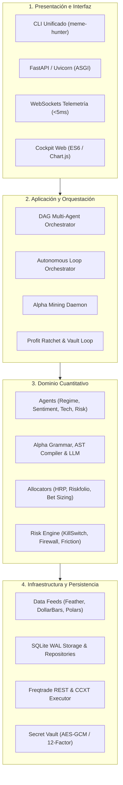
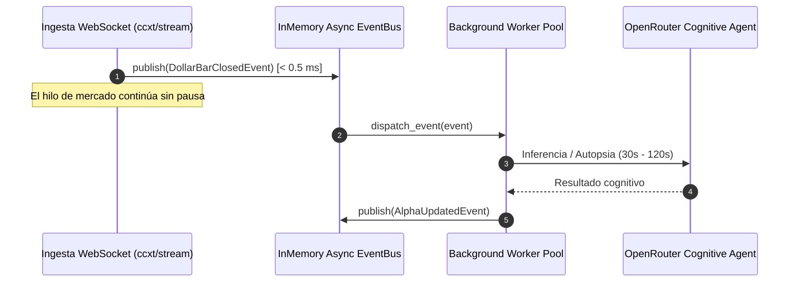

# 🛡️ Manual Estándar de Ingeniería y Desarrollo (Meme Hunter v8.5)

Este manual constituye la **norma técnica canónica y guía obligatoria de desarrollo** para todos los ingenieros de software, analistas cuantitativos e investigadores que contribuyan al proyecto **Meme Hunter**. Todo código, base de datos, interfaz o pipeline integrado en el repositorio debe apegarse estrictamente a los estándares definidos en este documento.

---

## 📑 Tabla de Contenidos

1. [Filosofía y Principios de Diseño](#1-filosofía-y-principios-de-diseño)
2. [Arquitectura Modular y Estructura de Código](#2-arquitectura-modular-y-estructura-de-código)
3. [Estándar de Bases de Datos y Gestión del Estado](#3-estándar-de-bases-de-datos-y-gestión-del-estado)
4. [Estándar de Comunicaciones, IPC y Eventos](#4-estándar-de-comunicaciones-ipc-y-eventos)
5. [Estándar de Herramientas, Entorno y Configuración](#5-estándar-de-herramientas-entorno-y-configuración)
6. [Flujos Operativos y Pipelines Estandarizados](#6-flujos-operativos-y-pipelines-estandarizados)
7. [Consolidación de Herramientas y CLI Canónico](#7-consolidación-de-herramientas-y-cli-canónico)
8. [Estándares de Calidad de Código y Tipado](#8-estándares-de-calidad-de-código-y-tipado)
9. [Estándares de Pruebas (Testing Pyramid)](#9-estándares-de-pruebas-testing-pyramid)
10. [Flujo de Trabajo, Git y Gestión Documental (DocOps)](#10-flujo-de-trabajo-git-y-gestión-documental-docops)

---

## 1. Filosofía y Principios de Diseño

El sistema Meme Hunter opera en entornos de alta volatilidad con capital real en mercados de derivados de criptoactivos. Por tanto, cada componente se rige por cuatro principios no negociables:

```
┌────────────────────────────────────────────────────────────────────────────────────────┐
│                        PRINCIPIOS FUNDAMENTALES DE INGENIERÍA                          │
├──────────────────────────┬─────────────────────────────────────────────────────────────┤
│ 1. Zero-Eval             │ Prohibido el uso de eval(), exec() o des-serialización      │
│    Determinista          │ no segura (pickle). Toda fórmula o código dinámico debe     │
│                          │ compilarse mediante AST formal bajo una gramática cerrada.  │
├──────────────────────────┼─────────────────────────────────────────────────────────────┤
│ 2. Single Source of      │ Erradicación absoluta del "Split-Brain". Ningún proceso     │
│    Truth (SSOT)          │ debe persistir estado operativo en JSONs paralelos. Todo    │
│                          │ estado de ciclo de vida se consolida en SQLite WAL.        │
├──────────────────────────┼─────────────────────────────────────────────────────────────┤
│ 3. Fail-Fast Criptográfico│ Cero secretos hardcodeados o credenciales dev por defecto. │
│    y de Configuración    │ Si falta una variable crítica en el entorno, el proceso     │
│                          │ aborta inmediatamente (exit code 1) al iniciar.            │
├──────────────────────────┼─────────────────────────────────────────────────────────────┤
│ 4. Desacoplamiento       │ Los bucles de ingesta de mercado (ticks/velas) jamás        │
│    I/O No Bloqueante     │ deben bloquearse por tareas cognitivas pesadas (LLMs, GA).  │
│                          │ La comunicación es asíncrona mediante un Event Bus interno.│
└──────────────────────────┴─────────────────────────────────────────────────────────────┘
```

---

## 2. Arquitectura Modular y Estructura de Código

El repositorio transiciona formalmente hacia una **Clean Modular Architecture** bajo el paquete `meme_hunter`. Se prohíbe la creación de "God Modules" y la colocación de scripts huérfanos en la raíz.



### 2.1 Mapeo de Dominios y Responsabilidades

| Paquete | Responsabilidad Única | Qué está PROHIBIDO dentro del paquete |
|---|---|---|
| `meme_hunter.core` | Kernel: Configuración tipada (`pydantic-settings`), criptografía (`secrets_vault`), excepciones y tipos base. | Dependencias de trading, llamadas a red o lógica de persistencia. |
| `meme_hunter.storage` | Base de datos SQLite WAL, pragmas de concurrencia, esquemas DDL y Repositorios canónicos. | Cálculos cuantitativos, toma de decisiones o conexión con brokers. |
| `meme_hunter.data` | Ingesta de Binance, feeds continuos, cálculo de Dollar Bars, microestructura (OFI) y feeds Polars. | Lógica de generación de órdenes o evaluación de stoploss. |
| `meme_hunter.alpha` | Gramática formal, parser AST seguro, síntesis de alfas con LLM, optimización genética NSGA-II. | Almacenamiento directo a disco sin pasar por `storage.repositories`. |
| `meme_hunter.validation` | Compuertas OOS (PBO, DSR), validación CPCV, data firewall y triple barrier labeling. | Modificación de capital o interacción con el exchange. |
| `meme_hunter.portfolio` | Dimensionamiento de apuestas (Bet Sizing), optimizadores HRP y Riskfolio, incubadora de alfas. | Ejecución de órdenes de mercado o acceso a credenciales crudas. |
| `meme_hunter.risk` | Kill Switch global, compuertas pre-trade, degradación elegante y sentinelas adversarios. | Bloquearse esperando respuestas externas sin timeout. |
| `meme_hunter.agents` | Nodos especializados del grafo (Técnico, Sentimiento, Régimen, Riesgo) y Fusión Bayesiana. | Escribir archivos de lock o mutar variables globales. |
| `meme_hunter.execution` | Conector REST con Freqtrade, enrutador de órdenes CCXT, compilador de estrategias y bóveda. | Ignorar las compuertas de `risk` al despachar órdenes. |
| `meme_hunter.api` | Servidor ASGI FastAPI, WebSockets de baja latencia y endpoints REST para el Cockpit. | Ejecutar tareas bloqueantes pesadas en el hilo del event loop. |
| `meme_hunter.cli` | Entrypoint unificado de terminal (`meme-hunter [command]`). | Lógica de negocio embebida (debe delegar a `application` o `domain`). |

---

## 3. Estándar de Bases de Datos y Gestión del Estado

### 3.1 Eliminación del *Split-Brain*
* **Regla Estricta:** Ningún proceso debe utilizar archivos `.json` (`incubator_state.json`, `cycle_history.json`, `autopsies.json`, `market_bias.json`) como almacenamiento operativo mutable.
* **Fuente Canónica:** La totalidad del estado transaccional reside en la base de datos SQLite WAL localizada en `storage/meme_hunter.db`.
* **Exportaciones JSON:** Los archivos JSON solo están permitidos como volcados periódicos *de solo lectura* para telemetría externa o depuración manual.

### 3.2 Pragmas Obligatorios de Concurrencia SQLite WAL
Toda conexión a base de datos debe inicializarse a través del gestor `meme_hunter.storage.db` aplicando los siguientes parámetros de resiliencia:

```python
# src/meme_hunter/storage/db.py
import sqlite3

def configure_sqlite_wal(conn: sqlite3.Connection, read_only: bool = False) -> None:
    cur = conn.cursor()
    # Timeout tolerante a concurrencia entre procesos (15 segundos)
    cur.execute("PRAGMA busy_timeout = 15000;")
    cur.execute("PRAGMA foreign_keys = ON;")
    cur.execute("PRAGMA synchronous = NORMAL;")
    if not read_only:
        # Habilitar lectura y escritura no bloqueante
        cur.execute("PRAGMA journal_mode = WAL;")
    cur.close()
```

### 3.3 El Patrón Repository
Queda prohibido intercalar sentencias SQL crudas en la lógica de dominio o de los agentes. Toda interacción con la base de datos debe implementarse mediante un repositorio específico:

```
src/meme_hunter/storage/repositories/
├── strategy_repo.py     # CRUD y transición de estados (SANDBOX -> LIVE -> ALPHA_DECAY -> RETIRED)
├── autopsy_repo.py      # Registro de dictámenes cognitivos de autopsia de factores
├── bias_repo.py         # Registro y consulta de sesgos de mercado por símbolo (con TTL)
├── allocation_repo.py   # Registro inmutable de ponderaciones HRP / Riskfolio
└── cycle_repo.py        # Métricas de ejecución del bucle autónomo
```

---

## 4. Estándar de Comunicaciones, IPC y Eventos

### 4.1 Comunicación Asíncrona Desacoplada (Event Bus Interno)
Para evitar congelamientos de la ingesta de mercado en vivo cuando los agentes ejecutan optimizaciones genéticas o inferencia con LLMs, se utiliza un bus de eventos en memoria:



### 4.2 Comunicación Inter-Proceso (IPC)
* **Prohibido:** Crear archivos de bandera planos (`user_data/KILL_SWITCH`, `ratchet_state.json`) sin control de bloqueo inter-proceso.
* **Estándar:** Toda señal de control inter-proceso (p. ej. activación del Kill Switch o solicitud de rebalanceo) se registra en la tabla `system_events` de SQLite o se transmite mediante la API REST interna autenticada.

### 4.3 Comunicación con el Dashboard Web
* **Prohibido:** Sondeo continuo (HTTP polling) a intervalos cortos hacia el servidor HTTP.
* **Estándar:** Transmisión reactiva de eventos a través de **WebSockets nativos** (`/ws/telemetry`, `/ws/trades`) gestionados por FastAPI / Uvicorn con latencia $< 5\text{ ms}$.

### 4.4 Contratos de Datos y DTOs (Data Transfer Objects)
Todos los datos transmitidos entre capas deben validarse mediante modelos **Pydantic v2**:

```python
# src/meme_hunter/core/types.py
from pydantic import BaseModel, Field
from datetime import datetime
from enum import Enum

class MarketRegime(str, Enum):
    BULL_MOMENTUM = "BULL_MOMENTUM"
    BEAR_BLEED = "BEAR_BLEED"
    CHOPPY_RANGE = "CHOPPY_RANGE"
    CRITICAL_BREAK = "CRITICAL_BREAK"

class AgentSignalDTO(BaseModel):
    symbol: str
    signal_value: float = Field(ge=-1.0, le=1.0)
    confidence: float = Field(ge=0.0, le=1.0)
    regime: MarketRegime
    timestamp_utc: datetime
    metadata: dict = Field(default_factory=dict)
```

---

## 5. Estándar de Herramientas, Entorno y Configuración

### 5.1 Especificación de Dependencias (`pyproject.toml`)
El archivo `pyproject.toml` en la raíz del repositorio centraliza las dependencias, configuración de linters, formateadores y suite de pruebas bajo el estándar **PEP 621**.

### 5.2 Configuración 12-Factor App (`pydantic-settings`)
* **Regla:** Ningún valor sensible (claves de API, contraseñas, URLs de brokers) debe contener un valor hardcodeado por defecto en el código fuente.
* **Validación Fail-Fast:** Toda variable obligatoria debe definirse como `SecretStr` o tipo estricto. La ausencia de variables críticas en tiempo de inicialización provocará un cierre controlado e inmediato:

```python
# src/meme_hunter/core/config.py
from pydantic_settings import BaseSettings, SettingsConfigDict
from pydantic import Field, SecretStr
from pathlib import Path

class AppSettings(BaseSettings):
    model_config = SettingsConfigDict(env_file=".env", env_file_encoding="utf-8", extra="ignore")

    ENV: str = Field("production")
    DATA_DIR: Path = Field(default_factory=lambda: Path("./user_data/data"))
    DB_PATH: Path = Field(default_factory=lambda: Path("./storage/meme_hunter.db"))
    
    # Credenciales sin valor por defecto (Fail-Fast)
    BINANCE_API_KEY: SecretStr
    BINANCE_API_SECRET: SecretStr
    FREQTRADE_API_PASSWORD: SecretStr
    DASHBOARD_SECRET_KEY: SecretStr
    OPENROUTER_API_KEY: SecretStr | None = None

settings = AppSettings()
```

---

## 6. Flujos Operativos y Pipelines Estandarizados

El ciclo de vida operativo del sistema se compone de 5 pipelines interconectados:

```
┌────────────────────────────────────────────────────────────────────────────────────────┐
│                          PIPELINES OPERATIVOS CANÓNICOS                                │
├──────────────────────────┬─────────────────────────────────────────────────────────────┤
│ Pipeline 1: Ingesta      │ Binance API -> Feather 4H Sync -> Dollar Bars ($500k)       │
│                          │ -> Microestructura (OFI/Amihud) -> In-Memory Store Polars.  │
├──────────────────────────┼─────────────────────────────────────────────────────────────┤
│ Pipeline 2: Minería      │ Detección de Decay -> Autopsia Cognitiva LLM -> Generación   │
│                          │ de Fórmulas -> AST Compiler -> NSGA-II -> MAP-Elites.       │
├──────────────────────────┼─────────────────────────────────────────────────────────────┤
│ Pipeline 3: Certificación│ Backtest VectorBT -> Gating OOS (PBO < 15%, DSR >= 95%,     │
│                          │ Corr < 0.40) -> Incubadora (SANDBOX -> LIVE).              │
├──────────────────────────┼─────────────────────────────────────────────────────────────┤
│ Pipeline 4: Decisión DAG │ Ingesta -> Nodos Especializados en Paralelo -> Fusión       │
│                          │ Bayesiana Condicional -> Consenso de Señal (> 0.68).        │
├──────────────────────────┼─────────────────────────────────────────────────────────────┤
│ Pipeline 5: Ejecución    │ Hook confirm_trade_entry -> 4 Capas de Protección           │
│                          │ (Firewall, Bias, Fricción, Gatekeeper) -> Freqtrade / CCXT. │
└──────────────────────────┴─────────────────────────────────────────────────────────────┘
```

---

## 7. Consolidación de Herramientas y CLI Canónico

Se reemplaza la ejecución de scripts dispersos por interfaces CLI estructuradas:

```bash
# Bucle de trading y orquestación autónoma
meme-hunter run live --config ./user_data/config_futures.json
meme-hunter run daemon --type ratchet

# Minería y generación de factores de alfa
meme-hunter mine run --population 100 --generations 20 --use-llm
meme-hunter mine compile --output ./user_data/strategies/MemeHunter_MinedEnsemble.py

# Backtesting y validación cuantitativa
meme-hunter backtest run --strategy MemeHunter_ApexOmegaAlpha --timerange 20260101-20261001
meme-hunter backtest audit --zip-path ./user_data/backtest_results/backtest-result.zip

# Simulaciones y estrés
meme-hunter sim montecarlo --drawdown-limit 0.25 --iterations 10000

# Base de datos y migraciones
meme-hunter db init
meme-hunter db migrate
meme-hunter db inspect

# CLI Operativo Diario (Docker, FreqUI :8081, Telegram Copilot)
python scripts/ops/meme_cli.py health          # Centinela de salud en 2s
python scripts/ops/meme_cli.py frequi          # Acceso a FreqUI oficial (:8081)
python scripts/ops/meme_cli.py futures start   # Iniciar motor de futuros
python scripts/ops/meme_cli.py telegram-ai --poll  # Iniciar Copilot Telegram
```

---

## 8. Estándares de Calidad de Código y Tipado

1. **Ruff (Linter y Formateador Canónico):**
   * Longitud máxima de línea: 100 caracteres.
   * Reglas obligatorias: `E` (pycodestyle), `F` (Pyflakes), `I` (isort), `B` (flake8-bugbear), `S` (flake8-bandit/seguridad), `ASYNC` (flake8-async).
   * Ejecutar antes de cada commit: `ruff check . --fix` y `ruff format .`.
2. **Mypy (Tipado Estático Estricto):**
   * Toda función, método y clase debe contar con anotaciones de tipos completas (argumentos y valor de retorno).
   * Modo estricto activado (`strict = true`). Prohibido el uso deliberado de `type: ignore` sin justificante documental en comentario.
3. **Manejo de Excepciones:**
   * Prohibido capturar `Exception` de forma genérica silenciando errores (`except Exception: pass`).
   * Toda excepción debe loguearse con contexto estructurado (`logger.error("Contexto", exc_info=True)`).

---

## 9. Estándares de Pruebas (Testing Pyramid)

La suite de pruebas en `tests/` se organiza en cuatro capas jerárquicas:

```text
tests/
├── conftest.py             # Fixtures globales, BD en memoria SQLite WAL y mocks
├── unit/                   # Pruebas unitarias puras en memoria (< 10 ms por test)
│   ├── test_ast_parser.py
│   ├── test_metrics.py
│   └── test_bet_sizing.py
├── integration/            # Pruebas entre módulos con base de datos e I/O real
│   ├── test_db_pool_wal.py
│   ├── test_dag_orchestrator.py
│   └── test_freqtrade_client.py
├── e2e/                    # Pruebas de ciclo de vida completo de extremo a extremo
│   ├── test_pipeline_e2e.py
│   └── test_cockpit_api.py
└── chaos/                  # Inyección de fallas, latencia forzada y quiebre de sockets
    └── test_resilience_chaos.py
```

### Reglas para la Creación de Pruebas:
1. **Determinismo:** Las pruebas jamás deben depender de conectividad a internet en vivo. Utilice mocks de `ccxt` o datos estáticos en fixtures.
2. **Aislamiento:** Toda prueba que interactúe con SQLite debe ejecutarse sobre una base de datos temporal con `sqlite3.connect(":memory:")` o eliminarse automáticamente al finalizar el test fixture.
3. **Cobertura Mínima:** El código nuevo debe mantener o superar el **85% de cobertura** de pruebas en el módulo correspondiente.

---

## 10. Flujo de Trabajo, Git y Gestión Documental (DocOps)

### 10.1 Convención de Ramas y Commits (Conventional Commits)
Los mensajes de commit deben seguir la especificación formal:
```
<tipo>(<alcance opcional>): <descripción concisa en imperativo>

[cuerpo explicativo opcional]

[referencia a issues o historias de usuario opcional]
```
Tipos válidos:
* `feat`: Nueva funcionalidad (ej: `feat(dag): add bayesian sentiment fusion node`).
* `fix`: Corrección de un fallo (ej: `fix(storage): resolve WAL busy timeout on Windows`).
* `refactor`: Reestructuración de código sin alterar comportamiento externo.
* `test`: Adición o refactorización de pruebas.
* `docs`: Modificaciones en la documentación.

### 10.2 Checklist Obligatorio Pre-Merge
Antes de integrar cualquier cambio a la rama `main`:
- [ ] `ruff check .` pasa sin errores ni advertencias.
- [ ] `ruff format . --check` valida el estilo.
- [ ] `mypy src/` pasa con 0 errores de tipado estricto.
- [ ] `pytest tests/` ejecuta el 100% de la suite con resultado exitoso.
- [ ] Todo nuevo parámetro o cambio de arquitectura cuenta con su respectiva actualización en `docs/`.
