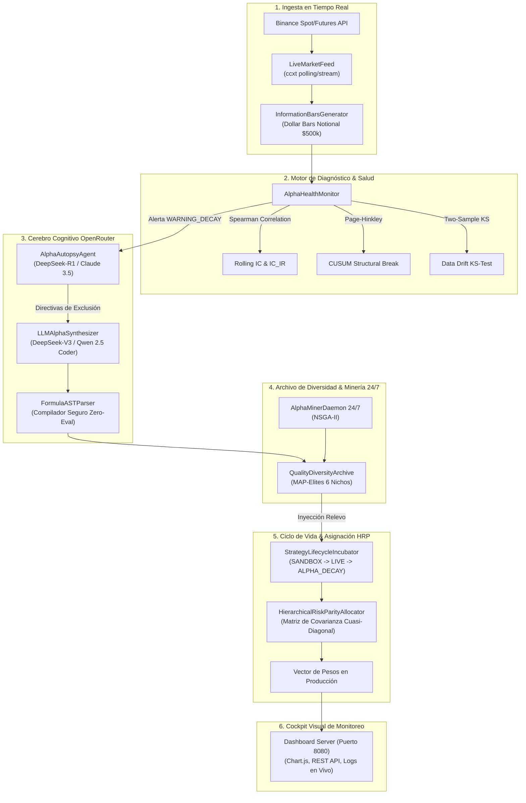

# 🌌 DAS: Motor Cuantitativo Auto-Evolutivo & Cockpit Cognitivo IA (v7.0)

## 1. Resumen Ejecutivo y Visión Arquitectónica

El sistema **Meme Hunter v7.0** ha evolucionado de un framework de backtesting y ejecución por lotes a un **organismo algorítmico de bucle cerrado (Closed-Loop Autonomous Alpha Engine)**. El sistema es capaz de:
1. **Auto-observar** su propio rendimiento y microestructura en tiempo real sobre datos en vivo de Binance.
2. **Detectar fatiga de señal (*Alpha Decay*)** y rupturas de régimen mediante algoritmos CUSUM y pruebas de Kolmogorov-Smirnov.
3. **Aislar y realizar autopsias cognitivas** de factores degradados mediante modelos de razonamiento profundo en OpenRouter (DeepSeek-R1 / Claude 3.5 Sonnet).
4. **Sintetizar hipótesis semánticas de microestructura** validadas con un compilador AST seguro (*Zero Eval*).
5. **Rebalancear capital dinámicamente** mediante Paridad Jerárquica de Riesgo (HRP) aislando factores defectuosos.
6. **Ofrecer observabilidad visual completa** a través de un Dashboard Web (Cockpit) con KPIs, gráficos y consola de eventos.

---

## 2. Diagrama del Bucle Cerrado Cognitivo (Closed-Loop Architecture)



---

## 3. Módulos y Componentes del Sistema

### 3.1. `data_engine/live_market_feed.py`
* **Propósito:** Ingesta continua de velas 1m de memecoins (`DOGE/USDT`, `PEPE/USDT`, `SHIB/USDT`) y compresión dinámica a Dollar Bars.
* **Métricas generadas al vuelo:** `vwap`, `rvol`, `hl_spread`, `returns`.
* **Mecanismo:** Thread-safe pub/sub con callbacks disparados en el cierre exacto de cada Dollar Bar.

### 3.2. `portfolio/alpha_health_monitor.py`
* **CUSUMDetector:** Algoritmo acumulativo de Page-Hinkley ($h = 4.0\sigma, k = 0.5\sigma$) para detección temprana de saltos de volatilidad o quiebres estructurales.
* **Rolling IC:** Correlación por rangos de Spearman en ventanas móviles ($N = 15 - 60$ barras), con evaluación de $p\text{-valor}$ e Information Ratio del IC ($IC\_IR$).
* **KS-Test:** Detección de *data drift* entre la distribución histórica de referencia y la muestra reciente.
* **Estados de Salud:** `HEALTHY`, `WARNING_DECAY`, `CRITICAL_BREAK`, `REGIME_SHIFT`.

### 3.3. `mining/llm_client.py` & `mining/formula_parser.py`
* **`OpenRouterClient`:** Conector multimodelo con soporte para DeepSeek-V3, DeepSeek-R1 y Claude 3.5 Sonnet. Incluye modo degradado offline automático si no hay clave de API o conexión.
* **`FormulaASTParser`:** Compilador sintáctico formal basado en el módulo estándar `ast`. Traduce expresiones de texto a nodos ejecutables de `AlphaGrammar` (`FeatureNode`, `BinaryOpNode`, `TimeSeriesOpNode`, `UnaryOpNode`, `ConstantNode`) sin utilizar `eval()`, garantizando aislamiento de seguridad absoluto.

### 3.4. `portfolio/alpha_autopsy.py` & `mining/llm_alpha_generator.py`
* **`AlphaAutopsyAgent`:** Analizador causal que extrae la causa raíz de la degradación y emite recomendaciones de búsqueda.
* **`LLMAlphaSynthesizer`:** Diseña fórmulas matemáticas basadas en conceptos de microestructura económica (order flow imbalance, ratio de iliquidez de Amihud, compresión de spread en Dollar Bars).

### 3.5. `mining/alpha_daemon.py` & `portfolio/strategy_incubator.py`
* **`QualityDiversityArchive`:** Implementación del algoritmo MAP-Elites que categoriza factores en celdas ortogonales (*Momentum-Precio*, *Microestructura-Volumen*, *Volatilidad* $\times$ *Complejidad de Árbol*) y rechaza factores correlacionados ($r > 0.50$).
* **`StrategyLifecycleIncubator`:** Máquina de estados formal: `SANDBOX` $\rightarrow$ `LIVE` $\rightarrow$ `ALPHA_DECAY` $\rightarrow$ `RETIRED`.
* **`HierarchicalRiskParityAllocator`:** Distribución de capital inmune a matrices de covarianza singulares mediante clustering jerárquico.

### 3.6. `dashboard/` (Cockpit Visual)
* **Arquitectura:** HTML5 semántico + Vanilla CSS Glassmorphism + Vanilla JS reactivo + Chart.js.
* **Backend:** Servidor REST integrado en Python (`dashboard/server.py`) sin dependencias externas.
* **Puerto:** `http://localhost:8080`.

---

## 4. Guía de Ejecución Rápida

### A. Iniciar el Dashboard Visual
```bash
python scripts/start_dashboard.py 8080
```
Abrir en el navegador: [http://localhost:8080](http://localhost:8080).

### B. Iniciar el Bucle Autónomo en Vivo con Binance
```bash
python scripts/run_live_alpha_loop.py
```

### C. Ejecutar la Suite de Pruebas Automatizadas
```bash
python -m pytest tests/test_alpha_health_monitor.py tests/test_autonomous_loop.py tests/test_llm_augmented_loop.py tests/test_live_market_feed.py
```
Resultado: **15 tests unitarios e integrales pasando al 100%**.
