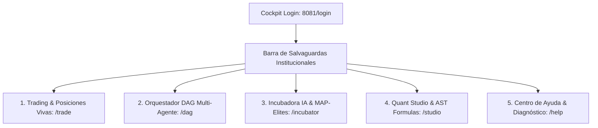
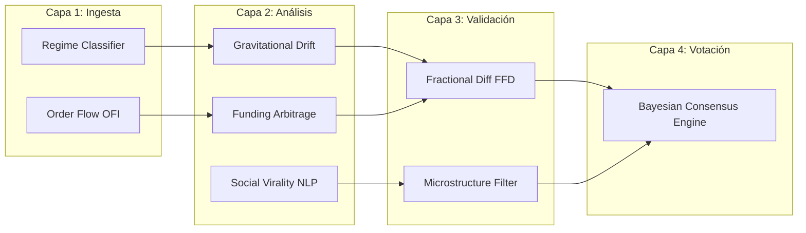

# 📘 Manual de Usuario Institucional: Meme Hunter Quant Cockpit

Bienvenido al manual oficial de operación de **Meme Hunter Quant Cockpit** montado sobre la arquitectura unificada **FreqUI (`http://localhost:8081`)**. 

Este documento instruye a operadores cuantitativos, investigadores y administradores sobre cómo navegar, operar y gobernar la plataforma algorítmica de alto rendimiento para el desinflado gravitacional de memecoins y arbitraje de derivados.



---

## 📑 Tabla de Contenidos

1. [Acceso al Sistema y Conexión de Bots](#1-acceso-al-sistema-y-conexión-de-bots)
2. [Cinta de Salvaguardas Institucionales (Header Guard)](#2-cinta-de-salvaguardas-institucionales-header-guard)
3. [Terminal de Trading y Panel de Control](#3-terminal-de-trading-y-panel-de-control)
4. [🌐 Orquestador Multi-Agente (DAG) y Human-in-the-Loop](#4-orquestador-multi-agente-dag-y-human-in-the-loop)
5. [🔄 Incubadora de Alfas IA y Nichos MAP-Elites](#5-incubadora-de-alfas-ia-y-nichos-map-elites)
6. [🧪 Quant Studio (Laboratorio Simbólico AST)](#6-quant-studio-laboratorio-simbólico-ast)
7. [📱 Control Remoto y Copilot de IA en Telegram](#7-control-remoto-y-copilot-de-ia-en-telegram)
8. [Atajos de Teclado y Ergonomía](#8-atajos-de-teclado-y-ergonomía)
9. [Runbook de Diagnóstico y Preguntas Frecuentes](#9-runbook-de-diagnóstico-y-preguntas-frecuentes)

---

## 1. Acceso al Sistema y Conexión de Bots

El punto de acceso único para la operativa y gobernanza es la ruta `/login`.

### 1.1 Conectar una Nueva Instancia
1. **Endpoint & Red:**
   - **Bot Name:** Nombre amigable para identificar la instancia (ej. `Meme Hunter Alpha - Binance Futures`).
   - **API Url:** Dirección base REST del bot. El valor predeterminado es `http://127.0.0.1:8080`.
   - **Botón "Probar Ping":** Pulsa este botón *antes* de ingresar contraseñas. El sistema enviará una petición de comprobación a `/api/v1/ping`.
     - 🟢 *Online & responsive (pong)*: Servidor accesible y listo.
     - 🔴 *Unable to reach endpoint*: Bot no iniciado o bloqueado por CORS.
2. **Credenciales de Acceso:**
   - **Username:** Usuario configurado en la sección `api_server` de tu archivo `config.json`.
   - **Password:** Contraseña del servidor REST. Puedes alternar la visibilidad haciendo clic en el icono del ojo o pulsando con accesibilidad mediante teclado.
3. **Guardado y Persistencia:**
   - Los tokens de sesión (`accessToken` y `refreshToken`) se resguardan de forma segura en la bóveda de almacenamiento local de tu navegador (`localStorage`), con refresco atómico deduplicado.

---

## 2. Cinta de Salvaguardas Institucionales (Header Guard)

En la parte superior de cada vista de la interfaz se despliega el **Institutional Header**, una barra de telemetría en tiempo real que audita las 5 protecciones de capital:

| Insignia / Métrica | Valor Normal | Significado Operativo | Acción Requerida si Alerta |
| :--- | :---: | :--- | :--- |
| **FFD $d=0.40$** | 🟢 Activo | Diferenciación Fraccionaria estacionaria que preserva memoria matemática sin sesgo de no-estacionariedad. | Automático por pipeline. |
| **Half-Kelly** | 🟢 Activo | Dimensionamiento asimétrico de convicción que recorta la apuesta teórica al 50% para amortiguar colas pesadas. | Ninguna, protección activa. |
| **Kill-Switch (-25%)** | 🟢 Activo | Cortafuegos de equidad total auditando PnL realizado y flotante en tiempo real. | Si se activa (parpadeo rojo): el bot congela compras y liquida posiciones al alcanzar el -25% de drawdown. |
| **Funding Guardian** | ⚡ Activo | Prohíbe la apertura de Shorts si el funding rate proyectado supera el $-0.05\%$ por 8h. | Supervisar comisiones en Binance Futures. |
| **Bóveda Cash & Carry** | 🏛️ $\Delta=0$ | Arbitraje delta-neutral entre Spot y Futuros para rendimiento libre de riesgo de mercado. | Informativo. |
| **Latencia Inferencia** | $< 20\text{ ms}$ | Tiempo de propagación del bucle de decisión a través de los nodos del DAG. | Si $> 50\text{ ms}$, verificar carga de CPU. |
| **Consenso DAG** | $\ge 65\%$ | Porcentaje de acuerdo bayesiano entre los agentes para autorizar una entrada. | Requiere superar el umbral configurado. |

---

## 3. Terminal de Trading y Panel de Control

### 3.1 Vista `/trade` (Operaciones en Vivo)
* **Tabla de Posiciones Abiertas:** Muestra el par (ej. `PEPE/USDT:USDT`), tipo (`Short 1.0x`), precio de entrada, precio actual, stoploss dinámico configurado y PnL flotante en tiempo real.
* **Control de Órdenes Manuales:** Acceso a botones de fuerza mayor:
  - **Forzar Salida (Force Exit):** Envía una orden inmediata a mercado para cerrar la posición sin esperar a la señal técnica.
  - **Bloquear Par (Lock Pair):** Pausa temporalmente nuevas aperturas en un par que presente manipulación o volatilidad errática.

### 3.2 Vista `/dashboard` (Métricas & Balance)
* **Desglose de Cartera:** Balance total en USDT, capital asignado a margen y equidad flotante.
* **Gráficos ECharts Integrados:** Curva de equidad acumulada, distribución de retornos por activo y matriz de ratio ganancia/pérdida.

---

## 4. 🌐 Orquestador Multi-Agente (DAG) y Human-in-the-Loop

La vista accesible en `/dag` renderiza el grafo dirigido acíclico de 8 agentes especializados organizados en 4 capas de procesamiento:



### 4.1 Operaciones Disponibles en `/dag`
1. **Inspección de Nodos:** Haz clic sobre cualquier nodo del grafo para abrir el panel lateral con su latencia de ejecución, último estado y peso bayesiano asignado.
2. **Pausa Human-in-the-Loop (HITL):** Puedes desactivar temporalmente un agente ruidoso (ej. el nodo de *Social Virality* durante una tormenta de spam en redes sociales).
3. **Ajuste del Umbral de Consenso:** Desliza el control de umbral entre $0.50$ (más agresivo) y $0.85$ (más conservador) según el régimen de volatilidad.
4. **Ciclo Manual Forzado:** Pulsa el botón **"Ejecutar Ciclo Manual"** para disparar una ronda de inferencia inmediata y recibir un resumen de telemetría.

---

## 5. 🔄 Incubadora de Alfas IA y Nichos MAP-Elites

Ubicada en `/incubator`, esta sección alberga el motor genético auto-evolutivo asistido por modelos de lenguaje (LLM DeepSeek-R1):

* **Matriz de Celdas de Nicho (MAP-Elites):** Cada celda clasifica un alfa descubierto según dos ejes:
  - **Eje X:** Nivel de Volatilidad / Régimen de Mercado.
  - **Eje Y:** Ratio de Frecuencia / Turnover.
* **Semáforo de Celdas:**
  - 🟢 **Verde:** Alfa elite con Sharpe $> 2.0$ y Retorno OOS verificado.
  - 🟡 **Amarillo:** Alfa candidato en período de prueba o incubación.
  - 🔴 **Rojo:** Alfa degradado o en proceso de autopsia forense.
* **Autopsias Forenses DeepSeek-R1:**
  - Al pulsar sobre un alfa fallido, puedes leer el informe forense detallado generado por el modelo de razonamiento, identificando si la falla se debió a sobreajuste, mechas de liquidación o desangrado por comisiones.
* **Disparo de Generación:** El botón **"Generar Nueva Población"** invoca la recombinación y mutación genética (`NSGA-II`) sobre el archivo de fórmulas.

---

## 6. 🧪 Quant Studio (Laboratorio Simbólico AST)

En `/studio`, los investigadores y traders pueden diseñar, validar y simular fórmulas matemáticas de alfas sin riesgo de ejecución arbitraria de código:

### 6.1 Características del Editor
* **Seguridad AST Zero-Eval:** El analizador sintáctico bloquea cualquier llamada peligrosa (`eval`, `exec`, `os`, `sys`). Solo permite operadores autorizados.
* **Operadores Disponibles:**
  - `ts_decay_linear(x, d)`: Decaimiento temporal ponderado.
  - `ts_rank(x, d)`: Rango percentil temporal de la serie.
  - `signed_power(x, y)`: Potencia conservando el signo del vector.
  - `volume_order_flow(l2)`: Desbalance de libro de órdenes bid/ask.
* **Validación en Tiempo Real:** Pulsa **"Validar Fórmula AST"** para auditar el árbol de sintaxis antes de guardar.
* **Backtest Express:** Prueba la fórmula contra los últimos 30 días de velas de memecoins con un solo clic.

---

## 7. 📱 Control Remoto y Copilot de IA en Telegram

El ecosistema **Meme Hunter v8.5** incorpora un Copilot Cuantitativo integrado con la API de Telegram, permitiendo auditar la cartera y controlar el motor de trading tanto desde el ordenador como desde el dispositivo móvil.

### 7.1 Arquitectura de Ciberseguridad & Acceso
* **Firewall por Chat ID:** Para evitar cualquier intrusión no autorizada, el bot rechaza cualquier mensaje cuyo `chat.id` no coincida exactamente con la variable `FREQTRADE__TELEGRAM__CHAT_ID`.
* **Zero-Trust Token:** Las credenciales de Telegram y OpenRouter se resguardan en `.env` o en la bóveda cifrada en reposo (`.secrets.vault`).

### 7.2 Comandos Operativos Directos
| Comando | Función Operativa | Ejemplo de Salida |
| :--- | :--- | :--- |
| `/status` | Lista posiciones vivas, par, dirección, stake y PnL flotante. | `• #17 BZ/USDT:USDT (LONG): -0.27% \| Stake: 92.60 USDT` |
| `/profit` | Resumen de PnL realizado, Win Rate y trades cerrados. | `• PnL Total: +45.20 USDT (+4.5%) \| Win Rate: 70.0%` |
| `/balance` | Capital total, capital libre y margen aislado en uso. | `• Capital Total: 926.33 USDT (Libre: 850.00 USDT)` |
| `/stopbuy` | **Inhibe nuevas compras:** congela aperturas manteniendo trailing stops. | `🛑 Se ha activado stopbuy. No se abrirán nuevas posiciones.` |
| `/stopbot` | Pausa ordenadamente la ejecución del bot. | `⏸️ El bot de trading ha sido detenido ordenadamente.` |
| `/startbot` | Reanuda la operativa del bot en Binance Futures. | `▶️ El bot de trading ha reanudado la operativa.` |
| `/forcesell <id>` | Salida forzada y liquidación inmediata a mercado de un trade. | `⚡ Se emitió orden de salida a mercado para el trade #25.` |
| `/reload` | Recarga en caliente configuración y estrategias compiladas. | `🔄 Hot-Reload exitoso sin reiniciar contenedor.` |
| `/killswitch` | 🚨 **Activación de Emergencia:** Detiene compras y el bot por DD > 25%. | `🚨 KILL-SWITCH ACTIVADO: Capital remanente asegurado.` |

### 7.3 Interacción en Lenguaje Natural con el AI Copilot
Puedes enviar consultas abiertas o emitir órdenes sin recordar la sintaxis exacta de los comandos:
* **Consultas de Rendimiento:** *"¿Cómo van las operaciones hoy y qué saldo tenemos?"*
* **Explicabilidad Cuantitativa:** *"¿Por qué el modelo abrió una posición corta en PEPE?"*
* **Acciones Asistidas (HITL):** Al escribir *"Apaga las compras por favor"* o *"Cierra el trade 19"*, el Copilot detecta la intención y te devuelve la sintaxis exacta de confirmación antes de la ejecución.

### 7.4 Comandos de Gestión CLI
```bash
# Auditar conectividad y verificar credenciales
python scripts/ops/meme_cli.py telegram-ai --test

# Probar inferencia cognitiva directa desde la terminal
python scripts/ops/meme_cli.py telegram-ai --query "¿Cómo van los trades hoy?"

# Iniciar el daemon del Copilot de Telegram en segundo plano
python scripts/ops/meme_cli.py telegram-ai --poll
```

---

## 8. Atajos de Teclado y Ergonomía

Para agilizar la operación durante fases de alta volatilidad, la interfaz soporta los siguientes atajos universales:

| Tecla / Combinación | Acción Realizada |
| :--- | :--- |
| <kbd>Enter</kbd> (en login) | Despacha la autenticación de forma segura sin tocar el ratón. |
| <kbd>Esc</kbd> (en modales) | Cierra el diálogo activo cancelando la operación de forma segura. |
| <kbd>G</kbd> + <kbd>T</kbd> | Navegación rápida hacia la terminal de **Trading** (`/trade`). |
| <kbd>G</kbd> + <kbd>D</kbd> | Navegación rápida hacia el orquestador **DAG** (`/dag`). |
| <kbd>G</kbd> + <kbd>I</kbd> | Navegación rápida hacia la **Incubadora IA** (`/incubator`). |
| <kbd>G</kbd> + <kbd>S</kbd> | Navegación rápida hacia **Quant Studio** (`/studio`). |
| <kbd>G</kbd> + <kbd>H</kbd> | Navegación rápida al **Centro de Ayuda** (`/help`). |

---

## 9. Runbook de Diagnóstico y Preguntas Frecuentes

### 8.1 Error: "Unable to reach Bot API / Failed to fetch"
* **Causa:** El contenedor Docker de Freqtrade o el servidor local no están corriendo o están en un puerto diferente.
* **Solución:**
  1. Verifica que el contenedor esté activo:
     ```bash
     docker ps
     ```
  2. Comprueba el estado con el CLI oficial:
     ```bash
     python scripts/ops/meme_cli.py check-health
     ```
  3. Asegúrate de que el endpoint sea accesible abriendo `http://127.0.0.1:8080/api/v1/ping` en tu navegador.

### 8.2 Error: "Cross-Origin Request Blocked (CORS)"
* **Causa:** El bot de Freqtrade rechazó la solicitud HTTP porque la URL de la interfaz no está autorizada.
* **Solución:** Abre tu archivo `user_data/config.json` y asegúrate de que `api_server.CORS_origins` incluya el origen de FreqUI:
  ```json
  "api_server": {
    "enabled": true,
    "listen_ip_address": "0.0.0.0",
    "listen_port": 8080,
    "CORS_origins": ["http://localhost:8081", "http://127.0.0.1:8081"]
  }
  ```

### 8.3 Error: "401 Unauthorized / Wrong Username or Password"
* **Causa:** Las credenciales suministradas no coinciden con las directivas `username` y `password` en el archivo de configuración.
* **Solución:** Verifica la sección `api_server.username` y `api_server.password` del bot. Si has editado las credenciales recientemente, reinicia el contenedor de Freqtrade.

---

## 🏛️ Certificación Canónica
Este manual forma parte del estándar oficial de documentación del ecosistema **Meme Hunter v8.5**. Toda modificación sobre las vistas debe sincronizarse con este documento y la zona interactiva `/help`.
