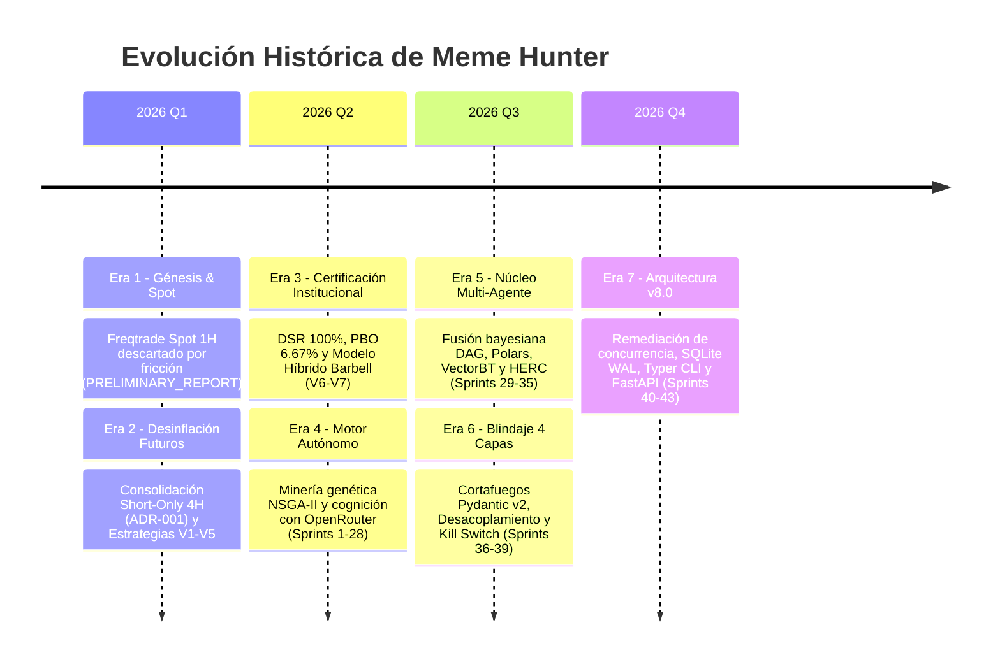

# 📜 Registro Histórico y Genealogía de Sprints (Meme Hunter)

Este documento preserva la memoria técnica, hitos y lecciones aprendidas a lo largo de las distintas eras evolutivas del sistema **Meme Hunter**, desde la concepción del motor discreto en Spot hasta el organismo cuantitativo multi-agente v8.0.

---

## 🗺️ Cronología de las Eras Evolutivas

---

## 📅 Catálogo de Planes de Sprint Archivados

| Documento de Sprint | Era / Enfoque | Hitos Clave y Entregables |
| :--- | :--- | :--- |
| **[Sprint 1: Motor Autónomo](sprints/SPRINT_AUTONOMOUS_SELF_IMPROVING_ENGINE.md)** | Self-Healing | Bucle cerrado, diagnóstico de decay CUSUM y Page-Hinkley. |
| **[Sprint 2: Cognición IA](sprints/SPRINT_LLM_AUGMENTED_AUTONOMOUS_ENGINE.md)** | OpenRouter | Autopsias cognitivas DeepSeek-R1 y síntesis de hipótesis. |
| **[Sprints 25-28: Loop Hardening](sprints/SPRINT_PLAN_AUTONOMOUS_LOOP_HARDENING.md)** | Hardening | Primera iteración SQLite WAL, OOS Gating y hot-reload. |
| **[Sprint 29: Bidireccional & Sync](sprints/SPRINT_PLAN_29_BIDIRECTIONAL_AND_DATA_SYNC.md)** | Ensamble | Ensamble Long/Short dinámico y auto-data-sync Binance. |
| **[Sprint 30: DAG Orchestrator](sprints/SPRINT_PLAN_30_MULTI_AGENT_DAG_ORCHESTRATOR.md)** | Multi-Agente | Nodos especializados y fusión probabilística. |
| **[Sprint 31: LLM Sentiment](sprints/SPRINT_PLAN_31_LLM_SENTIMENT_AND_DEGRADATION.md)** | NLP & Riesgo | Agente cualitativo de sentimiento y degradación elegante. |
| **[Sprint 32: Visual Cockpit](sprints/SPRINT_PLAN_32_HITL_VISUAL_DAG_COCKPIT.md)** | UI & HITL | Visor interactivo del grafo DAG y controles Human-in-the-Loop. |
| **[Sprints 33-35: Performance & Risk](sprints/SPRINT_PLAN_33_35_PERFORMANCE_RISK_AND_OPENBB.md)** | Aceleración | Ingesta Polars Arrow, simulaciones VectorBT y HERC CVaR 99%. |
| **[Sprints 36-39: Blindaje 4 Capas](sprints/SPRINT_PLAN_36_39_ASYNC_DETERMINISTIC_FIREWALL_KILLSWITCH.md)** | Resiliencia | Cortafuegos Pydantic v2, Sesgo asíncrono y Kill Switch absoluto. |
| **[Sprints 40-43: v8.0 Remediation](sprints/SPRINT_PLAN_40_43_REMEDIATION_CONCURRENCY_AND_ARCHITECTURE_V8.md)** | Arquitectura v8 | Erradicación WinError 32, Zero-Eval AST, FastAPI y E2E. |

---

## 🏆 Lecciones Aprendidas Principales

1. **La Fricción Mata el Alfa Intradiario:** El timeframe de 1H en memecoins destruye capital por comisiones y spread. 4H es el horizonte canónico óptimo.
2. **Prohibido el Split-Brain:** Persistir estado simultáneamente en JSON y SQLite genera condiciones de carrera catastróficas. Toda mutación debe ser transaccional en SQLite WAL.
3. **Cero Confianza en Texto Libre de LLMs:** Las salidas de modelos de lenguaje deben sanearse mediante esquemas Pydantic rígidos (`extra='forbid'`) y validación sintáctica AST antes de entrar en ejecución.
4. **Desacoplamiento I/O Innegociable:** Los bucles de ingesta de mercado en vivo jamás deben esperar llamadas a APIs de razonamiento o algoritmos genéticos pesados.
