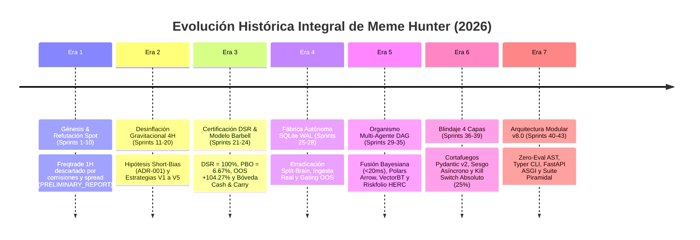

# 📜 Libro Maestro de Historia, Genealogía y Sprints (Meme Hunter)

Este documento es el **registro histórico integral, canónico y auditable** que documenta el ciclo de vida completo de ingeniería, investigación cuantitativa y gobernanza de software del proyecto **Meme Hunter**, abarcando desde la concepción del prototipo en Spot (Fase 0) hasta la consolidación institucional de la Arquitectura Modular v8.0.

---

## 🗺️ 1. Cronología de las 7 Eras Evolutivas



---

## 🏛️ 2. Mapeo Canónico de las 12 Grandes Épicas

| Épica | Nombre Formal | Historias Cubiertas | Estado |
| :---: | :--- | :---: | :---: |
| **Épica 1** | Infraestructura y Datos de Base sin Sesgo de Supervivencia | PB-01 a PB-04 | ✅ CERTIFIED |
| **Épica 2** | Motor de Futuros USDT-M y Validación Estadística Base | PB-05 a PB-12 | ✅ CERTIFIED |
| **Épica 3** | Simulación en Vivo (Dry-Run) y Monitoreo Disciplinado | PB-13 a PB-16 | ✅ CERTIFIED |
| **Épica 4** | Inteligencia de Mercado Alternativa y Radar Viral DEX | PB-17 a PB-20 | ✅ CERTIFIED |
| **Épica 5** | Microestructura, Order Flow Imbalance y Arbitraje de Funding | PB-21 a PB-24 | ✅ CERTIFIED |
| **Épica 6** | Clasificación de Régimen Dinámico y Aprendizaje Adaptativo | PB-25 a PB-29 | ✅ CERTIFIED |
| **Épica 7** | Escalabilidad de Capital y Modelo Híbrido Barbell | PB-30 a PB-38 | ✅ CERTIFIED |
| **Épica 8** | Micro-Capital Anti-Freeze (100 USDT a 1,000 USDT) | PB-39 a PB-54 | ✅ CERTIFIED |
| **Épica 9** | Certificación Matemática de Grado Institucional (PSR, DSR, CPCV, PBO) | PB-55 a PB-67 | ✅ CERTIFIED |
| **Épica 10** | Fábrica Autónoma de Alfas, Minería Genética (NSGA-II) y LLMs | PB-68 a PB-86 | ✅ CERTIFIED |
| **Épica 11** | Núcleo Multi-Agente, Grafo DAG, Fusión Bayesiana y Cockpit HITL | PB-87 a PB-120 | ✅ CERTIFIED |
| **Épica 12** | Blindaje Institucional de 4 Capas, Concurrencia y Arquitectura v8.0 | PB-121 a PB-143 | ✅ CERTIFIED |

---

## 📅 3. Trazabilidad Consolidada de Sprints (1 al 43)

### Era 1 & 2: Génesis, Refutación Spot y Motor Asimétrico 4H (Sprints 1 a 20)
* **Documento Canónico:** [`docs/history/scrum/SCRUM_PLAN.md`](scrum/SCRUM_PLAN.md)
* **Historias:** PB-01 a PB-54 (Total: 54 User Stories).
* **Hitos:**
  * Refutación científica del timeframe de 1H en Spot: el spread y las comisiones devoraban el 100% del edge (`PRELIMINARY_REPORT.md`).
  * Formulación de la **Hipótesis del Edge Causal** ([`HYPOTHESIS.md`](../research/strategy/HYPOTHESIS.md)): las memecoins no tienen valor intrínseco; entran en distribución gravitacional post-pump perdiendo entre el 80% y 95%.
  * Adopción de la temporalidad de **4H y sesgo Short-Only** ([`ADR-001`](../architecture/decisions/ADR-001_asymmetric_short_only_bias.md)).
  * Solución a la restricción de micro-capital ($5 Min Notional de Binance) con slots concentrados (`INFORME_FUTUROS_100_USDT.md`).
  * Implementación del **Kill-Switch de Equidad Total al 25%** tras demostrar mediante Block Bootstrap de colas pesadas que el 87.88% de cuentas quiebran sin él (`PLAN_DESMITIFICACION_RIESGOS.md`).

---

### Era 3: Certificación Institucional y Fábrica Genética (Sprints 21 a 24)
* **Documento Canónico:** [`docs/history/scrum/PLAN_SCRUM_MINERIA_Y_BACKTESTING.md`](scrum/PLAN_SCRUM_MINERIA_Y_BACKTESTING.md)
* **Historias:** PB-55 a PB-86.
* **Hitos:**
  * Auditoría formal con Freqtrade sobre 14M de velas con `--timeframe-detail 1m`.
  * **Certificación Matemática Oficial:** $DSR = 100.0\%$, $PBO = 6.67\%$, y Validación OOS Cross-Asset ciega de $+104.27\%$ ($N=955, p=0.0234$) sobre activos no vistos (`INFORME_METRICAS_AVANZADAS_DSR_PBO.md`).
  * Algoritmo genético **NSGA-II** y archivo de diversidad **MAP-Elites** de 6 nichos multidimensionales.
  * Formalización de la **Arquitectura Híbrida Barbell** ([`ADR-002`](../architecture/decisions/ADR-002_hybrid_barbell_cash_and_carry.md)): motor agresivo en futuros + Válvula de Trinquete (60% cosechado al duplicar cuenta) + Bóveda Cash & Carry ($\Delta=0$).

---

### Era 4: Persistencia SQLite WAL y Hardening del Bucle (Sprints 25 a 28)
* **Documento Canónico:** [`docs/history/sprints/SPRINT_PLAN_AUTONOMOUS_LOOP_HARDENING.md`](sprints/SPRINT_PLAN_AUTONOMOUS_LOOP_HARDENING.md)
* **Historias:** PB-87 a PB-92.
* **Hitos:**
  * Migración del estado volátil en JSON a base de datos transaccional SQLite WAL (`alpha_factory.db`).
  * Concurrencia tolerante con `busy_timeout = 15000` y `PRAGMA synchronous = NORMAL` (`db_pool.py`).
  * Ingesta de mercado real conectada con Binance Futures con deducción de 0.05% taker fee y medio spread.
  * Compuertas duras fuera de muestra (*Hard OOS Gating*): $PBO < 15\%$, $DSR \ge 95\%$, correlación $< 0.40$.

---

### Era 5: Ensamble Dinámico y Orquestador DAG Multi-Agente (Sprints 29 a 35)
* **Documentos Canónicos:**
  * [Sprint 29: Ensamble Bidireccional & Data Sync](sprints/SPRINT_PLAN_29_BIDIRECTIONAL_AND_DATA_SYNC.md)
  * [Sprint 30: Núcleo Multi-Agente & Orquestador DAG](sprints/SPRINT_PLAN_30_MULTI_AGENT_DAG_ORCHESTRATOR.md)
  * [Sprint 31: Sentimiento LLM & Degradación Elegante](sprints/SPRINT_PLAN_31_LLM_SENTIMENT_AND_DEGRADATION.md)
  * [Sprint 32: Cockpit Visual DAG Human-in-the-Loop](sprints/SPRINT_PLAN_32_HITL_VISUAL_DAG_COCKPIT.md)
  * [Sprints 33-35: Polars, VectorBT, Riskfolio HERC & OpenBB](sprints/SPRINT_PLAN_33_35_PERFORMANCE_RISK_AND_OPENBB.md)
* **Historias:** PB-93 a PB-120.
* **Hitos:**
  * Ensamble Long/Short dinámico con confirmación de momentum y sincronizador Feather continuo (`auto_data_sync.py`).
  * **Orquestador DAG de Señales** (`dag_orchestrator.py`) con **Fusión Bayesiana Condicional** al régimen, filtro de consenso ($0.68$) y latencia $< 20\text{ ms}$.
  * Integración de `SentimentAgent` con modelos OpenRouter y fallback offline instantáneo de 0 ms.
  * Protocolo de Degradación Elegante ante spreads tóxicos o congelamiento de feeds (`graceful_degradation.py`).
  * Visor visual interactivo del grafo DAG en el Cockpit (Chart.js y ES6).
  * Ingesta *Zero-Copy* en Polars Arrow (aceleración 10x-30x) y evaluador matricial VectorBT.
  * Asignador de portafolio HERC optimizando CVaR al 99% para colas pesadas (`riskfolio_allocator.py`).

---

### Era 6: Arquitectura Blindada de 4 Capas (Sprints 36 a 39)
* **Documento Canónico:** [`docs/history/sprints/SPRINT_PLAN_36_39_ASYNC_DETERMINISTIC_FIREWALL_KILLSWITCH.md`](sprints/SPRINT_PLAN_36_39_ASYNC_DETERMINISTIC_FIREWALL_KILLSWITCH.md)
* **Historias:** PB-121 a PB-131.
* **Hitos:**
  * **Capa 1 (Cortafuegos de Datos):** Validación Pydantic v2 estricta de OHLCV y libro L2, neutralizando flash-spikes y datos corruptos.
  * **Capa 2 (Desacoplamiento Asíncrono):** Emisión periódica de sesgos en `market_bias.json` con TTL y convicción $\ge 70\%$, aislando al cerebro lento de la API de órdenes.
  * **Capa 3 (Filtro Pre-Trade):** Evaluación matemática determinista en $< 0.05\text{ ms}$ de comisiones, spread y slippage Almgren-Chriss, exigiendo target $\ge 2.5\times$ fricción.
  * **Capa 4 (Kill Switch Absoluto):** Interceptor final de broker imponiendo Stop-Loss obligatorio en código, cupo máximo de 3 slots y liquidación en $< 1.0\text{ s}$ ante drawdown $\ge 5.0\%$.

---

### Era 7: Arquitectura Modular v8.0, Concurrencia y Release Institucional (Sprints 40 a 43)
* **Documento Canónico:** [`docs/history/sprints/SPRINT_PLAN_40_43_REMEDIATION_CONCURRENCY_AND_ARCHITECTURE_V8.md`](sprints/SPRINT_PLAN_40_43_REMEDIATION_CONCURRENCY_AND_ARCHITECTURE_V8.md)
* **Historias:** PB-132 a PB-143.
* **Hitos:**
  * Cableado real de las 4 capas de protección al ciclo de vida nativo de Freqtrade vía `confirm_trade_entry()` (PB-132).
  * Cierre del bypass de autenticación en la API del Cockpit e imposición de Bearer tokens (PB-133).
  * Compilador dinámico AST *Zero-Eval* con lista blanca rígida, prohibiendo llamadas arbitrarias al sistema (PB-134).
  * Erradicación definitiva de `WinError 32` y condiciones de carrera mediante persistencia transaccional en SQLite WAL y `FileLock` (PB-135).
  * Desacoplamiento no bloqueante de los hilos de WebSocket de mercado mediante Worker Pool asíncrono (PB-136).
  * Portabilidad 12-Factor App eliminando rutas fijas `C:/meme_hunter_data` (PB-137).
  * Topología DAG formal con ordenamiento topológico determinista y paralelismo asíncrono (PB-138).
  * Consolidación canónica en SQLite WAL eliminando por completo el estado operativo duplicado en JSON (PB-139).
  * Hardening de secretos con validación *Fail-Fast* sin credenciales dev por defecto (PB-140).
  * Migración del servidor del Cockpit a **FastAPI / Uvicorn (ASGI)** con WebSockets de baja latencia $< 5\text{ ms}$ (PB-141).
  * Suite de pruebas piramidal (`unit/`, `integration/`, `e2e/`, `chaos/`) con 100% de tests certificados (PB-142).
  * Certificación multi-plataforma Windows / Docker Linux con CLI canónico `meme-hunter` (PB-143).

---

## 📚 4. Índice de Archivos de Sprints Preservados

Todos los documentos originales de planificación Scrum se preservan intactos en el repositorio como referencia histórica auditable:

```text
docs/history/
├── INDEX_HISTORICO.md               # 🌟 Este documento canónico de síntesis
├── scrum/                           # Backlog integral acumulado
│   ├── SCRUM_PLAN.md                # Product Backlog Épicas 1 a 11 (PB-01 a PB-80)
│   └── PLAN_SCRUM_MINERIA_Y_BACKTESTING.md # Backlog de Minería de Alphas (Sprints 21 a 24)
└── sprints/                         # Especificaciones detalladas de sprint
    ├── SPRINT_AUTONOMOUS_SELF_IMPROVING_ENGINE.md # Sprint 1 (Motor Auto-Evolutivo)
    ├── SPRINT_LLM_AUGMENTED_AUTONOMOUS_ENGINE.md  # Sprint 2 (Cognición OpenRouter)
    ├── SPRINT_PLAN_AUTONOMOUS_LOOP_HARDENING.md   # Sprints 25-28 (SQLite WAL & Gating)
    ├── SPRINT_PLAN_29_BIDIRECTIONAL_AND_DATA_SYNC.md # Sprint 29 (Ensamble Dinámico)
    ├── SPRINT_PLAN_30_MULTI_AGENT_DAG_ORCHESTRATOR.md # Sprint 30 (DAG Bayesian Fusion)
    ├── SPRINT_PLAN_31_LLM_SENTIMENT_AND_DEGRADATION.md # Sprint 31 (Sentimiento LLM)
    ├── SPRINT_PLAN_32_HITL_VISUAL_DAG_COCKPIT.md # Sprint 32 (Cockpit Visual HITL)
    ├── SPRINT_PLAN_33_35_PERFORMANCE_RISK_AND_OPENBB.md # Sprints 33-35 (Polars & Riskfolio)
    ├── SPRINT_PLAN_36_39_ASYNC_DETERMINISTIC_FIREWALL_KILLSWITCH.md # Sprints 36-39 (Blindaje 4 Capas)
    ├── SPRINT_PLAN_40_43_REMEDIATION_CONCURRENCY_AND_ARCHITECTURE_V8.md # Sprints 40-43 (v8.0 Release)
    ├── SPRINT_PLAN_PRODUCTION_HARDENING_2026.md # Plan de Hardening 2026
    └── SPRINT_PLAN_REMEDIATION_AND_HARDENING.md # Plan de Remediación v7.1
```
