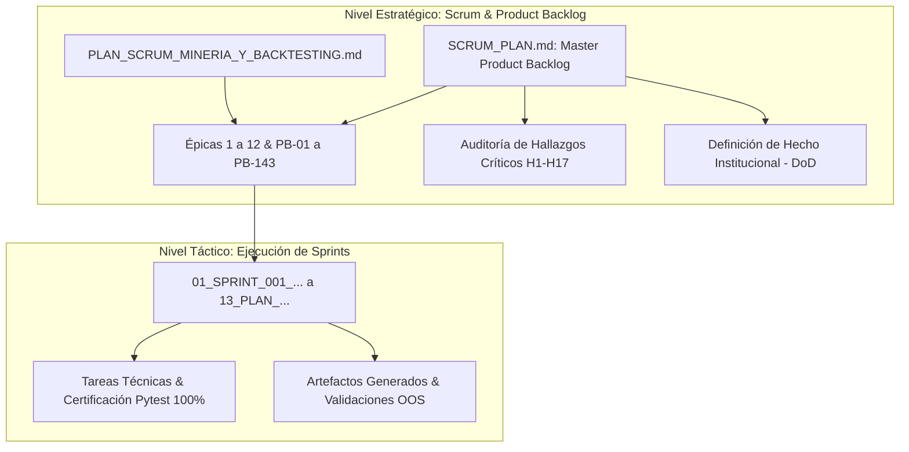

# 🛡️ Gobernanza Scrum y Marco de Trabajo Ágil (Meme Hunter)

Bienvenido a la sección de **Gobernanza Scrum y Gestión de Producto** del repositorio `meme_hunter`. Este directorio centraliza la planificación estratégica, las épicas macro y las historias de usuario del sistema bajo la metodología ágil cuantitativa.

---

## 🏗️ 1. Arquitectura de Dos Niveles: Scrum Backlog vs Sprints

Para garantizar una separación rigurosa entre **la visión del producto** (el *Qué* y el *Por qué*) y **la ejecución técnica** (el *Cómo* y el *Cuándo*), el ciclo de vida del proyecto se divide en dos niveles estandarizados:

---

## 📚 2. Estructura de Documentos en este Directorio

| Documento | Identificador | Rol en el Proyecto |
| :--- | :---: | :--- |
| [**`SCRUM_PLAN.md`**](SCRUM_PLAN.md) | `HIST-SCRUM-001` | **Product Backlog Maestro:** Visión de 12 épicas, historias PB-01 a PB-143, auditoría H1-H17, y resúmenes de Sprints 1 a 43. |
| [**`PLAN_SCRUM_MINERIA_Y_BACKTESTING.md`**](PLAN_SCRUM_MINERIA_Y_BACKTESTING.md) | `HIST-SCRUM-002` | **Backlog Temático de Alphas:** Detalle cuantitativo para la fábrica genética de factores, microestructura L2 y CPCV (Sprints 21-24). |

---

## 🎯 3. Las 12 Grandes Épicas de Meme Hunter

Las historias de usuario están rigurosamente enumeradas del **PB-01** al **PB-143** y distribuidas en 12 grandes épicas:

1. **Épica 1 (PB-01 a PB-04):** Infraestructura y Datos de Base sin Sesgo de Supervivencia.
2. **Épica 2 (PB-05 a PB-12):** Motor de Futuros USDT-M y Validación Estadística Base.
3. **Épica 3 (PB-13 a PB-16):** Simulación en Vivo (Dry-Run) y Monitoreo Disciplinado.
4. **Épica 4 (PB-17 a PB-20):** Inteligencia de Mercado Alternativa y Radar Viral DEX.
5. **Épica 5 (PB-21 a PB-24):** Microestructura, Order Flow Imbalance y Arbitraje de Funding.
6. **Épica 6 (PB-25 a PB-29):** Clasificación de Régimen Dinámico y Aprendizaje Adaptativo.
7. **Épica 7 (PB-30 a PB-38):** Escalabilidad de Capital y Modelo Híbrido Barbell.
8. **Épica 8 (PB-39 a PB-54):** Micro-Capital Anti-Freeze (100 USDT a 1,000 USDT).
9. **Épica 9 (PB-55 a PB-67):** Certificación Matemática Institucional (PSR, DSR, CPCV, PBO).
10. **Épica 10 (PB-68 a PB-86):** Fábrica Autónoma de Alfas, Minería Genética (NSGA-II) y LLMs.
11. **Épica 11 (PB-87 a PB-120):** Núcleo Multi-Agente, Grafo DAG, Fusión Bayesiana y Cockpit HITL.
12. **Épica 12 (PB-121 a PB-143):** Blindaje Institucional de 4 Capas, Concurrencia y Arquitectura v8.0.

---

## ⚙️ 4. Definición de Hecho (Definition of Done - DoD)

Ninguna historia de usuario o sprint se considera terminado (`COMPLETED` / `CERTIFIED`) sin cumplir:
1. **Tests Automatizados:** Cobertura con tests unitarios e integración pasando al 100% (`pytest tests/`).
2. **Cero Sesgo Intra-Vela:** Simulación estricta con `--timeframe-detail 1m` en trailing stops.
3. **Cero Sesgo de Retrospectiva:** Prohibición de listas negras estáticas cableadas post-hoc.
4. **Gating Fuera de Muestra (OOS):** PBO $< 15\%$, DSR $\ge 95\%$, correlación cruzada $< 0.40$.
5. **Control de Concurrencia:** Cero bloqueos SQLite mediante pool transaccional WAL y `filelock`.
6. **Validación Determinista:** Paso obligatorio por `DataFirewall` y `PreTradeProfitabilityGate`.
7. **Trazabilidad Git:** Commits limpios asociados al ID de historia correspondiente.

---

## 🔗 5. Enlaces Canónicos Relacionados

* [**Catálogo Cronológico de Sprints**](../sprints/README.md): Lista completa de los 13 planes tácticos de sprint.
* [**Libro Maestro de Historia y Genealogía**](../INDEX_HISTORICO.md): Cronología de las 7 eras del proyecto.
* [**Compendio Maestro de Estrategia Cuantitativa**](../../research/strategy/ESTRATEGIA_MAESTRA_UNIFICADA.md): Base matemática y financiera del sistema.
