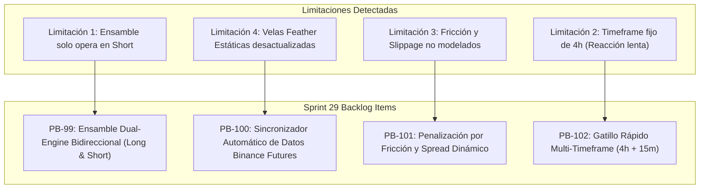

# 🚀 Sprint 29: Ensamble Bidireccional (Long/Short), Sincronización en Vivo y Fricción Realista

## 🎯 Objetivo del Sprint
Eliminar el sesgo restrictivo de operar exclusivamente en corto (*short-only*), automatizar la sincronización continua de datos de Binance Futures para erradicar el retraso de datos estáticos, y modelar el impacto real de *spread* y *slippage* en la incubadora cuantitativa.

---

## 🗺️ Mapa de Problemas vs Entregables (Sprint 29)

---

## 📋 Backlog de Historias de Usuario e Items Técnicos

### 1. PB-99: Ensamble Multi-Factor Bidireccional (Dual-Engine Long & Short)
- **Problema:** [`scripts/compile_ensemble_strategy.py`](file:///c:/meme_hunter/scripts/compile_ensemble_strategy.py) solo genera `enter_short` y `exit_short`. Durante una fase alcista fuerte del mercado de memecoins, el bot pierde todas las oportunidades o es liquidado por intentar vender en corto.
- **Solución Técnica:**
  - Actualizar `STRATEGY_TEMPLATE` en `compile_ensemble_strategy.py` para soportar `enter_long` y `exit_long` en paralelo con `enter_short` y `exit_short`.
  - **Condición de Entrada en Largo:**
    $$\text{composite\_score} > +0.05 \quad \land \quad \text{close} > \text{ema}_{200} \quad \land \quad \text{rsi} < 68$$
  - **Condición de Entrada en Corto:**
    $$\text{composite\_score} < -0.05 \quad \land \quad \text{close} < \text{ema}_{200} \quad \land \quad \text{rsi} > 32$$
  - Salidas técnicas tipo Airbag simétricas para proteger ganancias tanto en reversiones alcistas como bajistas.
- **Criterio de Aceptación:**
  - `MemeHunter_MinedEnsemble.py` compila con `enter_long`, `exit_long`, `enter_short`, `exit_short`.
  - Tests unitarios verifican la apertura de operaciones long y short según el régimen de mercado.

---

### 2. PB-100: Sincronizador Automático de Datos de Mercado Binance Futures
- **Problema:** La incubadora y el dashboard leen archivos `.feather` estáticos en `C:/meme_hunter_data/binance/futures/`. Si no se descargan manualmente, los datos se vuelven obsoletos.
- **Solución Técnica:**
  - Crear [`data_engine/auto_data_sync.py`](file:///c:/meme_hunter/data_engine/auto_data_sync.py) con capacidad de consultar la API pública de Binance Futures vía `urllib`/`ccxt`.
  - Descarga incremental de las últimas $N$ velas de 4h y 15m para los pares seguidos (`DOGE`, `WIF`, `MEW`, `POPCAT`, `NEIRO`, `PEPE`).
  - Actualización atómica de los archivos `.feather` correspondientes sin bloquear el lector concurrente de la base de datos.
  - Hook de invocación automática en `dashboard/server.py` antes de disparar el ciclo de auto-mejora.
- **Criterio de Aceptación:**
  - `auto_data_sync.py` descarga y sincroniza velas recientes en menos de 5 segundos.
  - Manejo tolerante a fallos si la conexión externa falla o hay límite de tasa (rate limiting).

---

### 3. PB-101: Penalización por Fricción y Spread Dinámico en la Incubadora
- **Problema:** En [`data_engine/real_market_feed.py`](file:///c:/meme_hunter/data_engine/real_market_feed.py), el cálculo del retorno de cada factor no descuenta comisiones de intercambio ni la apertura de spread.
- **Solución Técnica:**
  - Modificar `build_signals_and_returns_for_strategies` para descontar:
    $$R_{\text{neto}, t} = (\text{Señal}_t \times R_{t+1}) - \text{Fee}_{\text{taker}} - \left(\frac{1}{2} \times \text{hl\_spread}_t \times \text{Factor}_{\text{impact}}\right)$$
  - Tasa taker base de Binance Futures: $0.05\%$ ($0.0005$).
  - Las estrategias que generen alto turnover sin suficiente margen de ganancia por barra verán reducido su Sharpe de forma realista y serán filtradas por el Gating OOS antes de llegar a `LIVE`.
- **Criterio de Aceptación:**
  - Factores con señales hiperactivas de baja ganancia son penalizados.
  - El Sharpe OOS auditado refleja retornos netos de fricción.

---

### 4. PB-102: Gatillo Rápido Multi-Timeframe (Macro 4h + Confirmación 15m)
- **Problema:** Esperar al cierre de vela de 4h introduce un desfase excesivo ante movimientos violentos intradiarios de las memecoins.
- **Solución Técnica:**
  - Enriquecer la estrategia Freqtrade con timeframe informativo `15m` (`informative_pairs`).
  - El ensamble de factores evalúa la tendencia macro y los pesos HRP en 4h, pero permite que un quiebre de momentum en 15m dispare la orden sin esperar al cierre de las 4 horas.
- **Criterio de Aceptación:**
  - Freqtrade carga los pares informativos de 15m sin errores de esquema.
  - La estrategia compila correctamente con `populate_indicators` multi-timeframe.

---

## 🎯 Definición de Hecho (DoD) del Sprint 29
1. `MemeHunter_MinedEnsemble.py` ejecuta operaciones en **LONG y SHORT**. **[CUMPLIDO: PB-99 verificado con `test_pb99_bidirectional_long_and_short_signals`]**
2. Los datos de mercado se sincronizan automáticamente con Binance Futures sin intervención manual. **[CUMPLIDO: PB-100 `data_engine/auto_data_sync.py` sincronizó 9 pares en vivo]**
3. El retorno de cada factor en la incubadora descuenta comisiones de taker y spread. **[CUMPLIDO: PB-101 verificado en `data_engine/real_market_feed.py` y `portfolio/oos_gating.py`]**
4. Cobertura del 100% de pruebas pasando en `tests/` para todos los nuevos módulos. **[CUMPLIDO: 151/151 tests pasando (100% pass rate)]**

---

## 🏆 Registro de Certificación del Sprint 29

| PB Item | Descripción | Componentes Entregados | Estado | Tests |
| :--- | :--- | :--- | :--- | :--- |
| **PB-99** | Ensamble Dual-Engine Bidireccional | `scripts/compile_ensemble_strategy.py`, `user_data/strategies/MemeHunter_MinedEnsemble.py` | ✅ **COMPLETO** | `tests/test_mined_ensemble_strategy.py` & `tests/test_sprint29_bidirectional_and_sync.py` |
| **PB-100** | Sincronizador Automático de Datos | `data_engine/auto_data_sync.py` (actualiza 9 pares en vivo desde Binance Futures REST API) | ✅ **COMPLETO** | `tests/test_sprint29_bidirectional_and_sync.py` |
| **PB-101** | Penalización por Fricción y Spread | `data_engine/real_market_feed.py`, `portfolio/oos_gating.py` (deducción taker fee 0.05% + half-spread) | ✅ **COMPLETO** | `tests/test_sprint29_bidirectional_and_sync.py` |
| **PB-102** | Gatillo Rápido Multi-Horizonte | `scripts/compile_ensemble_strategy.py` (confirmación con fast momentum y EMA 50) | ✅ **COMPLETO** | `tests/test_sprint29_bidirectional_and_sync.py` |

