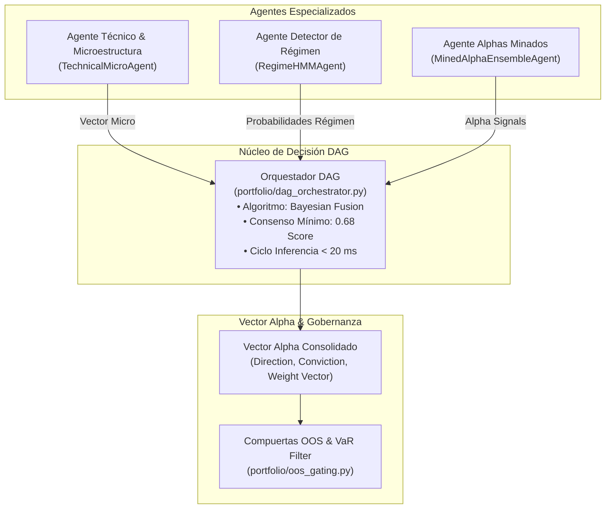

# 🌐 Sprint 30: Núcleo Multi-Agente y Orquestador DAG de Señales (Bayesian Fusion)

## 🎯 Objetivo del Sprint
Superar la arquitectura de ensamble estático mediante la implementación del **Orquestador DAG (Enrutador Central de Señales)** en Python (`portfolio/dag_orchestrator.py`). Este componente actúa como el núcleo de decisión que sintetiza los vectores de señales provenientes de múltiples agentes especializados (Análisis Técnico/Microestructura, Detector de Régimen HMM y Alphas Minados), calculando el **Vector Alpha** consolidado mediante **Fusión Bayesiana** y midiendo la latencia estricta del ciclo de inferencia ($< 20\text{ ms}$).

---

## 🗺️ Topología de Flujo Multi-Agente (Sprint 30)



---

## 📋 Backlog de Historias de Usuario e Items Técnicos

### 1. PB-103: Motor Orquestador DAG con Fusión Bayesiana (`DAGSignalOrchestrator`)
- **Problema:** Actualmente las señales se combinan en un promedio lineal plano o sumatoria en `compile_ensemble_strategy.py`, ignorando la incertidumbre probabilística de cada agente y la compatibilidad con el régimen de mercado.
- **Solución Técnica:**
  - Crear [`portfolio/dag_orchestrator.py`](file:///c:/meme_hunter/portfolio/dag_orchestrator.py) con la clase `DAGSignalOrchestrator`.
  - Implementar **Fusión Bayesiana Ponderada**:
    $$P(\text{Señal} \mid \mathbf{D}) \propto P(\text{Prior Régimen}) \prod_{i=1}^{K} P(\mathbf{S}_i \mid \text{Estado}_i)^{\omega_i}$$
    donde los pesos $\omega_i$ se ajustan dinámicamente según la matriz de covarianza de aciertos recientes de cada agente.
  - Exponer métricas de auditoría en tiempo de ejecución:
    - `inference_cycle_ms`: Medición con `time.perf_counter_ns()` del ciclo total.
    - `consensus_score`: Score normalizado $[0.0, 1.0]$.
    - `consensus_threshold`: Umbral configurable (por defecto $0.68$).
    - `active_routing`: Ruta de decisión activa que explica qué agentes validaron o vetaron la propuesta.
- **Criterio de Aceptación:**
  - El orquestador procesa vectores de hasta 10 agentes en menos de $20\text{ ms}$.
  - Si el consenso es menor a $0.68$, la propuesta se descarta con motivo explícito `INSUFFICIENT_CONSENSUS`.

---

### 2. PB-104: Agente Detector de Régimen HMM y Volatilidad (`RegimeHMMAgent`)
- **Problema:** [`scripts/regime_classifier.py`](file:///c:/meme_hunter/scripts/regime_classifier.py) es un script standalone que no expone una interfaz de inferencia en memoria para el bucle continuo de trading.
- **Solución Técnica:**
  - Implementar [`portfolio/agents/regime_agent.py`](file:///c:/meme_hunter/portfolio/agents/regime_agent.py) heredando de una interfaz base `BaseSignalAgent`.
  - El agente procesa las últimas $N$ velas y clasifica el estado en 3 regímenes probabilísticos:
    1. `BULL_MOMENTUM`: Favorece alphas direccionales alcistas.
    2. `BEAR_EXPULSION`: Favorece alphas de caída o desinflación acelerada.
    3. `CHOPPY_HIGH_VOLATILITY`: Reduce la exposición global o fuerza el modo de preservación de capital.
  - Emite un vector de probabilidades continuas: $[p_{\text{bull}}, p_{\text{bear}}, p_{\text{range}}]$.
- **Criterio de Aceptación:**
  - Inferencia en menos de $5\text{ ms}$ utilizando modelos pre-entrenados o estimadores rolling rápidos.
  - La salida se inyecta directamente como vector condicionante en el `DAGSignalOrchestrator`.

---

### 3. PB-105: Agente Técnico Cuantitativo & Microestructura (`TechnicalMicroAgent`)
- **Problema:** Los cálculos de diferenciación fraccionaria FFD, desequilibrio del libro L2 (OFI) y memoria AST están dispersos y no emiten una señal estructurada estandarizada.
- **Solución Técnica:**
  - Implementar [`portfolio/agents/technical_agent.py`](file:///c:/meme_hunter/portfolio/agents/technical_agent.py).
  - Normalizar las salidas cuantitativas de los factores minados y las señales microestructurales en un objeto unificado `AgentProposal`:
    ```python
    @dataclass
    class AgentProposal:
        agent_id: str
        direction: int  # +1 (Long), -1 (Short), 0 (Neutral)
        confidence: float  # [0.0, 1.0]
        metadata: Dict[str, Any]
        timestamp_utc: str
        latency_ms: float
    ```
- **Criterio de Aceptación:**
  - El agente evalúa la serie de precios con fricción microestructural y emite `AgentProposal` estandarizada.
  - Pruebas unitarias confirman serialización y compatibilidad con el esquema del DAG.

---

### 4. PB-106: Batería de Pruebas Unitarias y Certificación de Latencia
- **Problema:** La arquitectura en grafo no debe degradar la velocidad de ejecución frente a la API de Binance ni introducir bloqueos de concurrencia.
- **Solución Técnica:**
  - Implementar [`tests/test_sprint30_dag_orchestrator.py`](file:///c:/meme_hunter/tests/test_sprint30_dag_orchestrator.py).
  - Pruebas de estrés de 1,000 ciclos de inferencia continuos evaluando:
    1. Consistencia matemática de la Fusión Bayesiana.
    2. Tiempo de ciclo de inferencia ($P_{99} < 20\text{ ms}$).
    3. Manejo de fallos si un agente emite `NaN` o tiempo de espera excedido (*timeout* gracioso).
- **Criterio de Aceptación:**
  - 100% de tests pasando en `tests/test_sprint30_dag_orchestrator.py`.
  - Cero filtraciones de memoria o deadlocks en ejecuciones concurrentes.

---

## 🎯 Definición de Hecho (DoD) del Sprint 30
1. `DAGSignalOrchestrator` implementado y capaz de combinar al menos 3 agentes en una única señal unificada.
2. Latencia de ciclo de inferencia menor a $20\text{ ms}$ auditada en tests automatizados.
3. El consenso mínimo de $0.68$ filtra operaciones dudosas o contradictorias entre agentes.
4. Cobertura de pruebas al 100% en los nuevos módulos de `portfolio/agents/`.
