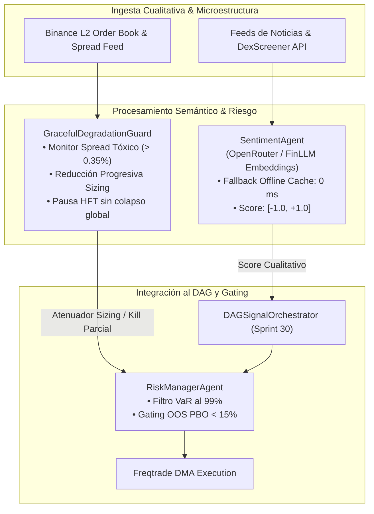

# 🧠 Sprint 31: Agente Cualitativo LLM (Sentimiento & Contexto) y Degradación Elegante

## 🎯 Objetivo del Sprint
Incorporar la dimensión cualitativa no estructurada al pipeline cuantitativo mediante el **Agente de Sentimiento LLM** (`SentimentAgent`), transformando noticias, flujo social y eventos macro en métricas numéricas normalizadas con fallback offline instantáneo ($0\text{ ms}$). Asimismo, implementar el protocolo institucional de **Degradación Elegante** que protege el capital ante eventos de cisne negro monitoreando la profundidad de libro L2, el ensanchamiento tóxico del *spread* y las anomalías de latencia.

---

## 🗺️ Arquitectura de Resiliencia y Flujo Semántico (Sprint 31)

---

## 📋 Backlog de Historias de Usuario e Items Técnicos

### 1. PB-107: Agente Cualitativo de Sentimiento y Noticias (`SentimentAgent`)
- **Problema:** Los algoritmos cuantitativos puros son ciegos ante catalizadores cualitativos repentinos (noticias regulatorias, hackeos, tweets virales de memecoins), sufriendo pérdidas antes de que el precio refleje el cambio estructural.
- **Solución Técnica:**
  - Implementar [`portfolio/agents/sentiment_agent.py`](file:///c:/meme_hunter/portfolio/agents/sentiment_agent.py) conectándolo con [`mining/llm_client.py`](file:///c:/meme_hunter/mining/llm_client.py).
  - Normalizar el análisis cualitativo en un vector de sentimiento cuantitativo continuo:
    $$\text{Sentiment Score} \in [-1.0, +1.0], \quad \text{Confidence} \in [0.0, 1.0]$$
  - **Mecanismo Anti-Latencia y Modo Offline:**
    - Caché inteligente de tokens y directivas basada en hash semántico.
    - Si la llamada a la API remota supera $500\text{ ms}$ o hay fallo de red, conmuta inmediatamente a modo local/offline ($0\text{ ms}$ de latencia) devolviendo score neutral ($0.0$) sin frenar el ciclo de inferencia del DAG.
- **Criterio de Aceptación:**
  - Emisión de señales cualitativas estructuradas como `AgentProposal`.
  - Fallback offline garantizado en caso de desconexión o timeout.

---

### 2. PB-108: Gestor de Riesgos Dinámico & Filtro VaR/Drawdown (`RiskManagerAgent`)
- **Problema:** Las compuertas OOS y el control de riesgo operan actualmente como validaciones batch aisladas en lugar de un nodo dinámico continuo dentro del flujo del DAG.
- **Solución Técnica:**
  - Implementar [`portfolio/agents/risk_manager_agent.py`](file:///c:/meme_hunter/portfolio/agents/risk_manager_agent.py).
  - Encapsular la lógica de [`portfolio/oos_gating.py`](file:///c:/meme_hunter/portfolio/oos_gating.py):
    1. **Filtro VaR Paramétrico y Cornish-Fisher:** Rechaza propuestas si la exposición proyectada eleva el VaR al $99\%$ por encima del umbral de margen disponible.
    2. **Filtro de Drawdown Dinámico:** Audita el PnL no realizado de la cuenta en vivo.
    3. **Correlación Cruzada:** Bloquea aperturas en activos con correlación $> 0.40$ respecto a posiciones ya abiertas en el portafolio.
- **Criterio de Aceptación:**
  - El nodo de riesgo evalúa cada propuesta generada por el `DAGSignalOrchestrator` y emite dictamen: `APPROVED`, `SCALED_DOWN`, o `REJECTED` con justificación formal.

---

### 3. PB-109: Módulo de Degradación Elegante ante Cisnes Negros (`GracefulDegradationGuard`)
- **Problema:** En momentos de pánico extremo o flash crashes, la liquidez desaparece, el spread bid/ask se ensancha violentamente y las órdenes sufren slippage masivo. Apagar el sistema abruptamente deja posiciones vivas a la deriva, mientras que seguir operando ciegamente destruye la cuenta.
- **Solución Técnica:**
  - Implementar [`portfolio/graceful_degradation.py`](file:///c:/meme_hunter/portfolio/graceful_degradation.py).
  - Monitoreo continuo de microestructura Level 2:
    - **Medición de Spread:** Si $\text{Spread} > 0.30\%$, se reduce el tamaño de orden al $50\%$. Si $\text{Spread} > 0.50\%$, se suspenden nuevas entradas.
    - **Latencia de WebSockets:** Si el retardo de datos supera los $1,500\text{ ms}$, se pausa temporalmente la lógica de alta frecuencia sin detener la telemetría de monitoreo ni los stops de protección.
    - **Modo Supervivencia:** Salidas ordenadas al bid pasivo si es posible, escalando a orden de mercado forzada únicamente si se vulnera el nivel de stop loss duro.
- **Criterio de Aceptación:**
  - En condiciones simuladas de iliquidez súbita, el sistema no crashea ni abre órdenes suicidas; escala el tamaño hacia abajo de forma gradual y transparente.

---

### 4. PB-110: Batería de Pruebas de Choque y Resiliencia de Nodos
- **Problema:** Es indispensable certificar que un fallo en la API externa de LLM o un spread inflado artificialmente no congele el DAG ni genere excepciones no controladas.
- **Solución Técnica:**
  - Implementar [`tests/test_sprint31_sentiment_and_graceful_degradation.py`](file:///c:/meme_hunter/tests/test_sprint31_sentiment_and_graceful_degradation.py).
  - Escenarios de prueba automatizados:
    1. Simulación de corte de conexión a OpenRouter con verificación del fallback de 0ms.
    2. Simulación de spread tóxico del $1.2\%$ con activación inmediata del modo de degradación elegante.
    3. Simulación de propuesta de señal de alto riesgo rechazada por el filtro VaR.
- **Criterio de Aceptación:**
  - Cobertura del 100% de tests pasando en la suite del Sprint 31.
  - Tiempos de recuperación de degradación elegantes inferiores a $100\text{ ms}$.

---

## 🎯 Definición de Hecho (DoD) del Sprint 31
1. `SentimentAgent` integrado y emitiendo scores continuos con fallback seguro offline.
2. `RiskManagerAgent` activo filtrando propuestas de trading antes de enviarse al motor de ejecución.
3. `GracefulDegradationGuard` protegiendo contra spreads tóxicos y desbordamientos de latencia.
4. Batería completa de pruebas pasando al 100% sin dependencias bloqueantes externas.
