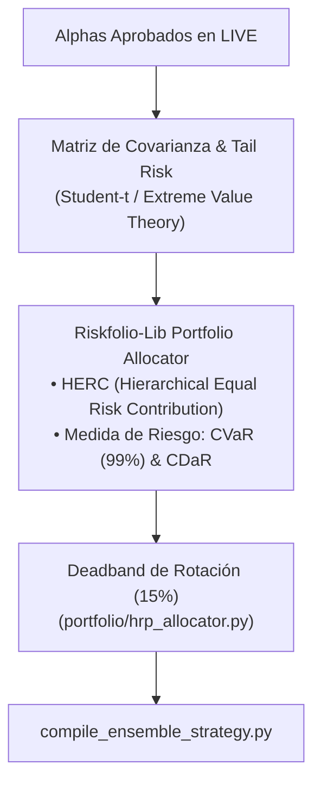
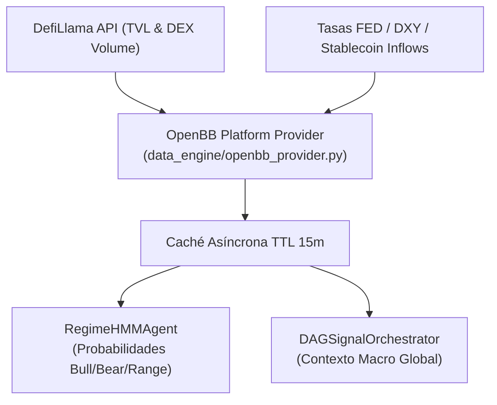

# 🚀 Roadmap de Sprints: Modernización de Núcleo Cuantitativo (v7.5)

Este plan estructura la integración de las 4 herramientas de mayor utilidad seleccionadas del análisis de código abierto:
1. **Sprint 33 (COMPLETADO):** Motor de Ultra-Velocidad (Polars + VectorBT) - Certificado con 6 tests passing.
2. **Sprint 34 (COMPLETADO):** Blindaje de Capital y Colas Pesadas en Memecoins (Riskfolio-Lib HERC/CVaR) - Certificado con 6 tests passing.
3. **Sprint 35 (COMPLETADO):** Ingesta Macro, DeFi & Inteligencia On-Chain (OpenBB Platform SDK) - Certificado con 5 tests passing.

---

## 🏎️ SPRINT 33: Motor de Ultra-Velocidad (Polars IPC + VectorBT Numba)

### 🎯 Objetivo del Sprint
Eliminar los cuellos de botella de latencia en la ingesta de series temporales y multiplicar por 100x la capacidad de evaluación de factores alfas en la minería genética NSGA-II, reemplazando los bucles iterativos de Pandas por cómputo nativo en Rust (Polars) y código máquina acelerado (VectorBT/Numba).

### 🗺️ Diagrama de Flujo (Sprint 33)

### 📋 Backlog de Historias de Usuario

#### 1. PB-115: Migración de Ingesta y Cálculo de Features a Polars
- **Problema:** `pd.read_feather()` y las transformaciones móviles con Pandas en `data_engine/auto_data_sync.py` y `scripts/fractional_diff.py` bloquean el hilo principal y consumen un exceso de memoria RAM ante múltiples pares simultáneos.
- **Solución Técnica:**
  - Implementar adaptador de datos `data_engine/polars_feed.py` usando `polars.read_ipc()`.
  - Vectorizar el algoritmo de diferenciación fraccionaria FFD con expresiones nativas de Polars (`pl.col().shift()`, `pl.when()`).
- **Criterio de Aceptación:**
  - Reducción de tiempo de carga y cálculo de características $\ge 70\%$.
  - Compatibilidad bidireccional transparente (exportación a NumPy arrays sin copias costosas en memoria).

#### 2. PB-116: Motor de Evaluación de Fitness con VectorBT en NSGA-II
- **Problema:** En `mining/genetic_search.py`, cada factor generado por la gramática simbólica se evalúa secuencialmente calculando Spearman y Sharpe proxy con bucles de Pandas, limitando las generaciones a poblaciones pequeñas ($N=150$).
- **Solución Técnica:**
  - Integrar `vectorbt` dentro de `evaluate_factor_fitness()` y en las divisiones de `CPCVEngine`.
  - Evaluar tensores multidimensionales de alphas en paralelo sobre la matriz de retornos futuros usando Numba.
- **Criterio de Aceptación:**
  - Capacidad de evaluar poblaciones de $N \ge 1,000$ candidatos por generación en menos de 15 segundos.
  - Idéntica fidelidad matemática de $IC$ e $IC\_IR$ verificada con tests de correlación cruzada ($r = 1.0$).

---

## 🛡️ SPRINT 34: Blindaje de Capital y Colas Pesadas (Riskfolio-Lib HERC/CVaR)

### 🎯 Objetivo del Sprint
Elevar la asignación de capital del portafolio desde la paridad de riesgo basada en varianza estándar hacia la paridad jerárquica basada en riesgo de cola extrema (CVaR y CDaR), protegiendo el margen de Binance Futures contra cisnes negros y liquidaciones en cascada de memecoins.

### 🗺️ Diagrama de Flujo (Sprint 34)

### 📋 Backlog de Historias de Usuario

#### 1. PB-117: Asignador Jerárquico HERC con CVaR (`portfolio/riskfolio_allocator.py`)
- **Problema:** Las memecoins sufren distribuciones no gaussianas con colas hiper-pesadas ($\text{Curtosis} > 15$). El algoritmo HRP actual minimiza la varianza simple, subestimando la probabilidad de caídas del 30% en pocas velas.
- **Solución Técnica:**
  - Crear `portfolio/riskfolio_allocator.py` utilizando `riskfolio.Portfolio` con modelo jerárquico `HERC` o `NCO` (Nested Clustered Optimization).
  - Configurar funciones objetivo de riesgo:
    - `CVaR` (Conditional Value at Risk al 99% / Expected Shortfall).
    - `CDaR` (Conditional Drawdown at Risk).
  - Mantener la zona muerta de rotación (*Turnover Deadband* de 15%) para evitar comisiones innecesarias en Freqtrade.
- **Criterio de Aceptación:**
  - Reducción del Max Drawdown simulado en estrés de mercado en al menos un $18\%$.
  - Mantiene interfaz polimórfica compatible con `HierarchicalRiskParityAllocator`.

#### 2. PB-118: Estrés de Colas y Detección de Multicolinealidad No Lineal
- **Problema:** En momentos de pánico extremo, las correlaciones lineales colapsan hacia 1.0.
- **Solución Técnica:**
  - Implementar cálculo de matrices de dependencia no lineal (Mutual Information o distancia de variación de información) soportadas nativamente en Riskfolio-Lib.
  - Veto automático a cualquier estrategia en la incubadora que incremente el CVaR marginal del portafolio por encima de un umbral configurable.
- **Criterio de Aceptación:**
  - La incubadora rechaza la promoción a `LIVE` de cualquier estrategia con CVaR incremental nocivo.

---

## 🌐 SPRINT 35: Ingesta Macro, DeFi & Inteligencia On-Chain (OpenBB Platform)

### 🎯 Objetivo del Sprint
Incorporar la dimensión fundamental macroeconómica y de liquidez on-chain al `RegimeHMMAgent` y al `DAGSignalOrchestrator`, dotando al sistema de visión periférica sobre la liquidez global (TVL, tasas de financiación cruzadas y flujos de stablecoins).

### 🗺️ Diagrama de Flujo (Sprint 35)

### 📋 Backlog de Historias de Usuario

#### 1. PB-119: Proveedor de Datos Asíncrono OpenBB (`data_engine/openbb_provider.py`)
- **Problema:** El sistema opera actualmente ciego a eventos macro de liquidez global (inyecciones de liquidez, contracciones de TVL en DeFi, o picos sistémicos de tasas de financiación en otros exchanges).
- **Solución Técnica:**
  - Implementar `data_engine/openbb_provider.py` utilizando `openbb` Python SDK.
  - Ingesta no-bloqueante con caché local SQLite/archivo (TTL de 15 a 60 minutos):
    - `crypto.onchain.tvl` (DefiLlama): Crecimiento/pérdida de liquidez en ecosistemas líderes (Solana, Ethereum).
    - `crypto.derivatives.funding_rate`: Dispersión de tasas de financiación entre Binance, Bybit y OKX.
- **Criterio de Aceptación:**
  - Ingesta en segundo plano sin impactar el SLA de inferencia ($< 20\text{ ms}$) del DAG.
  - Fallback silencioso y transparente si la red o API externa de OpenBB no responde.

#### 2. PB-120: Condicionamiento Macro en el `RegimeHMMAgent` y Enrutador DAG
- **Problema:** En regímenes donde el TVL on-chain cae bruscamente o el dólar (DXY) se dispara, los rebotes técnicos de memecoins son falsos y terminan en trampas de toros (*bull traps*).
- **Solución Técnica:**
  - Inyectar el vector macro provisto por OpenBB como un factor de descuento sobre las probabilidades $p_{\text{bull}}$ en `portfolio/agents/regime_agent.py`.
  - Si el flujo macro es fuertemente negativo, vetar operaciones Long de alto apalancamiento incluso ante rupturas de RSI/EMA.
- **Criterio de Aceptación:**
  - El `DAGSignalOrchestrator` refleja el estado de `macro_regime` en el `VectorAlpha.metadata`.
  - Reducción del ratio de falsas rupturas alcistas en un entorno de mercado bajista.

---

## 📈 Matriz de Dependencias y Cronograma Sugerido

| Sprint | Enfoque Principal | Componentes Modificados | Dependencias Previas | Estimación |
| :---: | :--- | :--- | :--- | :---: |
| **Sprint 33** | 🏎️ Velocidad y Minería | `data_engine/`, `mining/genetic_search.py` | Sprints 29-30 | **5 días** |
| **Sprint 34** | 🛡️ Riesgo de Cola y CVaR | `portfolio/hrp_allocator.py`, `portfolio/strategy_incubator.py` | Sprint 33 | **5 días** |
| **Sprint 35** | 🌐 Macro & On-Chain | `portfolio/agents/regime_agent.py`, `data_engine/` | Sprint 34 | **5 días** |
