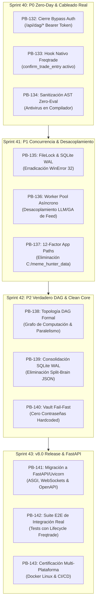

# 🛡️ Programa de Sprints 40-43: Remediación Crítica, Resiliencia & Arquitectura v8.0

Este programa de trabajo formaliza la resolución exhaustiva de todas las vulnerabilidades, anti-patrones, bloqueos de concurrencia y discrepancias de diseño detectadas durante la auditoría técnica de arquitectura institucional (Due Diligence).



---

## 📅 Resumen Ejecutivo del Programa

| Sprint | Enfoque Principal | Historias de Usuario | Puntos de Historia (SP) | Prioridad |
| :---: | :--- | :---: | :---: | :---: |
| **Sprint 40** | **P0 Zero-Day Fixes:** Seguridad API, Cableado de Ejecución y AST Sanitizer | PB-132, PB-133, PB-134 | 21 SP | 🔴 Crítica |
| **Sprint 41** | **P1 Concurrencia & I/O:** Desacoplamiento Feed/LLM, FileLock y Portabilidad | PB-135, PB-136, PB-137 | 21 SP | 🟠 Alta |
| **Sprint 42** | **P2 Core Cuantitativo:** Topología DAG Formal, SQLite Único y Vault Estricto | PB-138, PB-139, PB-140 | 18 SP | 🟡 Media |
| **Sprint 43** | **v8.0 Modernización:** FastAPI/Uvicorn ASGI, E2E Integration Suite & Docker | PB-141, PB-142, PB-143 | 24 SP | 🟢 Estratégica |
| **Total** | **Programa Integral de Remediación y Modernización v8.0** | **12 Historias** | **84 SP** | **4 Sprints** |

---

## 🔴 SPRINT 40: P0 Zero-Day Fixes & Cableado Real de Ejecución

### 🎯 Objetivo del Sprint
Eliminar de inmediato los riesgos de ejecución a ciegas y accesos no autorizados: conectar las 4 capas de protección al ciclo de vida real de Freqtrade, asegurar todos los endpoints de control del Dashboard y blindar el compilador dinámico contra inyección de código.

### 📋 Backlog de Historias de Usuario

#### 1. PB-132: Conexión Real de las 4 Capas en Freqtrade (`confirm_trade_entry`)
- **Problema:** `check_pre_trade_filters()` en `MemeHunter_ApexOmegaAlpha.py` es código huérfano. Freqtrade despacha órdenes al broker sin validar comisiones pre-trade, límites de slots concurrentes ni el Kill Switch.
- **Solución Técnica:**
  - Implementar el hook estándar de Freqtrade:
    ```python
    def confirm_trade_entry(self, pair: str, order_type: str, amount: float, rate: float,
                            time_in_force: str, current_time: datetime, entry_tag: Optional[str],
                            side: str, **kwargs) -> bool:
        return self._execute_gatekeeper_pipeline(...)
    ```
  - Interconectar en runtime:
    1. `DataFirewallGuard`: Validación de frescura del libro.
    2. `BiasStore`: Validación de autorización activa del Cerebro Lento.
    3. `PreTradeProfitabilityGate`: Validación de margen $\ge 2.5\times$ fricción.
    4. `ExecutionGatekeeper`: Comprobación de drawdown acumulado y cupo máximo de 3 slots.
  - Implementar `confirm_trade_exit()` para registrar auditoría de salidas forzadas por Kill Switch.
- **Archivos a Modificar:**
  - `user_data/strategies/MemeHunter_ApexOmegaAlpha.py`
  - `user_data/strategies/MemeHunterSpot_CapitulationAlpha.py`
  - `tests/test_apex_omega_strategy.py`
- **Criterio de Aceptación:**
  - Si el Gatekeeper rechaza una orden, Freqtrade no la envía al exchange y emite un log `CRITICAL`.
  - 100% de los tests de regresión de estrategias validan invocaciones reales vía `confirm_trade_entry`.

#### 2. PB-133: Cierre Inmediato del Bypass de Autenticación en Dashboard API
- **Problema:** En `dashboard/server.py:L360`, las rutas `/api/dag/*` saltan `self._check_auth()`. Además, el servidor se enlaza a `0.0.0.0` por defecto, permitiendo a cualquier actor de red pausar agentes o alterar el consenso.
- **Solución Técnica:**
  - Eliminar la excepción `is_dag_control` en `CockpitAPIHandler.do_POST()`.
  - Exigir Bearer token válido en todos los endpoints de mutación (`/api/dag/toggle-node`, `/api/dag/set-threshold`, `/api/dag/trigger-cycle`).
  - Cambiar el bind predeterminado de `DASHBOARD_HOST` a `127.0.0.1` en `run_server()`.
  - Implementar validación estricta de header `Origin` contra `ALLOWED_ORIGINS` para mitigar CSRF.
- **Archivos a Modificar:**
  - `dashboard/server.py`
  - `tests/test_dashboard_server.py`
- **Criterio de Aceptación:**
  - Toda petición a `/api/dag/*` sin cabecera `Authorization: Bearer <TOKEN>` responde `401 Unauthorized`.
  - El servidor se inicia en `127.0.0.1` a menos que se declare explícitamente una variable de entorno segura.

#### 3. PB-134: Sanitización Cero-Eval en Generación de Código Dinámico
- **Problema:** `compile_ensemble_strategy.py` valida fórmulas con `ast.parse()`, lo cual permite inyección arbitraria de código Python (`__import__('os').system(...)`) en estrategias compiladas en caliente.
- **Solución Técnica:**
  - Reemplazar la validación laxa por `FormulaASTParser.parse(formula_str)` de `mining/formula_parser.py`.
  - Aplicar whitelist rígida de nodos AST (`ast.Call`, `ast.Name`, `ast.BinOp`, `ast.UnaryOp`, `ast.Constant`) prohibiendo llamadas a built-ins, imports y atributos dunder.
  - Generar el archivo de estrategia de forma atómica y rechazar la compilación si un solo factor contiene código fuera de la gramática formal.
- **Archivos a Modificar:**
  - `scripts/compile_ensemble_strategy.py`
  - `tests/test_compile_ensemble_strategy.py`
- **Criterio de Aceptación:**
  - Cualquier intento de compilar fórmulas con funciones fuera de `AlphaGrammar` falla con `ValueError` y bloquea la regeneración de la estrategia.

---

## 🟠 SPRINT 41: Resiliencia de Concurrencia, I/O Multiproceso & 12-Factor App

### 🎯 Objetivo del Sprint
Erradicar las condiciones de carrera de archivos en Windows, desacoplar los procesos pesados de IA/minería del hilo del WebSocket de mercado y garantizar portabilidad absoluta eliminando rutas fijas.

### 📋 Backlog de Historias de Usuario

#### 1. PB-135: Bloqueo Inter-Proceso Atómico en `BiasStore` (`filelock` / SQLite)
- **Problema:** `BiasStore.save_bias()` realiza read-modify-write en `market_bias.json` sin locks, provocando `WinError 32` y actualizaciones perdidas bajo concurrencia.
- **Solución Técnica:**
  - Introducir `filelock.FileLock` con timeout configurable (2,000 ms) alrededor de la lectura y escritura atómica en disco.
  - Implementar adaptador de persistencia en SQLite WAL (`portfolio/alpha_factory.db`) en la tabla `market_biases` con índices `(symbol, valid_until_utc)` para lecturas sub-milisegundo concurrentes sin colisiones.
- **Archivos a Modificar:**
  - `portfolio/bias_store.py`
  - `portfolio/db_schema.py`
  - `tests/test_bias_store.py`
- **Criterio de Aceptación:**
  - Pruebas de estrés concurrentes con 20 hilos y múltiples procesos escribiendo sesgos simultáneamente registran 0 excepciones `PermissionError` y 0 datos corruptos.

#### 2. PB-136: Desacoplamiento Asíncrono del Bucle de Ingesta y Worker Pool
- **Problema:** En `scripts/run_live_alpha_loop.py`, `on_dollar_bar_closed` llama síncronamente a `orchestrator.process_cycle()`, congelando la ingesta de ticks durante 30 a 120 segundos cuando se invocan autopsias LLM o algoritmos genéticos.
- **Solución Técnica:**
  - Implementar una cola de eventos (`queue.Queue`) y un `ThreadPoolExecutor` desacoplado para el ciclo de autopsia y auto-sanación.
  - El hilo de WebSocket de Binance procesa barras y encola el evento en $< 1.0\text{ ms}$, continuando inmediatamente la escucha de sockets sin bloqueo.
  - Añadir flags de estado `is_processing_cycle` para evitar encolamiento masivo de ciclos superpuestos.
- **Archivos a Modificar:**
  - `scripts/run_live_alpha_loop.py`
  - `portfolio/autonomous_orchestrator.py`
  - `tests/test_live_alpha_loop.py`
- **Criterio de Aceptación:**
  - El bucle de mercado en vivo mantiene latencia de ingesta $< 5\text{ ms}$ incluso mientras el LLM genera hipótesis o el algoritmo genético optimiza en segundo plano.

#### 3. PB-137: Portabilidad 12-Factor App & Centralización de Rutas
- **Problema:** Rutas absolutas `C:/meme_hunter_data/binance/futures` hardcoded en más de 8 archivos rompen la ejecución en Docker Linux y servidores cloud.
- **Solución Técnica:**
  - Crear `data_engine/paths.py` con resolución unificada basada en variables de entorno:
    ```python
    def get_data_dir() -> Path:
        env_dir = os.getenv("MEME_DATA_DIR")
        if env_dir:
            return Path(env_dir)
        # Fallback local relativo al root del repositorio
        return ROOT_DIR / "user_data" / "data"
    ```
  - Reemplazar todas las ocurrencias fijas en scripts y feeds por `get_data_dir()`.
  - Actualizar `docker-compose.yml` para mapear volúmenes de forma estandarizada en Linux y Windows.
- **Archivos a Modificar:**
  - `data_engine/paths.py` (Nuevo)
  - `data_engine/auto_data_sync.py`
  - `data_engine/polars_feed.py`
  - `data_engine/real_market_feed.py`
  - `dashboard/strategy_tester.py`
  - `scripts/backtest_apex_omega.py`
  - `docker-compose.yml`
- **Criterio de Aceptación:**
  - La suite completa de tests y scripts se ejecuta idénticamente en Linux sin requerir unidad `C:`.

---

## 🟡 SPRINT 42: Topología DAG Formal, Persistencia Canónica & Vault Estricto

### 🎯 Objetivo del Sprint
Formalizar una verdadera arquitectura de Grafo Acíclico Dirigido (DAG) con resolución topológica de dependencias, unificar la persistencia eliminando el estado duplicado en JSON y reforzar la gestión criptográfica de secretos.

### 📋 Backlog de Historias de Usuario

#### 1. PB-138: Topología DAG Formal con Computación Basada en Dependencias
- **Problema:** `DAGSignalOrchestrator` es un bucle secuencial lineal sobre un diccionario plano con promedios ponderados. Carece de capacidades de DAG real.
- **Solución Técnica:**
  - Rediseñar el orquestador con un grafo dirigido explícito:
    - Nodos de Ingesta (WebSockets L2, Order Flow, OpenBB).
    - Nodos de Features (FFD, HMM Regime, NLP Sentiment).
    - Nodos de Fusión (Bayesian Synthesizer condicionado por régimen).
    - Nodos de Gobernanza (Risk Manager, Pre-Trade Friction Gate).
  - Implementar ordenamiento topológico determinista (`topological_sort`) y validación de aciclicidad en el registro.
  - Ejecución concurrente con `asyncio.gather` para ramas independientes del grafo (ej: HMM y Sentiment en paralelo).
- **Archivos a Modificar:**
  - `portfolio/dag_orchestrator.py`
  - `portfolio/agents/base_agent.py`
  - `tests/test_dag_orchestrator.py`
- **Criterio de Aceptación:**
  - Grafo formal validado con detección de ciclos cíclicos.
  - Ejecución paralela de ramas independientes reduciendo el tiempo de inferencia total a la rama más lenta.

#### 2. PB-139: Consolidación Canónica de Persistencia en SQLite WAL
- **Problema:** La coexistencia de `incubator_state.json` y `alpha_factory.db` genera duplicidad de I/O y riesgo de divergencia de datos (Split-Brain).
- **Solución Técnica:**
  - Deprecar `incubator_state.json` como almacén de persistencia de escritura.
  - Centralizar todo el estado del ciclo de vida de estrategias (`StrategyRecord`), autopsias, registros de salud y ponderaciones HRP exclusivamente en SQLite WAL (`portfolio/alpha_factory.db`).
  - Proporcionar métodos de solo lectura para volcar snapshots JSON si son requeridos por telemetría externa.
- **Archivos a Modificar:**
  - `portfolio/strategy_incubator.py`
  - `portfolio/db_schema.py`
  - `portfolio/autonomous_orchestrator.py`
  - `tests/test_strategy_incubator.py`
- **Criterio de Aceptación:**
  - 100% de operaciones de ciclo de vida se ejecutan con integridad ACID en SQLite WAL. Eliminación de bloqueos por archivos JSON compartidos.

#### 3. PB-140: Hardening de Secretos y Fallbacks Fail-Fast
- **Problema:** Existencia de fallbacks con contraseñas fijas (`FREQTRADE_API_PASSWORD="MemeHunter2026!"`) y tokens dev predeterminados.
- **Solución Técnica:**
  - Prohibir terminantemente valores por defecto para credenciales críticas en código fuente.
  - Implementar validación fail-fast al inicio del sistema: si falta una variable o secreto crítico en `SecretVaultManager`, el proceso se niega a iniciar con un mensaje de diagnóstico claro.
  - Automatizar la rotación de claves maestras y verificación de permisos restrictivos (0600 en Linux) para `.secrets.vault`.
- **Archivos a Modificar:**
  - `client/freqtrade_client.py`
  - `dashboard/server.py`
  - `portfolio/secrets_vault.py`
  - `tests/test_secrets_vault.py`
- **Criterio de Aceptación:**
  - Ningún archivo del repositorio contiene contraseñas en texto plano como valor por defecto.
  - Intentar iniciar el sistema sin configurar credenciales aborta con código de salida 1 de inmediato.

---

## 🟢 SPRINT 43: Migración a FastAPI/ASGI, Suite E2E Real & v8.0 Release

### 🎯 Objetivo del Sprint
Modernizar la interfaz del Cockpit reemplazando el servidor estándar por FastAPI de alto rendimiento con WebSockets, implementar pruebas E2E de ciclo de vida completo y certificar la versión v8.0 multi-plataforma.

### 📋 Backlog de Historias de Usuario

#### 1. PB-141: Migración del Cockpit Server a FastAPI & Uvicorn (ASGI)
- **Problema:** [`dashboard/server.py`](file:///c:/meme_hunter/dashboard/server.py) es un monolito acoplado de 1,000 líneas basado en `http.server.ThreadingHTTPServer`.
- **Solución Técnica:**
  - Refactorizar en arquitectura modular FastAPI con Uvicorn:
    - `dashboard/api/routers/dag.py`
    - `dashboard/api/routers/trades.py`
    - `dashboard/api/routers/strategies.py`
    - `dashboard/api/routers/emergency.py`
  - Sustituir polling REST por WebSockets nativos (`/ws/telemetry`, `/ws/trades`) para actualización reactiva en tiempo real (< 5 ms).
  - Documentación Swagger/OpenAPI autogenerada y protegida con esquemas OAuth2/Bearer.
- **Archivos a Crear/Modificar:**
  - `dashboard/app.py` (Nuevo)
  - `dashboard/api/` (Nuevo paquete)
  - `dashboard/server.py` (Wrapper legacy redirigiendo a Uvicorn)
  - `scripts/start_dashboard.py`
- **Criterio de Aceptación:**
  - Servidor ASGI asíncrono con soporte de alta concurrencia, validación automática Pydantic y WebSocket de telemetría activo.

#### 2. PB-142: Suite de Pruebas de Integración E2E en Runtime
- **Problema:** Las pruebas actuales evalúan funciones desacopladas sin emular el ciclo de eventos real de Freqtrade.
- **Solución Técnica:**
  - Diseñar tests E2E que ejecuten el pipeline completo:
    1. Ingesta de velas con perturbaciones sintéticas de precio (flashes, gaps).
    2. Filtrado por `DataFirewallGuard`.
    3. Inferencia de agentes DAG en ramas paralelas.
    4. Consulta de `BiasStore` por la estrategia.
    5. Evaluación en `confirm_trade_entry()` con rechazos por slippage y aprobación exitosa.
    6. Disparo forzado de Kill Switch y verificación de cancelación de órdenes.
- **Archivos a Crear:**
  - `tests/test_e2e_runtime_pipeline.py`
- **Criterio de Aceptación:**
  - Simulación E2E de ciclo de vida completo pasando al 100% sin dependencias de red externa.

#### 3. PB-143: Empaquetado Multi-Stage Docker y Certificación Institucional v8.0
- **Problema:** La configuración actual de Docker depende de rutas locales de Windows.
- **Solución Técnica:**
  - Diseñar `Dockerfile` multi-stage ligero basado en `python:3.11-slim`:
    - Etapa 1: Build de dependencias numéricas y C extensions (Numba, Polars, VectorBT).
    - Etapa 2: Runtime seguro sin privilegios de root (`non-root user meme_operator`).
  - Actualizar `docker-compose.yml` para levantar Freqtrade, el Cockpit FastAPI y el sincronizador con volúmenes declarativos.
  - Ejecutar auditoría final de seguridad con Bandit y Trivy.
- **Archivos a Modificar:**
  - `Dockerfile`
  - `docker-compose.yml`
  - `docs/MANUAL_UNIFICADO_DEL_SISTEMA.md`
- **Criterio de Aceptación:**
  - Despliegue en 1 comando: `docker compose up -d` funcionando en Linux, macOS y Windows WSL2 sin errores.
  - Cero hallazgos críticos o altos en auditoría automatizada de seguridad.

---

## 📈 Matriz de Trazabilidad: Hallazgos de Auditoría vs Historias de Usuario

| Hallazgo de Auditoría | Nivel | Sprint Asignado | Historia de Usuario | Módulo Objetivo |
| :--- | :---: | :---: | :---: | :--- |
| **SEC-01 (Bypass Auth en DAG)** | **CRÍTICO** | **Sprint 40** | PB-133 | `dashboard/server.py` |
| **EXE-01 (Dead Code en Gatekeeper)** | **CRÍTICO** | **Sprint 40** | PB-132 | `MemeHunter_ApexOmegaAlpha.py` |
| **SEC-02 (RCE en Compilador AST)** | **CRÍTICO** | **Sprint 40** | PB-134 | `scripts/compile_ensemble_strategy.py` |
| **CON-01 (WinError 32 en BiasStore)** | **ALTO** | **Sprint 41** | PB-135 | `portfolio/bias_store.py` |
| **LAT-01 (Bloqueo Feed por LLM/GA)** | **ALTO** | **Sprint 41** | PB-136 | `scripts/run_live_alpha_loop.py` |
| **ENV-01 (Rutas Hardcoded C:)** | **MEDIO** | **Sprint 41** | PB-137 | `data_engine/paths.py` |
| **ARC-01 (Discrepancia DAG)** | **ALTO** | **Sprint 42** | PB-138 | `portfolio/dag_orchestrator.py` |
| **DAT-01 (Split-Brain JSON vs SQLite)** | **BAJO** | **Sprint 42** | PB-139 | `portfolio/strategy_incubator.py` |
| **SEC-03 (Credenciales Default)** | **MEDIO** | **Sprint 42** | PB-140 | `client/freqtrade_client.py` |
| **Monolito HTTP Threading** | **MEDIO** | **Sprint 43** | PB-141 | `dashboard/app.py` (FastAPI) |
| **Tests Sintéticos vs Reales** | **ALTO** | **Sprint 43** | PB-142 | `tests/test_e2e_runtime_pipeline.py` |
| **Portabilidad Contenedor** | **MEDIO** | **Sprint 43** | PB-143 | `Dockerfile` & `docker-compose.yml` |
