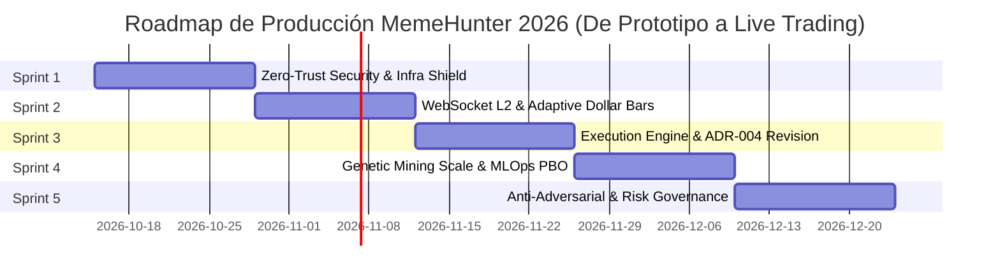

# Plan Integral de Sprints Scrum: Production Hardening, Microestructura y Resiliencia 2026
**Proyecto:** MemeHunter Industrial Quantitative Engine  
**Marco Metodológico:** Scrum Ágil / Engineering Cuantitativa FinTech  
**Duración del Ciclo:** 5 Sprints × 2 Semanas (10 días laborables / sprint) = 10 Semanas  
**Velocidad Promedio Estimada:** 36 Story Points (SP) / Sprint (Total: 180 SP)  
**Equipo Scrum:** Product Owner / Lead Quant, Scrum Master, Quant Devs (C++/Python), Security/DevOps Engineer  

---

## 🗺️ Roadmap de Sprints y Arquitectura de Maduración

| Sprint | Clave | Foco Estratégico | Riesgo Mitigado | Capacidad |
| :--- | :--- | :--- | :--- | :--- |
| **Sprint 1** | *Security & Infra Shield* | Cero tokens en logs, Vault/KMS, CORS estricto, API Gateway/FastAPI, SQLite WAL | 4 (Seguridad) y 5 (Infraestructura) | 36 SP |
| **Sprint 2** | *Data Streaming & Adaptive Bars* | WebSocket Binance nativo L2, eliminación de polling CCXT 5s, Dollar Bars dinámicas | 1 (Latencia feed) y 2 (Calidad datos) | 38 SP |
| **Sprint 3** | *Execution & Smart Order Routing* | Enmienda ADR-004 (Maker exits/TWAP), Almgren-Chriss integrado, Book-based fills | 1 (Slippage salidas) y Backtesting | 36 SP |
| **Sprint 4** | *Genetic Scale & MLOps Rigor* | Minería NSGA-II masiva, Purged CPCV/PBO, Dataset hashing, reproducibilidad | 3 (Sobreajuste y potencia minería) | 35 SP |
| **Sprint 5** | *Anti-Adversarial & Kill-Switches* | Filtros Anti-Pump&Dump, Gobernanza de cuota LLM 2026, Chaos Testing, Kill-Switches | 6 (Presupuestos LLM) y 7 (Manipulación) | 35 SP |

---

## 🏃 Sprint 1: Zero-Trust Security, Secret Management & Infra Shield
- **Sprint Goal:** *"Eliminar cualquier vector de exposición de credenciales y tokens por defecto en [dashboard/server.py](file:///c:/meme_hunter/dashboard/server.py), implementar gestión segura de secretos con cifrado en reposo, restringir CORS y migrar la capa de persistencia a SQLite WAL con pool transaccional concurrente."*
- **Capacidad Estimada:** 36 Story Points (SP)

### User Stories del Sprint 1

#### 🟢 US-1.1: Eliminación de Tokens por Defecto y Modo Fail-Fast en Arranque (8 SP)
- **Como:** Lead Security Engineer.
- **Quiero:** Que el servidor del Dashboard y los servicios del sistema fallen inmediatamente (`raise RuntimeError`) si no se define explícitamente un `DASHBOARD_API_TOKEN` criptográficamente seguro en las variables de entorno.
- **Para:** Impedir que el sistema opere en producción con la clave hardcodeada `"meme_hunter_dev_token_2026"`.
- **Criterios de Aceptación:**
  - [x] Eliminar el valor de respaldo `"meme_hunter_dev_token_2026"` en [dashboard/server.py:L42](file:///c:/meme_hunter/dashboard/server.py#L42).
  - [x] Validar longitud mínima de entropía (32 caracteres hexadecimales/base64) en el token inyectado.
  - [x] Eliminar la impresión del token en consola en [dashboard/server.py:L476](file:///c:/meme_hunter/dashboard/server.py#L476); emitir únicamente un log enmascarado (`API Token: [CONFIGURED - SHA256: ...****]`).
  - [x] Pruebas unitarias que confirmen que el proceso aborta el inicio si falta la variable.

#### 🟢 US-1.2: Gestión de Secretos en Reposo con Cifrado AES-256 / Integración Vault (10 SP)
- **Como:** DevOps & Compliance Engineer.
- **Quiero:** Un gestor de secretos centralizado (`SecretVaultManager`) que desacople las API Keys de Binance y OpenRouter del archivo `.env` plano.
- **Para:** Proteger las claves de trading y fondos contra accesos indebidos o fugas accidentales en repositorios Git.
- **Criterios de Aceptación:**
  - [x] Crear módulo `portfolio/secrets_vault.py` con soporte para variables cifradas (AES-GCM o SOPS/HashiCorp Vault adapter).
  - [x] Configurar `.env.example` auditado sin valores por defecto operativos.
  - [x] Modificar [mining/llm_client.py:L45-L57](file:///c:/meme_hunter/mining/llm_client.py#L45-L57) para leer claves exclusivamente a través de `SecretVaultManager` sin escanear el archivo de texto en disco de forma no supervisada.
  - [x] Añadir pruebas unitarias completas de ciclo de vida cifrado/descifrado y resistencia a manipulación.

#### 🟢 US-1.3: Endurecimiento de CORS, Rate Limiting por IP y Headers de Seguridad (8 SP)
- **Como:** Platform Architect.
- **Quiero:** Restringir las cabeceras HTTP de respuesta para admitir solo orígenes específicos y aplicar limitador de tasa (10 req/s por IP).
- **Para:** Mitigar ataques de cross-site request forgery (CSRF), DoS volumétrico y secuestro de endpoints administrativos.
- **Criterios de Aceptación:**
  - [x] Eliminar `Access-Control-Allow-Origin: *` de cualquier respuesta; validar la lista blanca configurable `ALLOWED_ORIGINS` (por defecto `http://127.0.0.1:8088`).
  - [x] Implementar middleware en memoria de `TokenBucketRateLimiter` por IP para endpoints POST (`/api/trigger-loop`, `/api/synthesize-alpha`, `/api/test-strategy`).
  - [x] Añadir cabeceras de seguridad estrictas: `X-Content-Type-Options: nosniff`, `X-Frame-Options: DENY`, `Content-Security-Policy`.

#### 🟢 US-1.4: Resiliencia de Persistencia SQLite: Modo WAL y Conexiones Concurrente (10 SP)
- **Como:** Data & Infrastructure Engineer.
- **Quiero:** Configurar la base de datos de operaciones `user_data/tradesv3.futures.sqlite` en modo Write-Ahead Logging (`PRAGMA journal_mode=WAL`) con timeout de bloqueo de 15 segundos y pool de conexiones.
- **Para:** Eliminar excepciones `sqlite3.OperationalError: database is locked` cuando el dashboard, los workers de alpha y Freqtrade escriben o leen en paralelo.
- **Criterios de Aceptación:**
  - [x] Crear wrapper `DatabaseConnectionPool` en `portfolio/db_pool.py`.
  - [x] Ejecutar migraciones automáticas `PRAGMA synchronous = NORMAL; PRAGMA journal_mode = WAL;` al conectar.
  - [x] Probar concurrencia con múltiples hilos simultáneos simulando lecturas de [dashboard/backtest_scanner.py](file:///c:/meme_hunter/dashboard/backtest_scanner.py) y escrituras de trades sin bloqueos.

---

## 🏃 Sprint 2: High-Frequency WebSocket Streaming & Adaptive Dollar Bars
- **Sprint Goal:** *"Reemplazar la ingesta REST polling CCXT de 5 segundos por un feed nativo WebSocket de Binance Futures con orderbook L2 y reconexión automática, e implementar calibración dinámica de umbrales en InformationBarsGenerator para memecoins heterogéneas."*
- **Capacidad Estimada:** 38 Story Points (SP)

### User Stories del Sprint 2

#### 🟢 US-2.1: Ingestor Nativo WebSocket de Baja Latencia para Binance Futures (15 SP)
- **Como:** High-Frequency Quant Developer.
- **Quiero:** Un feed asíncrono WebSocket (`BinanceFuturesWebSocketFeed`) conectado a los streams `@trade` y `@depth20@100ms` de Binance Futures.
- **Para:** Reducir la latencia de captura de datos de ~5000 ms a < 100 ms y alimentar el motor con granularidad tick-level real.
- **Criterios de Aceptación:**
  - [x] Refactorizar [data_engine/live_market_feed.py](file:///c:/meme_hunter/data_engine/live_market_feed.py) para incorporar conexión WebSocket nativa (`BinanceFuturesWebSocketFeed`) multiplexando streams `@aggTrade` y `@depth20@100ms`.
  - [x] Implementar heartbeat / ping-pong automático con detección de socket zombi y reconexión exponencial (< 3s).
  - [x] Desacoplar procesamiento de eventos de trades y profundidad de libro L2 sin bloquear la red.
  - [x] Pruebas unitarias de parsing, reconexión y fallback automático a modo REST.

#### 🟢 US-2.2: Dollar Bars Dinámicas y Autocalibradas por Símbolo y Régimen (13 SP)
- **Como:** Quantitative Portfolio Researcher.
- **Quiero:** Que el `notional_threshold` en [data_engine/dollar_bars.py](file:///c:/meme_hunter/data_engine/dollar_bars.py) se autocalibre dinámicamente como una fracción del volumen diario promedio en dólares ($ADV_{20} / 50$), en lugar de utilizar un valor fijo de \$1,000,000 USD.
- **Para:** Garantizar que tokens de menor liquidez (como WIF o BONK) no queden congelados sin barras durante horas, y tokens ultra-líquidos (DOGE, PEPE) no saturen la memoria con miles de barras por minuto.
- **Criterios de Aceptación:**
  - [x] Añadir método `calibrate_threshold_from_history(df, target_bars_per_day=50)` en `InformationBarsGenerator`.
  - [x] Implementar actualización rodante diaria del umbral con suavizado exponencial (`update_symbol_threshold_rolling`) para evitar saltos discretos artificiales.
  - [x] Validar que el cálculo dinámico ajuste los umbrales para obtener ~50 barras diarias por símbolo.
  - [x] Permitir umbrales específicos por símbolo en `InformationBarsGenerator` y `StreamingDollarBarAggregator`.

#### 🟢 US-2.3: Agregador Incremental O(1) Streaming de Dollar Bars (10 SP)
- **Como:** Algorithmic Execution Engineer.
- **Quiero:** Que cada tick entrante actualice el estado acumulado de la barra en $O(1)$ sin volver a iterar sobre el histórico de velas en [data_engine/live_market_feed.py:L103](file:///c:/meme_hunter/data_engine/live_market_feed.py#L103).
- **Para:** Reducir el consumo de CPU en un 95% y emitir la señal alfa en el milisegundo exacto en que se completa el volumen notional.
- **Criterios de Aceptación:**
  - [x] Implementar clases `AccumulatorState` y `StreamingDollarBarAggregator` en [data_engine/dollar_bars.py](file:///c:/meme_hunter/data_engine/dollar_bars.py).
  - [x] Mantener acumuladores atómicos: `high`, `low`, `close`, `vwap_num`, `volume`, `cum_notional`.
  - [x] Emitir evento de cierre única y exclusivamente cuando `cum_notional >= current_threshold` y resetear el acumulador de forma limpia.

---

## 🏃 Sprint 3: Microestructura de Ejecución, Revisión ADR-004 y Fills Realistas
- **Sprint Goal:** *"Enmendar la política de salidas forzadas a mercado de ADR-004 implementando un Smart Order Router con órdenes Limit Post-Only + Cancel/Replace y sliced exits (TWAP), e integrar formalmente el modelo de microestructura de Almgren-Chriss en todo el pipeline de backtesting."*
- **Capacidad Estimada:** 36 Story Points (SP)

### User Stories del Sprint 3

#### 🟢 US-3.1: Enmienda de ADR-004 y Algoritmo de Salida Maker Inteligente (14 SP)
- **Como:** Lead Execution Trader.
- **Quiero:** Reemplazar las salidas de emergencia forzadas a mercado (`market orders`) de [docs/architecture/decisions/ADR-004_airbag_technical_exit_market_orders.md](file:///c:/meme_hunter/docs/architecture/decisions/ADR-004_airbag_technical_exit_market_orders.md) por un enrutador inteligente de dos etapas: (1) intento Maker agresivo en el Ask con Timeout de 3 segundos, y (2) desescalamiento a TWAP sliced market exit solo si el spread o la urgencia lo ameritan.
- **Para:** Eliminar el sangrado continuo de comisiones taker (0.05%) y slippage en memecoins ilíquidas que convertía estrategias ganadoras en perdedoras.
- **Criterios de Aceptación:**
  - [x] Redactar y aprobar la enmienda `ADR-004.1: Adaptive Microstructure Order Routing for Exits` en [docs/architecture/decisions/ADR-004.1_adaptive_microstructure_exit_routing.md](file:///c:/meme_hunter/docs/architecture/decisions/ADR-004.1_adaptive_microstructure_exit_routing.md).
  - [x] Implementar `SmartExitRouter` en [portfolio/order_router.py](file:///c:/meme_hunter/portfolio/order_router.py) con enrutamiento de 3 etapas (Maker Post-Only, Sliced TWAP y Hard Stop Market).
  - [x] Desescalamiento automático a TWAP fraccionado si la orden Maker no se completa para minimizar el impacto cuadrático de Almgren-Chriss.
  - [x] Mecanismo de seguridad: activación inmediata de orden de protección a mercado si la posición alcanza el stop-loss estructural duro (-8%).

#### 🟢 US-3.2: Integración Nativa del Simulador de Slippage Almgren-Chriss (12 SP)
- **Como:** Quantitative Risk Analyst.
- **Quiero:** Conectar [data_engine/slippage_engine.py](file:///c:/meme_hunter/data_engine/slippage_engine.py) (`MicrostructureSlippageEngine`) directamente dentro de [dashboard/strategy_tester.py](file:///c:/meme_hunter/dashboard/strategy_tester.py) y los scripts de backtest de alphas.
- **Para:** Que cada trade simulado calcule su deslizamiento dinámico en función de la profundidad del orderbook L2 y el tamaño de orden relativo, sustituyendo el slippage plano de 0.02%.
- **Criterios de Aceptación:**
  - [x] Modificar [dashboard/strategy_tester.py](file:///c:/meme_hunter/dashboard/strategy_tester.py) para invocar `MicrostructureSlippageEngine` y `SmartExitRouter`.
  - [x] Incluir costes de impacto permanente ($\gamma$) y temporal ($\eta$) calibrados para cada memecoin según volumen diario y volatilidad rodante.
  - [x] Reportar en los resultados del Cockpit la métrica `total_slippage_drag_usd` y `effective_spread_bps`.
  - [x] Validar que estrategias con alto turnover sean penalizadas realistamente.

#### 🟢 US-3.3: Simulación de Fills Realistas con Comisiones y Tasas de Financiación (Funding) (10 SP)
- **Como:** Algorithmic Systems Tester.
- **Quiero:** Que el motor de backtesting incorpore comisiones escalonadas reales (Maker 0.02% / Taker 0.05%), penalizaciones por funding rate cada 8 horas y márgenes de liquidación en futuros.
- **Para:** Evitar que estrategias apalancadas generen alfas espurios que desaparecen en condiciones de mercado real.
- **Criterios de Aceptación:**
  - [x] Incorporar tabla de comisiones VIP-0 de Binance Futures en el evaluador vectorial (0.02% Maker, 0.05% Taker).
  - [x] Simular deducción/cobro periódico de tasa de financiación cada 8 horas (carry positivo en cortos de memecoins).
  - [x] Modelar margen de mantenimiento de futuros y registrar eventos de liquidación forzada si el balance de margen cae por debajo del umbral crítico.

---

## 🏃 Sprint 4: Genetic Mining Scale, PBO Control & MLOps Pipeline
- **Sprint Goal:** *"Escalar el motor de minería genética de 30 a 150+ individuos con paralelismo multiproceso, integrar el control estricto de PBO/CPCV con Purged K-Fold para evitar sobreajuste y establecer un pipeline reproducible con hashing inmutable de datos y semillas fijadas."*
- **Capacidad Estimada:** 35 Story Points (SP)

### User Stories del Sprint 4

#### 🟢 US-4.1: Paralelización y Expansión del Espacio de Búsqueda Genética NSGA-II (12 SP)
- **Como:** Lead Machine Learning Engineer.
- **Quiero:** Refactorizar [mining/genetic_search.py](file:///c:/meme_hunter/mining/genetic_search.py) para evaluar poblaciones de 150 individuos a lo largo de 25 generaciones utilizando `multiprocessing.Pool` o `concurrent.futures`.
- **Para:** Ampliar la capacidad de descubrimiento de factores de alfa sin incrementar el tiempo de ejecución por ciclo de optimización.
- **Criterios de Aceptación:**
  - [x] Parametrizar `population_size=150` y `generations=25` como configuración de producción.
  - [x] Paralelizar la función `evaluate_factor_fitness` distribuyendo el cómputo de ASTs vectorizados en todos los núcleos disponibles de CPU.
  - [x] Medir aceleración de al menos 4x en benchmarks de 8 cores.
  - [x] Preservar diversidad de la población mediante crowding distance de NSGA-II.

#### 🟢 US-4.2: Integración Obligatoria de Purged CPCV y Cálculo de PBO (13 SP)
- **Como:** Quantitative Validation Lead.
- **Quiero:** Que ningún factor minado sea promovido a `SANDBOX` sin superar una prueba de Combinatorial Purged Cross-Validation (`validation/cpcv_engine.py`) con $PBO < 0.25$ y $PSR > 0.95$.
- **Para:** Inmunizar el portafolio contra el sobreajuste masivo y la selección de factores que solo funcionan por azar estadístico (*data snooping bias*).
- **Criterios de Aceptación:**
  - [x] Integrar el validador `CPCVEngine` en el pipeline de [mining/genetic_search.py:L55](file:///c:/meme_hunter/mining/genetic_search.py#L55).
  - [x] Aplicar Purged K-Fold con ventana de embargo del 1% para erradicar fuga de información serial.
  - [x] Descartar automáticamente factores con Probability of Backtest Overfitting ($PBO \ge 0.25$).
  - [x] Almacenar la curva de distribución de Sharpe out-of-sample en los metadatos de `factor_library.json`.

#### 🟢 US-4.3: Versionado Inmutable de Datasets, Checksums y Fijación de Semillas (10 SP)
- **Como:** MLOps & Reproducibility Engineer.
- **Quiero:** Que cada ejecución de entrenamiento o minería registre el hash SHA-256 del dataset de entrada, el commit de Git y la semilla determinista (`seed`) utilizada.
- **Para:** Garantizar reproducibilidad matemática completa y trazabilidad en caso de auditoría regulatoria o cuantitativa.
- **Criterios de Aceptación:**
  - [x] Crear módulo `validation/data_manifest.py` que calcule el manifiesto de datos (SHA-256 de archivos OHLCV, timestamps de inicio/fin).
  - [x] Configurar inyección obligatoria de `RANDOM_SEED` en `numpy`, `random` y optimizadores genéticos.
  - [x] Exportar manifiesto estructurado `run_metadata.json` junto a cada factor minado.
  - [x] Validar que dos ejecuciones con la misma semilla y dataset produzcan resultados matemáticamente idénticos.

---

## 🏃 Sprint 5: Anti-Adversarial Sentinel, 2026 LLM Governance & Production Kill-Switches
- **Sprint Goal:** *"Blindar el sistema contra manipulación de mercado y anomalías de memecoins con filtros estadísticos, formalizar el presupuesto y fallbacks de inferencia LLM para condiciones de 2026 e implementar kill-switches de hardware/software validados mediante Chaos Testing."*
- **Capacidad Estimada:** 35 Story Points (SP)

### User Stories del Sprint 5

#### 🟢 US-5.1: Centinela Anti-Manipulación y Detección de Spoofing / Pump & Dump (13 SP)
- **Como:** Senior Quantitative Risk Manager.
- **Quiero:** Un módulo centinela (`AdversarialMarketSentinel`) que analice discrepancias de volumen anómalas, órdenes fantasma en book y divergencias de precio cross-exchange antes de habilitar señales.
- **Para:** Evitar que los algoritmos tomen posiciones en trampas de liquidez orquestadas por bots depredadores o grupos de manipulación.
- **Criterios de Aceptación:**
  - [x] Extender [scripts/meme_sentinel.py](file:///c:/meme_hunter/scripts/meme_sentinel.py) para incluir detector de *Volume-to-Depth Imbalance* (volumen explosivo sin soporte en el libro L2).
  - [x] Verificar consistencia de precio comparando Binance Futures contra índice de referencia Spot/DEX (umbral de divergencia máxima: 0.8%).
  - [x] Suspender temporalmente las operaciones sobre cualquier memecoin que muestre señales de manipulación activa o desbalance de funding > 0.20%.
  - [x] Integrar el filtro centinela como compuerta previa obligatoria en `AutonomousPortfolioOrchestrator`.

#### 🟢 US-5.2: Gobernanza Presupuestaria de LLMs 2026 y Formalización de SLAs de Fallback (10 SP)
- **Como:** Operations & Cost Controller.
- **Quiero:** Actualizar los parámetros económicos en [mining/llm_client.py](file:///c:/meme_hunter/mining/llm_client.py) a la estructura de costes de modelos de 2026 (DeepSeek-R1, Claude 3.5 Sonnet), con limitadores dinámicos de presupuesto diario y métricas de SLA para el fallback heurístico.
- **Para:** Evitar la interrupción abrupta de la operativa por agotamiento de créditos y garantizar continuidad de negocio cuando la API de OpenRouter esté saturada.
- **Criterios de Aceptación:**
  - [x] Reemplazar el presupuesto irreal de \$1.00 USD por un modelo configurable `DAILY_LLM_BUDGET_USD` (ej. \$10-\$25 USD) con seguimiento de coste por millón de tokens en tiempo real.
  - [x] Implementar circuit breaker: si el consumo alcanza el 90% del presupuesto diario, alertar y conmutar de forma segura al fallback heurístico.
  - [x] Registrar tiempos de respuesta y ratio de fallback en el dashboard Cockpit.
  - [x] Validar en pruebas de integración que la desconexión total de red de OpenRouter permita al sistema continuar minando factores válidos sin excepciones.

#### 🟢 US-5.3: Kill-Switches Industriales y Suite de Pruebas de Caos (Chaos Testing) (12 SP)
- **Como:** Head of Quantitative Risk & Trading Operations.
- **Quiero:** Un mecanismo de apagado de emergencia de triple nivel (Nivel 1: Stop de nuevas entradas, Nivel 2: Cierre ordenado de posiciones abiertas, Nivel 3: Desconexión de API y cancelación masiva de órdenes) respaldado por pruebas de inyección de fallos.
- **Para:** Proteger el capital de la firma ante caídas de exchange, picos de latencia de red o comportamientos imprevistos de los modelos.
- **Criterios de Aceptación:**
  - [x] Implementar clase `EmergencyKillSwitch` en `portfolio/kill_switch.py` con activación por software (API/Cockpit) y activación automática por umbrales:
    - Drawdown intradía > 3.5%.
    - Pérdida acumulada en 1 hora > 1.5%.
    - Pérdida de latencia de WebSocket > 10 segundos.
  - [x] Crear suite de pruebas de caos (`tests/chaos/test_failure_injection.py`) simulando desconexión de red, respuestas HTTP 502/429 del exchange y corrupción de memoria.
  - [x] Demostrar que el sistema cancela el 100% de las órdenes y asegura la cuenta en < 1 segundo durante un evento de activación de Nivel 3.

---

## 📅 Matriz de Trazabilidad: Riesgos vs Sprints de Resolución

| # | Riesgo Crítico Identificado en la Evaluación | Sprint Mitigador | Historias Clave |
| :--- | :--- | :--- | :--- |
| **1** | **Latencia y modelo de ejecución CCXT 5s** | **Sprint 2** | US-2.1 (WebSocket Nativo), US-2.3 (Acumulador $O(1)$) |
| **2** | **Reglas de orden ADR-004 (Salidas Market Forzadas)** | **Sprint 3** | US-3.1 (Enmienda ADR-004.1 Maker/TWAP Smart Router) |
| **3** | **Slippage simulado vs infraestructura de ejecución** | **Sprint 3** | US-3.2 (Integración Almgren-Chriss), US-3.3 (Fees & Funding) |
| **4** | **Dependencia de API pública REST Binance** | **Sprint 2** | US-2.1 (WebSocket Futures con reconexión automática) |
| **5** | **Dollar Bars estáticas (\$1,000,000 USD)** | **Sprint 2** | US-2.2 (Calibración Dinámica $ADV_{20}/50$) |
| **6** | **Miner genético con búsqueda reducida (30/5)** | **Sprint 4** | US-4.1 (NSGA-II 150/25 Multiproceso) |
| **7** | **Riesgo de sobreajuste y reproducibilidad** | **Sprint 4** | US-4.2 (Purged CPCV/PBO < 0.25), US-4.3 (Data Hashes & Seeds) |
| **8** | **Token por defecto `"meme_hunter_dev_token_2026"` e impresión en logs** | **Sprint 1** | US-1.1 (Fail-Fast Token), US-1.3 (Headers & CORS) |
| **9** | **Ausencia de Vault o cifrado de secretos** | **Sprint 1** | US-1.2 (SecretVaultManager AES-256 / Vault) |
| **10** | **Servidor `http.server` y DoS / Concurrencia SQLite** | **Sprint 1** | US-1.3 (Rate Limiter), US-1.4 (SQLite WAL Mode Pool) |
| **11** | **Presupuesto LLM irreal (\$1.00 USD, \$0.00125/ciclo)** | **Sprint 5** | US-5.2 (Presupuestos Dinámicos 2026 & Fallback SLAs) |
| **12** | **Vulnerabilidad a Pump & Dump y manipulación de Memecoins** | **Sprint 5** | US-5.1 (Adversarial Sentinel & Depth Cross-Check) |
| **13** | **Gobernanza y Kill-Switches frente a fallos de mercado** | **Sprint 5** | US-5.3 (Triple-Level Kill-Switch & Chaos Testing) |

---

## 📋 Definición de Hecho (Definition of Done - DoD) para Producción

1. **Seguridad y Cero Credenciales Expuestas:** Cero credenciales o tokens en logs, historial git o variables por defecto.
2. **Cobertura y Rigor de Pruebas:** Cobertura de pruebas unitarias $\ge 90\%$ en módulos críticos (`data_engine`, `portfolio`, `mining`).
3. **Validación Cuantitativa Out-of-Sample:** Todo factor desplegado debe contar con reporte CPCV firmado con $PBO < 0.25$.
4. **Verificación de Microestructura:** Pruebas de backtesting ejecutadas con simulación de slippage Almgren-Chriss y comisiones reales.
5. **Auditoría de Resiliencia en Docker:** El stack completo debe superar la suite de inyección de caos en entorno contenerizado sin memory leaks ni deadlocks.
6. **Aprobación Multidisciplinar:** Revisión y aprobación formal por parte del Lead Quant y del Lead Platform Engineer.
