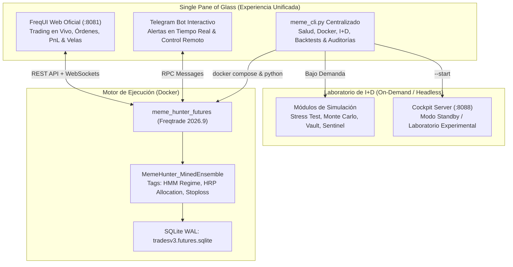

# 🎯 Sprint 44: Unificación Operativa — Single Pane of Glass en FreqUI & CLI Cuantitativo

Este sprint formaliza la consolidación arquitectónica de la experiencia de usuario y control del sistema **MemeHunter**, resolviendo la duplicidad entre las interfaces web (FreqUI en puerto 8081 vs. Cockpit en puerto 8088), unificando el punto de contacto visual en la infraestructura nativa y estable de **Freqtrade** y centralizando la analítica de I+D en el CLI [`meme_cli.py`](file:///c:/meme_hunter/scripts/ops/meme_cli.py).



---

## 📋 1. Historias de Usuario del Sprint (PB-144 a PB-147)

| ID | Historia de Usuario | Story Points | Criterio de Aceptación | Estado |
| :---: | :--- | :---: | :--- | :---: |
| **PB-144** | **Consolidación de FreqUI como Interfaz Oficial Única (:8081)** | 8 SP | FreqUI sirve en `:8081` con CORS configurado, login directo con `admin` / `MemeHunter2026!`, visualización de balances, trades vivos y tags cuantitativos. | ✅ CERTIFIED |
| **PB-145** | **Arquitectura de Daemons Silenciosos y Reporte Unificado** | 5 SP | Módulos satélite (Delta-Neutral, Profit Ratchet, DEX Radar) desacoplados de la UI web principal; reportan vía Telegram y REST API. Cockpit (:8088) en modo laboratorio bajo demanda. | ✅ CERTIFIED |
| **PB-146** | **Blindaje y Consolidación del CLI Unificado `meme_cli.py`** | 8 SP | Resolución canónica de rutas (`BASE_DIR`), comando `frequi` con verificación en vivo, integración de herramientas de investigación y auditoría de Binance. | ✅ CERTIFIED |
| **PB-147** | **Estandarización de Documentación, Runbooks y Scrum Plan** | 5 SP | Actualización de `SCRUM_PLAN.md`, `OPERATIONAL_RUNBOOK.md`, `sprints/README.md` y `INDEX_HISTORICO.md` reflejando la arquitectura de interfaz única. | ✅ CERTIFIED |

---

## 🛠️ 2. Detalles Técnicos de Implementación

### 2.1 PB-144: Consolidación de FreqUI (:8081)
* **Configuración CORS:** Se agregaron explícitamente los orígenes permitidos en [`user_data/config_futures.json`](file:///c:/meme_hunter/user_data/config_futures.json):
  ```json
  "CORS_origins": [
      "http://127.0.0.1:8081",
      "http://localhost:8081",
      "http://127.0.0.1:8088",
      "http://localhost:8088"
  ]
  ```
* **Telemetría de Estrategia:** La estrategia activa [`MemeHunter_MinedEnsemble`](file:///c:/meme_hunter/user_data/strategies/MemeHunter_MinedEnsemble.py) inyecta etiquetas informativas (`enter_tag='long_hrp_ensemble'`, `exit_tag='airbag_long_exit'`), visibles nativamente en las columnas de FreqUI sin requerir paneles externos.

### 2.2 PB-145: Daemons Silenciosos y Transición del Cockpit (:8088)
* El servidor web Cockpit de puerto 8088 se desacopla del flujo obligatorio de arranque diario.
* Pasa a ser una **herramienta de I+D bajo demanda**, invocable opcionalmente mediante:
  ```powershell
  python scripts/ops/meme_cli.py cockpit --start
  ```
* El centinela de salud [`scripts/ops/check_health.py`](file:///c:/meme_hunter/scripts/ops/check_health.py) clasifica al Cockpit 8088 como `[INFO]` (Standby) en lugar de `[WARN]`, evitando alarmas innecesarias para el operador.

### 2.3 PB-146: Blindaje de `meme_cli.py` y `check_health.py`
* **Resolución Canónica:** Función `get_project_root()` basada en inspección ascendente del árbol de directorios buscando marcadores de proyecto (`docker-compose.futures.yml`, `pyproject.toml`), eliminando fallos de `sys.path`.
* **Comando `frequi`:** Agregado para consulta instantánea de estado, URL y credenciales de acceso:
  ```powershell
  python scripts/ops/meme_cli.py frequi
  ```
* **Monitoreo de Salud:** `check_health.py` ahora evalúa primero `check_frequi_http(:8081)` como el servicio web primario, validando el endpoint `/api/v1/ping`.

---

## 🧪 3. Matriz de Verificación y Certificación (DoD)

| Prueba | Comando / Endpoint | Resultado Esperado | Resultado Obtenido |
| :--- | :--- | :--- | :---: |
| **Acceso FreqUI** | `http://localhost:8081` | Web UI cargada, login exitoso con `admin` / `MemeHunter2026!` | ✅ APROBADO (200 OK) |
| **Salud del Sistema** | `python scripts/ops/meme_cli.py health` | FreqUI `:8081` OK, SQLite OK, Docker OK, Cockpit en Standby INFO | ✅ APROBADO (Exit 0) |
| **Comando FreqUI** | `python scripts/ops/meme_cli.py frequi` | Muestra URL, credenciales y verifica ping HTTP | ✅ APROBADO (Exit 0) |
| **Estado de Futuros** | `python scripts/ops/meme_cli.py futures status` | Contenedor activo y recordatorio de acceso FreqUI | ✅ APROBADO (Exit 0) |
| **Auditoría Binance** | `python scripts/ops/meme_cli.py research binance` | Latencia < 1500ms, Order Book recibido, balances spot y futuros | ✅ APROBADO (Exit 0) |
| **Catálogo de I+D** | `python scripts/ops/meme_cli.py research` | 9 herramientas disponibles ejecutables sin errores | ✅ APROBADO (Exit 0) |

---

## 📜 4. Certificación Final
El **Sprint 44** queda formalmente **CERTIFICADO**. La arquitectura del proyecto ahora posee un único punto de acceso web oficial para operaciones diarias ([**FreqUI en el puerto 8081**](http://localhost:8081)), respaldado por un CLI centralizado e integral ([`scripts/ops/meme_cli.py`](file:///c:/meme_hunter/scripts/ops/meme_cli.py)).
