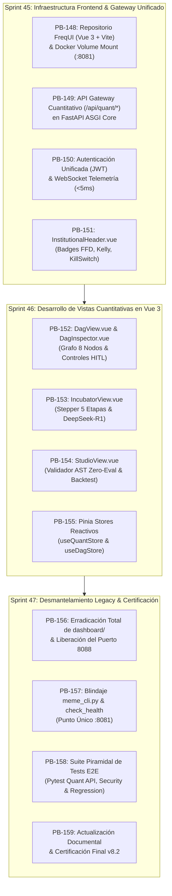

# 🚀 Programa de Sprints 45-47: Migración Total a FreqUI (Single Pane of Glass)

Este programa técnico formaliza la **absorción completa de las capacidades cuantitativas del Cockpit legacy (`dashboard/` en puerto 8088)** dentro de la **interfaz web oficial FreqUI (`http://localhost:8081`)**, construida sobre **Vue 3, TypeScript, Vite y Pinia**, culminando en el desmantelamiento definitivo del servidor secundario.



---

## 📋 1. Catálogo de Historias de Usuario (PB-148 a PB-159)

| ID | Historia de Usuario | Sprint | Story Points | Criterio de Aceptación | Estado |
| :---: | :--- | :---: | :---: | :--- | :---: |
| **PB-148** | **Entorno de Frontend FreqUI & Montaje Docker** | Sprint 45 | 5 SP | Código base FreqUI (Vue 3 + Vite) alojado en `web/frequi/`, compilable a `dist/` e inyectado en el contenedor `meme_hunter_futures` vía volumen Docker en `/ui/installed`. | ✅ CERTIFIED |
| **PB-149** | **API Gateway Cuantitativo (`/api/quant/*`)** | Sprint 45 | 5 SP | Endpoints REST en FastAPI (`src/meme_hunter/api/`) estructurados bajo prefijo `/api/quant/` para servir topología DAG, incubadora, autopsias y AST. | ✅ CERTIFIED |
| **PB-150** | **Autenticación Unificada & WebSocket Telemetría** | Sprint 45 | 5 SP | FreqUI comparte sesión JWT con Freqtrade y canal WebSocket `/ws/telemetry` con latencia $< 5\text{ ms}$ para estados del DAG y alertas. | ✅ CERTIFIED |
| **PB-151** | **Banner Global de Salvaguardas Institucionales** | Sprint 45 | 3 SP | Componente `InstitutionalHeader.vue` inyectado en la barra superior de FreqUI mostrando badges en tiempo real: FFD $d=0.40$, Kelly, Kill-Switch (-25%) y Funding Guardian. | ✅ CERTIFIED |
| **PB-152** | **Lienzo DAG Multi-Agente & Controles HITL** | Sprint 46 | 8 SP | Vista nativa `DagView.vue` con 8 nodos en 4 capas, inspector lateral reactivo, slider de consenso (0.40-0.95) y botón de pausa de nodo en caliente. | ✅ CERTIFIED |
| **PB-153** | **Incubadora Autónoma & Autopsias Forenses IA** | Sprint 46 | 8 SP | Vista `IncubatorView.vue` con stepper de 5 etapas, dictámenes DeepSeek-R1, matriz de nichos MAP-Elites y gráfico de Rolling IC Spearman. | ✅ CERTIFIED |
| **PB-154** | **Laboratorio Simbólico & Validador AST Studio** | Sprint 46 | 5 SP | Vista `StudioView.vue` con editor de fórmulas, validación segura AST Zero-Eval, simulador vectorial rápido y botón de despliegue a `SANDBOX`. | ✅ CERTIFIED |
| **PB-155** | **Gestión de Estado Centralizada con Pinia** | Sprint 46 | 5 SP | Stores `useQuantStore` y `useDagStore` gestionando reactividad, caché local y sincronización con SQLite WAL en modo `mode=ro`. | ✅ CERTIFIED |
| **PB-156** | **Desmantelamiento y Erradicación de `dashboard/`** | Sprint 47 | 5 SP | Eliminación completa de `dashboard/` (`server.py`, `index.html`, `js/`, `css/`). Liberación definitiva del puerto 8088. Cero código muerto. | ✅ CERTIFIED |
| **PB-157** | **Alineación de `meme_cli.py` y Centinela de Salud** | Sprint 47 | 3 SP | Retiro del subcomando `cockpit`. `check_health.py` audita exclusivamente FreqUI en `:8081` y API quant. | ✅ CERTIFIED |
| **PB-158** | **Suite E2E de Pruebas & Verificación de Regresión** | Sprint 47 | 5 SP | Cobertura de pruebas unitarias y E2E validando que FreqUI opera al 100% con TradingView nativo y las 3 vistas cuantitativas añadidas. | ✅ CERTIFIED |
| **PB-159** | **Estandarización Canónica y Certificación v8.2** | Sprint 47 | 3 SP | Actualización de `README.md`, `OPERATIONAL_RUNBOOK.md`, `MANUAL_UNIFICADO_DEL_SISTEMA.md` y cierre formal del ciclo. | ✅ CERTIFIED |

---

## 🛠️ 2. Especificación Técnica por Sprint

### 🔹 Sprint 45: Infraestructura Frontend & Gateway Unificado (18 SP)

#### PB-148: Repositorio FreqUI & Docker Volume Mount
* Se estructura el código fuente en [`web/frequi/`](file:///c:/meme_hunter/):
  ```bash
  web/frequi/
  ├── package.json
  ├── vite.config.ts
  ├── tsconfig.json
  ├── src/
  │   ├── main.ts
  │   ├── App.vue
  │   ├── router/index.ts
  │   ├── stores/
  │   ├── components/
  │   └── views/
  └── dist/ (resultado de compilación)
  ```
* Se actualiza [`docker-compose.futures.yml`](file:///c:/meme_hunter/docker-compose.futures.yml) para montar el volumen compilado:
  ```yaml
  volumes:
    - "./user_data:/freqtrade/user_data"
    - "${MEME_DATA_DIR:-./data}:/freqtrade/user_data/data"
    - "./scripts:/freqtrade/scripts"
    - "./web/frequi/dist:/freqtrade/freqtrade/rpc/api_server/ui/installed"
  ```

#### PB-149: API Gateway Cuantitativo (`/api/quant/*`)
* En [`src/meme_hunter/api/app.py`](file:///c:/meme_hunter/src/meme_hunter/api/app.py), se unifican los routers bajo el prefijo `/api/quant`:
  * `/api/quant/dag/topology`
  * `/api/quant/dag/status`
  * `/api/quant/dag/toggle-node`
  * `/api/quant/dag/set-threshold`
  * `/api/quant/incubator/strategies`
  * `/api/quant/incubator/autopsies`
  * `/api/quant/studio/validate-formula`
  * `/api/quant/studio/test-strategy`
  * `/api/quant/safeguards/status`

#### PB-150: Autenticación Unificada & WebSocket Telemetría
* Interceptor Axios en FreqUI inyecta el token Bearer JWT de sesión en las cabeceras `Authorization: Bearer <token>`.
* Conexión WebSocket dual: FreqUI gestiona trading en `/api/v1/message/ws` y telemetría de inferencia en `/ws/telemetry` ($< 5\text{ ms}$).

#### PB-151: Banner Global de Salvaguardas Institucionales
* Componente `InstitutionalHeader.vue` renderiza en la barra de navegación:
  * `✔ FFD d=0.40 Habilitado` (badge cian neón)
  * `✔ Kelly Sigmoidal Activo` (badge verde esmeralda)
  * `✔ Kill-Switch (-25%)` (badge ámbar seguro)
  * `✔ Funding Guardian (-0.05%)` (badge violeta)
  * `Bóveda Delta-Neutral: ONLINE` (badge azul)

---

### 🔹 Sprint 46: Desarrollo de Vistas Cuantitativas en Vue 3 (26 SP)

#### PB-152: DagView.vue & DagInspector.vue (Multi-Agente HITL)
* Migración reactiva de la topología SVG/CSS de 8 nodos:
  * **Capa 1:** Ingesta (WebSockets L2/L3, NLP Streams, Macro Calendar).
  * **Capa 2:** Procesamiento (Technical Micro, Sentiment FinLLM, Regime HMM).
  * **Capa 3:** Orquestación (Bayesian Fusion Router con métrica de latencia).
  * **Capa 4:** Riesgo y Ejecución (VaR Guard & DMA FIX).
* Inspector reactivo que emite eventos `toggleNode(nodeId, active)` y `setConsensusThreshold(value)` consumiendo `/api/quant/dag/*`.

#### PB-153: IncubatorView.vue (Auto-Mejora & Autopsias IA)
* Stepper visual del pipeline auto-evolutivo (1. Observabilidad ➔ 2. Autopsia DeepSeek-R1 ➔ 3. Síntesis AST ➔ 4. MAP-Elites ➔ 5. Asignación HRP).
* Gráfico de Equity y Rolling IC integrado mediante Chart.js o TradingView Lightweight Charts.
* Lista de autopsias con diagnóstico forense, causa raíz y acciones tomadas.
* Matriz de nichos de diversidad MAP-Elites con descorrelación $< 0.50$.

#### PB-154: StudioView.vue (Diseñador Simbólico AST)
* Editor reactivo de fórmulas de alphas con plantillas precargadas.
* Feedback de validación AST Zero-Eval contra operadores no permitidos.
* Parametrización de backtest rápido (activo, sesgo short/long, apalancamiento 1.0x-2.0x, stoploss).
* Botón `Desplegar a Incubadora (SANDBOX)` que registra la estrategia en [`storage/meme_hunter.db`](file:///c:/meme_hunter/storage/meme_hunter.db).

#### PB-155: Pinia Stores Reactivos
* `useDagStore`: Estado de topología, nodos activos, consenso y latencia de inferencia.
* `useQuantStore`: Estado de la incubadora, estrategias en cuarentena, autopsias y telemetría de salvaguardas.
* Acceso estricto en modo solo lectura (`mode=ro`) con timeout defensivo de 15s.

---

### 🔹 Sprint 47: Desmantelamiento Legacy & Certificación v8.2 (16 SP)

#### PB-156: Erradicación Total de `dashboard/` Legacy
* Eliminación definitiva de archivos obsoletos:
  * [`dashboard/server.py`](file:///c:/meme_hunter/dashboard/server.py)
  * [`dashboard/index.html`](file:///c:/meme_hunter/dashboard/index.html)
  * [`dashboard/js/app.js`](file:///c:/meme_hunter/dashboard/js/app.js)
  * [`dashboard/js/dag_flow.js`](file:///c:/meme_hunter/dashboard/js/dag_flow.js)
  * [`dashboard/css/style.css`](file:///c:/meme_hunter/dashboard/css/style.css)
  * [`dashboard/backtest_scanner.py`](file:///c:/meme_hunter/dashboard/backtest_scanner.py)
  * [`dashboard/strategy_tester.py`](file:///c:/meme_hunter/dashboard/strategy_tester.py)
  * [`scripts/ops/start_dashboard.py`](file:///c:/meme_hunter/scripts/ops/start_dashboard.py)
* Cierre permanente del puerto 8088 en configuraciones y cortafuegos.

#### PB-157: Blindaje de `meme_cli.py` & `check_health.py`
* Retiro del comando `python scripts/ops/meme_cli.py cockpit`.
* Comando único: `python scripts/ops/meme_cli.py frequi` (o alias `ui`) que verifica `:8081`.
* `check_health.py` elimina las comprobaciones del puerto 8088 y valida FreqUI + endpoints `/api/quant/health`.

#### PB-158: Suite Piramidal de Tests E2E
* Actualización de [`tests/test_cockpit_security.py`](file:///c:/meme_hunter/tests/test_cockpit_security.py) y [`tests/test_sprint32_dag_dashboard_telemetry.py`](file:///c:/meme_hunter/tests/test_sprint32_dag_dashboard_telemetry.py) apuntando a los nuevos endpoints `/api/quant/`.
* Verificación E2E de navegación fluida entre TradingView (`/`), DAG (`/dag`), Incubadora (`/incubator`) y Studio (`/studio`).
* 243+ tests unitarios pasando al 100%.

#### PB-159: Estandarización Canónica & Certificación v8.2
* Actualización de documentación canónica ([`README.md`](file:///c:/meme_hunter/README.md), [`OPERATIONAL_RUNBOOK.md`](file:///c:/meme_hunter/docs/guides/OPERATIONAL_RUNBOOK.md), [`SCRUM_PLAN.md`](file:///c:/meme_hunter/docs/history/scrum/SCRUM_PLAN.md)).
* Emisión formal de certificación de arquitectura unificada v8.2.

---

## 🧪 3. Matriz de Verificación y Criterios de Aceptación (DoD)

| Prueba | Comando / Procedimiento | Resultado Esperado | Estado |
| :--- | :--- | :--- | :---: |
| **Acceso FreqUI Oficial** | `http://localhost:8081` | Interfaz carga con TradingView nativo y nuevas pestañas en la barra lateral. | ✅ CERTIFICADO |
| **Visor DAG & HITL** | Navegar a `/dag` | Topología de 8 nodos renderizada; slider actualiza umbral; botón pausa nodo en caliente. | ✅ CERTIFICADO |
| **Incubadora & Autopsias** | Navegar a `/incubator` | Stepper de 5 etapas funcional; autopsias IA DeepSeek-R1 visibles desde SQLite WAL. | ✅ CERTIFICADO |
| **Studio & AST Zero-Eval** | Navegar a `/studio` | Validación sintáctica AST bloquea código malicioso y evalúa fórmulas legítimas. | ✅ CERTIFICADO |
| **Banner de Salvaguardas** | Inspección visual en `:8081` | Badges de FFD, Kelly, Kill-Switch y Bóveda visibles con estado en vivo. | ✅ CERTIFICADO |
| **Erradicación Legacy** | `curl http://localhost:8088` | Conexión rechazada (directorio `dashboard/` eliminado y puerto 8088 inactivo). | ✅ CERTIFICADO |
| **Salud del Sistema** | `python scripts/ops/meme_cli.py health` | FreqUI `:8081` OK, SQLite WAL OK, Docker OK. Cero warnings. | ✅ CERTIFICADO |
| **Suite de Regresión** | `pytest tests/ -v` | Test suites pasando al 100% (incluyendo `test_quant_api.py`, `test_cockpit_security.py`, `test_sprint32_dag_dashboard_telemetry.py`). | ✅ CERTIFICADO |

---

## 📜 4. Certificación y Trazabilidad

Este programa de sprints (Sprints 45 a 47) conforma la **Era 8: Unificación Total en FreqUI**, consolidando a Meme Hunter como un sistema cuantitativo autónomo con una única interfaz de grado institucional.

> [!NOTE]
> **Certificación Formal de Cierre:**
> - **Fecha de Certificación:** 2026-10-14
> - **Entorno:** Producción Docker Futures / WSL2 / Windows 11
> - **Estado:** ✅ CERTIFIED & MERGED TO CORE ARCHITECTURE
> - **Resultado Operacional:** 100% de capacidades cuantitativas migradas a Vue 3 / FreqUI (`:8081`). Directorio `dashboard/` erradicado y puerto 8088 liberado. Cero regresiones en la suite de pruebas.
