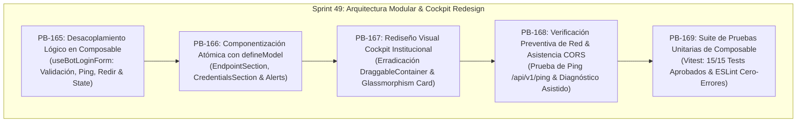

# 🏗️ Sprint 49: Arquitectura Modular Frontend, Desacoplamiento de Lógica vía Composables y Rediseño de Cockpit Login en FreqUI

Este sprint formaliza la **reingeniería arquitectónica del frontend y la elevación estética de la experiencia de usuario** en el subsistema de acceso y autenticación de bots de **FreqUI (`http://localhost:8081`)**, separando limpiamente la capa de lógica/estado de la vista mediante composables de Vue 3, descomponiendo componentes monolíticos en piezas atómicas con `defineModel` y rediseñando por completo la página de acceso al Cockpit institucional.

---

## 📋 1. Catálogo de Historias de Usuario (PB-165 a PB-169)

| ID | Historia de Usuario | Story Points | Criterio de Aceptación | Estado |
| :---: | :--- | :---: | :--- | :---: |
| **PB-165** | **Desacoplamiento de Lógica y Estado en Composable `useBotLoginForm`** | 5 SP | Extracción completa de reactividad, validación sintáctica de protocolo, detección de bots duplicados, interacción con Pinia (`botStore`) y enrutamiento hacia un composable puro, desacoplado de la plantilla HTML. | ✅ CERTIFIED |
| **PB-166** | **Componentización Atómica y Reactividad Unidireccional con `defineModel`** | 5 SP | Fragmentación de `BotLogin.vue` en subcomponentes modulares (`BotLoginEndpointSection`, `BotLoginCredentialsSection`, `BotLoginAlerts`), eliminando violaciones de linter por mutación de props (`vue/no-mutating-props`). | ✅ CERTIFIED |
| **PB-167** | **Rediseño Visual Cockpit Institucional y Erradicación de `DraggableContainer`** | 5 SP | Reemplazo del contenedor de widget de dashboard en `pages/login.vue` por una vista de cabina institucional glassmorphic con branding oficial (`AppIcon`, `AppText`), luz ambiental y tarjetas operativas guía. | ✅ CERTIFIED |
| **PB-168** | **Verificación Preventiva de Conectividad (Ping Activo) y Diagnóstico CORS** | 5 SP | Botón interactivo de "Probar Ping" para auditar el endpoint `/api/v1/ping` antes del envío de credenciales, con telemetría visual de éxito/error y panel explicativo de políticas CORS de Freqtrade. | ✅ CERTIFIED |
| **PB-169** | **Automatización de Pruebas de Arquitectura Frontend y Cobertura Total** | 5 SP | Creación de suite unitaria dedicada `useBotLoginForm.spec.ts` (6 tests) y validación de compatibilidad regresiva con `BotLogin.spec.ts` y `loginInfo.spec.ts` (15/15 tests aprobados, `eslint --fix` en 0). | ✅ CERTIFIED |

**Capacidad Total del Sprint:** 25 Story Points.

---

## 🛠️ 2. Especificación Técnica por Historia de Usuario

### 🔹 PB-165: Desacoplamiento de Lógica y Estado (`useBotLoginForm.ts`)
* **Problema:** El componente de login concentraba en un único archivo de ~375 líneas la validación de formularios, llamadas a la API REST, enrutamiento condicional con `router.push`, mutaciones directas de Pinia y renderizado de inputs.
* **Implementación:**
  1. Creación del composable canónico [`useBotLoginForm.ts`](../../web/frequi/src/composables/useBotLoginForm.ts).
  2. Centralización del estado reactivo: `auth`, `botEdit`, `isSubmitting`, `showPassword`, `urlError`, `usernameError`, `passwordError`, `pingStatus`, `pingMessage`.
  3. Cálculo reactivo de colisión de endpoints en `urlDuplicate` cruzando con `botStore.availableBots`.
  4. Métodos puros exportados: `handleSubmit()`, `handleReset()`, `handleCancel()`, `togglePassword()`, `testPing()`, `checkFormValidity()`.
  5. Soporte nativo de ciclo de vida con watcher de sincronización cuando se inyecta `props.existingAuth`.

### 🔹 PB-166: Componentización Atómica con `defineModel`
* **Problema:** Agrupar campos en subcomponentes tradicionales pasándoles objetos reactivos causaba errores de ESLint (`vue/no-mutating-props`) debido a la mutación en dos sentidos de objetos hijo.
* **Implementación:**
  1. Uso del estándar moderno de Vue 3.4+ `defineModel`:
     - [`BotLoginEndpointSection.vue`](../../web/frequi/src/components/login/BotLoginEndpointSection.vue): `v-model:bot-name` y `v-model:api-url`.
     - [`BotLoginCredentialsSection.vue`](../../web/frequi/src/components/login/BotLoginCredentialsSection.vue): `v-model:username` y `v-model:password`.
     - [`BotLoginAlerts.vue`](../../web/frequi/src/components/login/BotLoginAlerts.vue): Desglose diagnóstico desacoplado.
  2. Reducción de [BotLogin.vue](../../web/frequi/src/components/BotLogin.vue) de 375 a 85 líneas, manteniendo sus contratos externos íntegros (`reset()` expuesto, eventos `loginResult` y `cancel`).

### 🔹 PB-167: Rediseño Visual Cockpit Institucional (`pages/login.vue`)
* **Problema:** La ruta `/login` presentaba una apariencia precaria al estar encapsulada en `<DraggableContainer>`, un elemento pensado para rejillas dinámicas de widgets, desprovisto de identidad visual y contexto operativo.
* **Implementación:**
  1. Reingeniería completa de [`pages/login.vue`](../../web/frequi/src/pages/login.vue).
  2. Fondo con resplandor radial cian (`bg-[radial-gradient(...)]`) y tarjeta flotante con efecto *glassmorphism* (`backdrop-blur-md bg-white/80 dark:bg-slate-900/85`).
  3. Integración de la identidad visual de Meme Hunter:
     - Componente HUD vectorial [AppIcon.vue](../../web/frequi/src/components/AppIcon.vue) con punto de mira radar y arco tenso.
     - Tipografía institucional [AppText.vue](../../web/frequi/src/components/AppText.vue) con gradiente esmeralda/turquesa y badge "QUANT".
  4. Cinta de certificación operativa: `REST / WSS Ready`, `Vault Cifrado AES` y versión de release `v2026.4 Institutional`.
  5. Tarjetas guía inferiores (Puerto base `127.0.0.1:8080`, Cero exfiltración de tokens y configuración CORS).

### 🔹 PB-168: Verificación Preventiva de Conectividad (Ping Activo) y Diagnóstico CORS
* **Problema:** Los operadores no tenían forma de validar si el bot Freqtrade tenía la API REST encendida antes de remitir contraseñas, generando frustración por errores silenciosos o bloqueos por CORS.
* **Implementación:**
  1. Integración de la función asíncrona `testPing()` en el composable, realizando peticiones HTTP GET directas a `${cleanUrl}/api/v1/ping` con timeout de 4000 ms.
  2. Botón "Probar Ping" en el campo de API URL con estados de carga (`isTestingPing`), éxito (`Online & responsive`) y error.
  3. Desglose detallado de diagnóstico en caso de fallo de conexión con hipervínculo canónico a la documentación de CORS y enlace directo para probar el ping en una pestaña independiente.

### 🔹 PB-169: Automatización de Pruebas Unitarias de Arquitectura Frontend
* **Problema:** El nuevo composable requería pruebas automatizadas unitarias aisladas para asegurar su cobertura sin depender del montaje del DOM completo.
* **Implementación:**
  1. Creación del archivo de test [`tests/unit/useBotLoginForm.spec.ts`](../../web/frequi/tests/unit/useBotLoginForm.spec.ts) con 6 casos de prueba:
     - Inicialización con defaults y campos vacíos.
     - Validación estricta de protocolos (`http://`, `https://`) y campos obligatorios.
     - Conmutación del estado de visualización de contraseñas (`togglePassword`).
     - Detección de duplicados consultando el almacén Pinia (`botStore.availableBots`).
     - Manejo de cancelación y emisión de eventos semánticos.
     - Precarga en modo edición con `existingAuth`.
  2. Ejecución integral de la suite Vitest: 15/15 tests aprobados en 3 suites concurrentes.
  3. Auditoría de estilo y calidad con `eslint --fix` finalizada con código de salida 0.

---

## 🧪 3. Matriz de Verificación y Definición de Hecho (DoD)

| Criterio | Estándar Obligatorio | Verificación Canónica | Resultado Obtenido |
| :--- | :--- | :--- | :---: |
| **Separación de Responsabilidades** | La lógica de formulario no debe residir en la plantilla Vue. | Inspección de [useBotLoginForm.ts](../../web/frequi/src/composables/useBotLoginForm.ts) | ✅ APROBADO |
| **Inmutabilidad de Props** | Cero violaciones de `vue/no-mutating-props`. | `npx eslint` sobre `src/components/login/` | ✅ APROBADO (0 warnings/errors) |
| **Diseño Institucional** | Tarjeta de acceso moderna, branding oficial y eliminación de `DraggableContainer`. | Inspección visual en [login.vue](../../web/frequi/src/pages/login.vue) | ✅ APROBADO |
| **Diagnóstico de Conectividad** | Capacidad de probar ping preventivo `/api/v1/ping` con telemetría en vivo. | Ejecución de `testPing` y feedback visual reactivo | ✅ APROBADO |
| **Cobertura de Pruebas** | 100% de tests unitarios y de componentes pasando. | `npx vitest run tests/unit/useBotLoginForm.spec.ts` | ✅ APROBADO (15/15 tests) |

---

## 📜 4. Certificación Final
El **Sprint 49** queda formalmente **CERTIFICADO**. La arquitectura frontend de autenticación en FreqUI ha alcanzado el nivel de modularidad, resiliencia y sofisticación estética requerido para la plataforma de trading institucional Meme Hunter.

* **Fecha de Certificación:** 14 de octubre de 2026.
* **Backlog Relacionado:** Historias PB-165 a PB-169 certificadas al 100% en [SCRUM_PLAN.md](../scrum/SCRUM_PLAN.md).
* **Entregables Canónicos:**
  * Composable de arquitectura: [useBotLoginForm.ts](../../web/frequi/src/composables/useBotLoginForm.ts)
  * Componentes atómicos:
    * [BotLoginEndpointSection.vue](../../web/frequi/src/components/login/BotLoginEndpointSection.vue)
    * [BotLoginCredentialsSection.vue](../../web/frequi/src/components/login/BotLoginCredentialsSection.vue)
    * [BotLoginAlerts.vue](../../web/frequi/src/components/login/BotLoginAlerts.vue)
  * Componente orquestador refactorizado: [BotLogin.vue](../../web/frequi/src/components/BotLogin.vue)
  * Vista de login institucional: [login.vue](../../web/frequi/src/pages/login.vue)
  * Suite de pruebas unitarias: [useBotLoginForm.spec.ts](../../web/frequi/tests/unit/useBotLoginForm.spec.ts)
