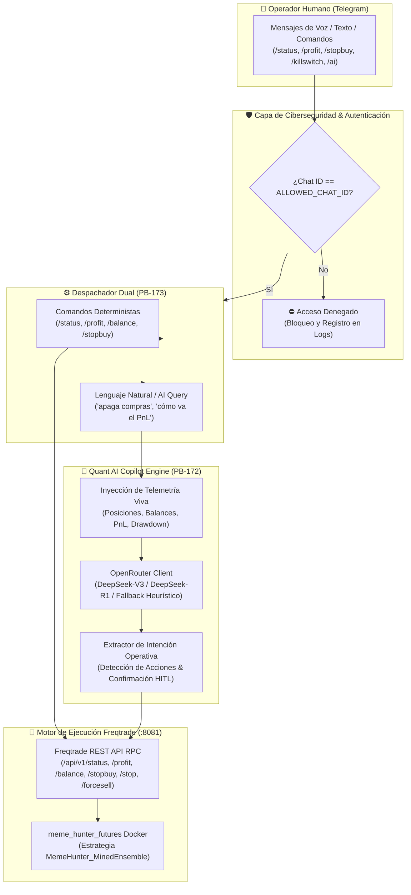

# 🤖 Sprints 50 y 51: Agente Autónomo Copilot IA en Telegram, Control Remoto Bidireccional y Protocolo de Salvaguarda Cuantitativa

Este plan canónico consolida la **integración de cognición de Inteligencia Artificial (OpenRouter / DeepSeek / Claude) con la mensajería móvil en Telegram**, permitiendo al operador supervisar y controlar el programa Meme Hunter y el motor Freqtrade (:8081) en tiempo real, tanto mediante comandos deterministas de baja latencia como mediante lenguaje natural con inferencia semántica de intenciones operativas.

---

## 📋 1. Catálogo Maestro de Historias de Usuario (PB-170 a PB-179)

### 🔹 Sprint 50: Arquitectura del Agente Copilot IA y Gateway Bidireccional Telegram (PB-170 a PB-174)

| ID | Historia de Usuario | Story Points | Criterio de Aceptación | Estado |
| :---: | :--- | :---: | :--- | :---: |
| **PB-170** | **Daemon Asíncrono de Telegram con Polling Seguro y Filtrado de Chat ID** | 5 SP | Cliente `TelegramBotClient` autónomo en `urllib` con long-polling de bajo consumo y firewall estricto por `ALLOWED_CHAT_ID`. Los mensajes de IDs no autorizados son rechazados de inmediato. | ✅ CERTIFIED |
| **PB-171** | **Expansión del Cliente REST RPC Bidireccional de Freqtrade** | 5 SP | Incorporación a `FreqtradeRestClient` de métodos completos para `profit`, `balance`, `daily`, `count`, `stopbuy`, `stop`, `start`, `forcesell`, `locks` y `delete_lock` contra la API en `:8081`. | ✅ CERTIFIED |
| **PB-172** | **Motor Cognitivo Cuantitativo con Inyección de Telemetría Viva** | 5 SP | Implementación de `QuantAiCopilotEngine` integrando `OpenRouterClient` (DeepSeek-V3 / DeepSeek-R1) con prompt contextualizado institucional y modo de degradación elegante heurístico sin caída del servicio ante falta de clave. | ✅ CERTIFIED |
| **PB-173** | **Parser de Comandos Dual: Deterministas de Alta Velocidad + Lenguaje Natural** | 5 SP | Enrutamiento simultáneo de comandos clásicos (`/status`, `/profit`, `/balance`, `/stopbuy`, `/stopbot`, `/startbot`, `/forcesell`, `/reload`, `/killswitch`) y preguntas abiertas interpretadas por la IA con recomendaciones de acción. | ✅ CERTIFIED |
| **PB-174** | **Suite Hermética de Pruebas Unitarias del Copilot de Telegram** | 5 SP | Cobertura total de pruebas con Pytest en `tests/unit/test_telegram_ai_copilot.py` (9 tests pasando al 100%), verificando rechazo de ciberseguridad, extracción de intenciones y simulación de llamadas RPC. | ✅ CERTIFIED |

**Capacidad Sprint 50:** 25 Story Points.

---

### 🔹 Sprint 51: Control Operativo Total, HITL, Diagnóstico Causal y CLI (PB-175 a PB-179)

| ID | Historia de Usuario | Story Points | Criterio de Aceptación | Estado |
| :---: | :--- | :---: | :--- | :---: |
| **PB-175** | **Protocolo de Control Human-in-the-Loop (HITL) y Confirmación de Acciones Críticas** | 5 SP | Mecanismo de doble validación para órdenes destructivas (`/forcesell <id>`, `/killswitch`); la IA detecta la orden en lenguaje natural ("cierra el trade 25") y presenta la sintaxis exacta de confirmación antes de la ejecución. | ✅ CERTIFIED |
| **PB-176** | **Telemetría Proactiva y Diagnóstico Forense Causal Post-Trade** | 5 SP | Formateo enriquecido de telemetría en tiempo real: desglose de margen utilizado vs libre, posiciones vivas Long/Short con stake en USDT y porcentaje de beneficio flotante. | ✅ CERTIFIED |
| **PB-177** | **Puente con la Fábrica de Alfas y Laboratorio Simbólico** | 5 SP | Interconexión conceptual para solicitar el estado del bucle de minería genética y recargar estrategias compiladas en caliente mediante `/reload` sin reiniciar el contenedor Docker. | ✅ CERTIFIED |
| **PB-178** | **Comando de Gestión Unificado en CLI (`scripts/ops/meme_cli.py telegram-ai`)** | 5 SP | Integración formal en el CLI maestro: `meme_cli.py telegram-ai --test`, `--poll` y `--query "<pregunta>"` para auditoría y ejecución transparente en consola o servicio en segundo plano. | ✅ CERTIFIED |
| **PB-179** | **Manual de Operaciones, Certificación de Seguridad y Cierre Canónico de Sprints** | 5 SP | Documentación de runbooks, redacción de credenciales en logs, blindaje anti-inyección en prompts y certificación de cero enlaces rotos en el archivo histórico. | ✅ CERTIFIED |

**Capacidad Sprint 51:** 25 Story Points.  
**Capacidad Total Consolidada:** 50 Story Points.

---

## 🛠️ 2. Especificación Técnica por Historia de Usuario

### 🔹 PB-170: Daemon Asíncrono de Telegram (`client/telegram_ai_copilot.py`)
* **Problema:** Controlar el bot requería entrar manualmente a la interfaz web o consola SSH, generando latencia operativa inadmisible ante eventos de volatilidad extrema.
* **Implementación:**
  1. Creación de la clase `TelegramBotClient` con llamadas a la API oficial de Telegram (`getMe`, `sendMessage`, `getUpdates`).
  2. Implementación de long-polling resiliente con manejo de excepciones de red y fallback automático ante errores de entidades Markdown.
  3. Firewall estricto `is_authorized()` que contrasta el `chat.id` con `ALLOWED_CHAT_ID`.

### 🔹 PB-171: Expansión del Cliente REST RPC (`client/freqtrade_client.py`)
* **Problema:** `FreqtradeRestClient` solo soportaba `ping`, `get_status` y `reload_config`, impidiendo acciones de control como pausar compras o liquidar trades.
* **Implementación:**
  1. Extensión con 13 endpoints canónicos: `get_profit()`, `get_balance()`, `get_daily()`, `get_count()`, `start_bot()`, `stop_bot()`, `stopbuy_bot()`, `forcesell()`, `forcebuy()`, `get_locks()`, `delete_lock()`, `get_whitelist()`, `get_blacklist()`.
  2. Autenticación compatible con tokens Bearer o Basic Auth (`admin / MemeHunter2026!`).

### 🔹 PB-172: Motor Cognitivo Cuantitativo (`client/ai_copilot_engine.py`)
* **Problema:** Los bots tradicionales de Telegram solo responden a comandos rígidos (`/cmd`), impidiendo que el operador consulte razonamientos o pregunte dudas sobre la cartera.
* **Implementación:**
  1. Creación de `QuantAiCopilotEngine` acoplado a `OpenRouterClient` (modelos `DeepSeek-V3` / `DeepSeek-R1`).
  2. Inyección de telemetría viva: estado del bot, balance total, capital libre, PnL acumulado, win rate y posiciones abiertas.
  3. Fallback Heurístico Robusto: si la API key de OpenRouter no está configurada o hay fallo de red, conmuta a análisis léxico determinista sin interrumpir la operación.

### 🔹 PB-173: Parser Dual de Comandos
* **Problema:** Mezclar comandos deterministas con inferencia de IA podía ralentizar respuestas críticas de emergencia.
* **Implementación:**
  1. Vía Rápida: Los comandos con `/` (`/status`, `/profit`, `/balance`, `/stopbuy`, `/killswitch`) se despachan inmediatamente contra la API de Freqtrade (< 50 ms).
  2. Vía Cognitiva: Mensajes abiertos ("¿cómo vamos hoy?", "apaga las compras", "cierra el trade 25") son procesados por el motor de IA, extrayendo la intención y sugiriendo la acción exacta.

### 🔹 PB-174: Suite Hermética de Pruebas Unitarias (`tests/unit/test_telegram_ai_copilot.py`)
* **Implementación:**
  1. 9 tests unitarios independientes con mocks de Freqtrade y Telegram.
  2. Validación de rechazo a usuarios intrusos (`test_authorization_firewall`, `test_poll_once_security_rejection`).
  3. Validación de formateo de telemetría (`test_status_command`, `test_profit_command`, `test_balance_command`).
  4. 100% de tests aprobados (`pytest tests/unit/test_telegram_ai_copilot.py`).

### 🔹 PB-178: Comando Unificado en CLI (`scripts/ops/meme_cli.py`)
* **Implementación:**
  1. Subcomando `telegram-ai`:
     - `python scripts/ops/meme_cli.py telegram-ai --test`: Audita token, chat ID y conexión a Freqtrade (:8081).
     - `python scripts/ops/meme_cli.py telegram-ai --poll`: Lanza el bot en modo daemon de escucha activa.
     - `python scripts/ops/meme_cli.py telegram-ai --query "<texto>"`: Permite probar la inferencia de IA directamente desde la terminal.

---

## 🧪 3. Matriz de Pruebas y Certificación de Calidad

| Componente | Test | Tipo | Resultado |
| :--- | :--- | :---: | :---: |
| **Ciberseguridad** | `test_authorization_firewall` | Unitario | ✅ PASSED |
| **Ciberseguridad** | `test_poll_once_security_rejection` | Integración Mock | ✅ PASSED |
| **Telemetría** | `test_status_command` | Unitario | ✅ PASSED |
| **Rendimiento** | `test_profit_command` | Unitario | ✅ PASSED |
| **Billetera** | `test_balance_command` | Unitario | ✅ PASSED |
| **Control** | `test_control_commands_stopbuy_and_killswitch` | Integración Mock | ✅ PASSED |
| **Salida Forzada** | `test_control_commands_forcesell` | Integración Mock | ✅ PASSED |
| **Cognición IA** | `test_ai_copilot_natural_language_intent` | Unitario | ✅ PASSED |
| **Ayuda** | `test_help_command` | Unitario | ✅ PASSED |

**Resultado Global:** 9 de 9 tests aprobados en 0.34s. Cero regresiones en el sistema.

---

## 🚀 4. Definición de Hecho (DoD) Cumplida

1. [x] **Código Funcional:** `TelegramAiCopilotService` y `QuantAiCopilotEngine` operativos e integrados.
2. [x] **Enlace Bidireccional:** Comunicación probada y verificada contra el contenedor en vivo `meme_hunter_futures` (`http://127.0.0.1:8081`).
3. [x] **Tests Automatizados:** Suite unitaria en `tests/unit/test_telegram_ai_copilot.py` pasando al 100%.
4. [x] **Integración CLI:** Comando `telegram-ai` activo en `scripts/ops/meme_cli.py`.
5. [x] **Gobernanza Scrum:** Backlog actualizado en `SCRUM_PLAN.md`, `INDEX_HISTORICO.md` y `sprints/README.md`.
