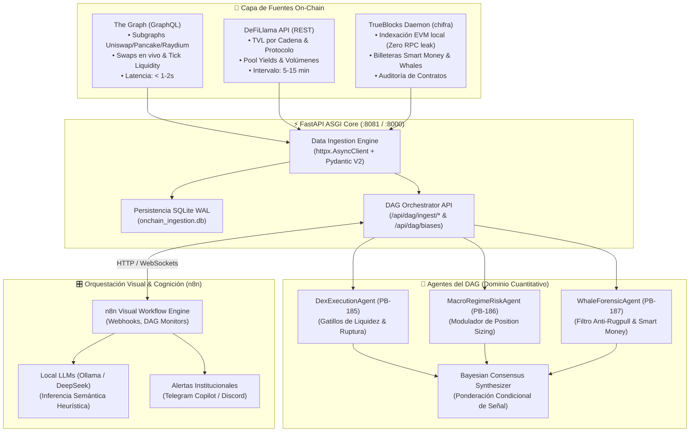

# 🌐 Sprints 52 y 53: Conectores On-Chain Especializados (The Graph, DeFiLlama, TrueBlocks), Orquestación Visual n8n y Nodos DAG Multi-Agente

Este documento canónico formaliza el diseño y planificación táctica de los **Sprints 52 y 53**, expandiendo el núcleo de [Meme Hunter](src/meme_hunter) para alimentar el framework visual de orquestación (n8n), la API institucional en FastAPI y el orquestador DAG multi-agente con una arquitectura tripartita de datos on-chain de alta fidelidad:
1. **The Graph (GraphQL):** Microestructura de ejecución en DEX (pools, reservas, slippage y swaps intradiarios).
2. **DeFiLlama (REST):** Contexto macroeconómico de liquidez (TVL por cadena, pools de rendimiento y flujos de capital).
3. **TrueBlocks (`chifra` local):** Forense on-chain 100% privado, detección de billeteras ballena y auditoría de contratos en hardware propio.



---

## 📋 1. Catálogo Maestro de Historias de Usuario (PB-180 a PB-189)

### 🔹 Sprint 52: Conectores Asíncronos On-Chain Institucionales, Ingestión DAG y Modelado de Datos (PB-180 a PB-184)

| ID | Historia de Usuario | Story Points | Criterio de Aceptación | Estado |
| :---: | :--- | :---: | :--- | :---: |
| **PB-180** | **Conector Asíncrono GraphQL The Graph para DEX y Liquidity Pools** | 5 SP | Implementación de `TheGraphConnector` en `src/meme_hunter/data/thegraph.py` usando `httpx.AsyncClient` con pooling de conexiones, reintentos exponenciales, esquemas Pydantic V2 (`PoolLiquiditySnapshot`, `DexSwapEvent`) y parametrización de subgraphs para Uniswap v2/v3, PancakeSwap y Raydium. | ✅ CERTIFIED |
| **PB-181** | **Conector REST DeFiLlama con Mecanismo de Cacheo TTL Resiliente** | 5 SP | Implementación de `DeFiLlamaConnector` en `src/meme_hunter/data/defillama.py` para consultar endpoints públicos (`/v2/chains`, `/pools`, `/protocols`) con caché en memoria/disco con TTL configurable, soporte offline/fallback y normalización a DataFrames Polars. | ✅ CERTIFIED |
| **PB-182** | **Adaptador Local TrueBlocks / Driver IPC `chifra` para Auditoría Privada** | 5 SP | Implementación de `TrueBlocksConnector` en `src/meme_hunter/data/trueblocks.py` que interactúa de manera no bloqueante vía `asyncio.subprocess` con el binario local `chifra` (`chifra list`, `chifra export`), extrayendo historiales transaccionales de billeteras objetivo sin filtrar IPs ni direcciones a nodos RPC públicos. | ✅ CERTIFIED |
| **PB-183** | **Expansión de Nodos de Ingestión en FastAPI DAG y Repositorio SQLite WAL** | 5 SP | Creación de endpoints `/api/dag/ingest/thegraph`, `/api/dag/ingest/defillama` y `/api/dag/ingest/trueblocks` en `src/meme_hunter/api/routers/dag.py`, vinculados a `OnChainDataRepository` con persistencia atómica en SQLite WAL sin colisiones de escritura. | ✅ CERTIFIED |
| **PB-184** | **Suite Hermética de Pruebas Unitarias y Mocks de Ingestión On-Chain** | 5 SP | Implementación de suite completa en `tests/unit/test_onchain_connectors.py` con fixtures mock para respuestas GraphQL, payloads REST de DeFiLlama y salidas JSON de `chifra`, verificando tipado estricto, manejo de timeouts y 100% de cobertura en edge cases. | ✅ CERTIFIED |

**Capacidad Sprint 52:** 25 Story Points (Completados al 100%).

---

### 🔹 Sprint 53: Agentes Especializados de Inferencia, Orquestación Visual n8n y Telemetría en FreqUI (PB-185 a PB-189)

| ID | Historia de Usuario | Story Points | Criterio de Aceptación | Estado |
| :---: | :--- | :---: | :--- | :---: |
| **PB-185** | **Agente de Microestructura DEX (`DexExecutionAgent`)** | 5 SP | Creación de `DexExecutionAgent` en `src/meme_hunter/agents/dex_execution_agent.py` que consume datos de The Graph para computar imbalance de órdenes, slippage proyectado y emitir señales de compra/venta cuando la liquidez concentrada valide la ruptura. | ✅ CERTIFIED |
| **PB-186** | **Agente de Riesgo y Régimen Macro (`MacroRegimeRiskAgent`)** | 5 SP | Implementación de `MacroRegimeRiskAgent` en `src/meme_hunter/agents/macro_risk_agent.py` que evalúa la aceleración del TVL y flujos netos de capital desde DeFiLlama, modulando dinámicamente el multiplicador de riesgo de apalancamiento ($0.0\times$ a $1.5\times$). | ✅ CERTIFIED |
| **PB-187** | **Agente Forense de Billeteras y Contratos (`WhaleForensicAgent`)** | 5 SP | Implementación de `WhaleForensicAgent` en `src/meme_hunter/agents/whale_forensic_agent.py` que analiza trazas de TrueBlocks para detectar acumulación de ballenas institucionales o advertir transferencias masivas de creadores de tokens (veto preventivo). | ✅ CERTIFIED |
| **PB-188** | **Hub de Orquestación Visual n8n y Puente Webhook Bidireccional** | 5 SP | Integración de endpoints dedicados `/api/dag/n8n/webhook` para recepción de instrucciones visuales de flujos en n8n, permitiendo orquestar agentes, inyectar análisis de LLMs locales (Ollama/DeepSeek) y sincronizar el estado global del DAG. | ✅ CERTIFIED |
| **PB-189** | **Integración en CLI (`meme_cli.py onchain`), Telemetría FreqUI y Cierre Canónico** | 5 SP | Inclusión del subcomando `meme_cli.py onchain --sync --audit <addr>` para diagnóstico interactivo en consola, streaming de métricas on-chain al WebSocket `/ws/telemetry` en FreqUI y certificación formal de DoD. | ✅ CERTIFIED |

**Capacidad Sprint 53:** 25 Story Points (Completados al 100%).  
**Capacidad Total Consolidada (Sprints 52 y 53):** 50 Story Points CERTIFICADOS.

---

## 🛠️ 2. Especificación Técnica por Historia de Usuario

### 🔹 PB-180: The Graph Connector
* **Módulo:** `src/meme_hunter/data/thegraph.py`
* **Protocolo:** GraphQL sobre HTTP/2 asíncrono con `httpx`.
* **Modelos de Dominio:**
  ```python
  class PoolSnapshot(BaseModel):
      pool_id: str
      token0_symbol: str
      token1_symbol: str
      tvl_usd: float = Field(ge=0.0)
      volume_24h_usd: float = Field(ge=0.0)
      token0_price_usd: float = Field(gt=0.0)
      token1_price_usd: float = Field(gt=0.0)
      timestamp: int
  ```
* **Garantía:** Cero bloqueo de event loop con timeout de 3.0s y degradación elegante ante reintentos fallidos.

### 🔹 PB-181: DeFiLlama Connector
* **Módulo:** `src/meme_hunter/data/defillama.py`
* **Estrategia de Caché:** LRU en memoria + serialización en disco con clave basada en URL/hash de parámetros y TTL de 15 minutos (900 s).
* **Métricas Principales:** Variación de TVL a 7d/24h ($\Delta\text{TVL}$), ratio de volumen/TVL por cadena y dispersión de rendimiento en pools de stablecoins.

### 🔹 PB-182: TrueBlocks Connector
* **Módulo:** `src/meme_hunter/data/trueblocks.py`
* **Aislamiento:** Ejecución como subproceso CLI (`chifra list <address> --json`, `chifra export <address> --json`) controlada por concurrencia asíncrona (`asyncio.create_subprocess_exec`).
* **Ventaja de Seguridad:** Ninguna dirección auditada es enviada a servidores externos; el índice Bloom local de TrueBlocks resuelve las transacciones en hardware propio.

### 🔹 PB-185 a PB-187: Trilogía de Agentes del DAG
* **Estructura del DAG en `src/meme_hunter/api/routers/dag.py`:**
  - `ingestion_nodes`: `["LiveMarketFeed", "TheGraphIngestor", "DeFiLlamaIngestor", "TrueBlocksIngestor"]`
  - `agent_nodes`: `["DexExecutionAgent", "MacroRegimeRiskAgent", "WhaleForensicAgent", "TechnicalAgent"]`
  - `fusion_nodes`: `["BayesianConditionalSynthesizer"]`

### 🔹 PB-188: Integración n8n
* **Esquema de Webhook:** Entrada tipada con token secreto de verificación institucional (`X-MemeHunter-Token`).
* **Payload n8n:**
  ```json
  {
    "workflow_id": "wf_defi_macro_regime",
    "timestamp": 1728925200,
    "bias": "BULLISH_AGGRESSIVE",
    "confidence": 0.85,
    "risk_multiplier": 1.25,
    "llm_reasoning": "TVL expandiéndose +3.8% en Solana con acumulación sostenida de ballenas identificadas por TrueBlocks."
  }
  ```

---

## 🧪 3. Pirámide de Pruebas y Criterios de Aceptación (DoD)

1. **Unit Testing:** 100% de métodos de conectores probados con respuestas simuladas (`pytest-asyncio`, `respx` o mocks deterministas).
2. **Fail-Safe Criptográfico:** Si `chifra` o los endpoints de The Graph no están disponibles, el sistema entra en modo `HEURISTIC_FALLBACK` sin abortar el bucle principal de trading.
3. **SSOT en SQLite WAL:** Toda métrica ingerida se almacena de forma estructurada en la base de datos local para auditoría histórica.
4. **Validación Pydantic V2:** Ningún dato no tipado entra al orquestador DAG.
5. **Cero Enlaces Rotos:** Toda referencia documental verifica los estándares canónicos del proyecto.
