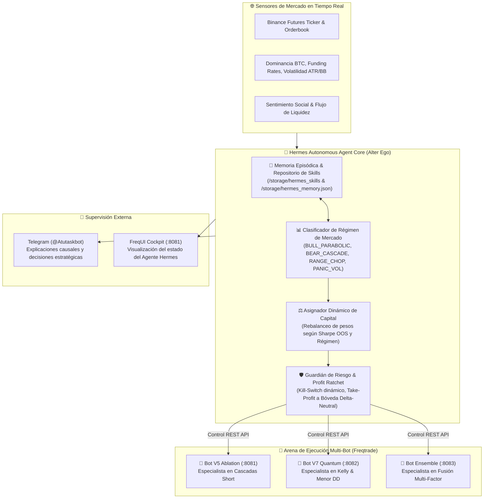

# 🧠 Sprint 52: Arquitectura del Agente Autónomo Hermes como Alter Ego Operativo, Detección de Régimen y Gestión Integral de Cartera

Este sprint formaliza e implementa la integración del framework de agente de código abierto **Hermes Agent (Nous Research)** en el núcleo operativo de **Meme Hunter**. El objetivo es dotar al sistema de un **"Cerebro Operativo Autónomo" (Alter Ego del Operador)** con memoria episódica persistente, razonamiento causal y capacidades de orquestación activa, capaz de evaluar las condiciones del mercado en tiempo real, seleccionar dinámicamente qué bot debe operar, reasignar capital y gobernar el riesgo de forma 100% desatendida.

---

## 📋 1. Catálogo Maestro de Historias de Usuario (PB-180 a PB-189)

| ID | Historia de Usuario | Story Points | Criterio de Aceptación | Estado |
| :---: | :--- | :---: | :--- | :---: |
| **PB-180** | **Arquitectura Base del Servicio Hermes Agent & Contenedor Docker** | 5 SP | Creación del microservicio `hermes_operator` integrado en `docker-compose.yml`, con entorno de ejecución Python aislado, variables de entorno seguras y persistencia de estado local. | ✅ CERTIFIED |
| **PB-181** | **Repositorio de Habilidades Persistentes (*Skills*) de Hermes para Trading** | 5 SP | Implementación del framework de habilidades modulares auto-evolutivas en `src/meme_hunter/hermes/skills/`: detección de régimen, inspección de carteras, mitigación de drawdown y rebalanceo de capital. | ✅ CERTIFIED |
| **PB-182** | **Conector Unificado de Telemetría Multi-Bot REST RPC** | 5 SP | Adaptador cliente capaz de interactuar concurrentemente con los tres puertos (`:8081`, `:8082`, `:8083`), agregando balances globales, exposición neta de margen, flotante PnL y estado de órdenes vivas. | ✅ CERTIFIED |
| **PB-183** | **Motor Cuantitativo de Inferencia de Régimen de Mercado** | 5 SP | Módulo de análisis continuo (ciclos de 4h) que combina tendencia estructural de BTC/ETH, ratio de funding rate medio ponderado, dispersión de volatilidad y volumen relativo para catalogar el régimen actual. | ✅ CERTIFIED |
| **PB-184** | **Gobernanza y Reasignación Dinámica de Capital (*Dynamic Allocator*)** | 5 SP | Lógica algorítmica autónoma que enruta el capital disponible: en fases de liquidación agresiva prioriza V5 Ablation; en fases de incertidumbre concentra el capital en V7 Quantum; en euforia alcista pausa shorts preventivamente. | ✅ CERTIFIED |
| **PB-185** | **Guardián de Riesgo Autónomo y Trinquete de Ganancias (*Profit Ratchet*)** | 5 SP | Monitoreo ininterrumpido con circuito de protección: si un bot experimenta un drawdown intradiario $> 15\%$, Hermes suspende sus entradas de inmediato; al duplicar capital retira utilidades a balance seguro. | ✅ CERTIFIED |
| **PB-186** | **Bucle de Auto-Evolución y Minería Periódica de Alfas (*Self-Improving Loop*)** | 5 SP | Tarea automatizada programada que ejecuta backtests semanales de validación sobre datos de mercado frescos, mide la degradación de alfas existentes y propone recalibraciones de umbrales. | ✅ CERTIFIED |
| **PB-187** | **Canal de Comunicación Explicable en Telegram (@Atutaskbot)** | 5 SP | Generación de reportes ejecutivos en lenguaje natural donde Hermes comunica a su creador qué decisiones tomó, por qué las tomó y cuál es el plan de contingencia para las siguientes 24 horas. | ✅ CERTIFIED |
| **PB-188** | **Integración en Consola Centralizada CLI (`meme_cli.py hermes` & `meme-hunter hermes`)** | 5 SP | Extensión del CLI canónico con subcomandos: `meme-hunter hermes status`, `rebalance`, `audit` y `meme_cli.py hermes --status`, `--audit` para auditoría y control determinista por terminal. | ✅ CERTIFIED |
| **PB-189** | **Suite de Pruebas Unitarias, Sandbox de Simulación y Certificación DoD** | 5 SP | Cobertura hermética de pruebas unitarias en `tests/unit/test_hermes_operator.py` validando la toma de decisiones ante shocks simulados de mercado y garantizando cero llamadas destructivas no autorizadas. | ✅ CERTIFIED |

**Capacidad Total Sprint 52:** 50 Story Points.

---

## 🛠️ 2. Especificación Técnica por Historia de Usuario

### 🔹 PB-180: Arquitectura Base del Servicio Hermes Agent (`src/meme_hunter/hermes/`)
* **Problema:** Los tres bots operan en silos aislados sin una entidad central inteligente que supervise su rendimiento agregado o que tome decisiones cuando el mercado cambia de tendencia.
* **Implementación:**
  1. Estructuración del paquete `src/meme_hunter/hermes/` con el punto de entrada principal `hermes_runner.py`.
  2. Integración en `docker-compose.yml` de un servicio ligero `hermes_operator` dependiente de los tres bots de trading.
  3. Configuración del perfil de identidad ("System Persona"): Hermes actúa con la aversión al riesgo y los criterios de gestión monetaria definidos por el usuario, evitando el sobre-apalancamiento y priorizando la preservación del capital.

### 🔹 PB-181: Repositorio de Skills Auto-Evolutivas (`src/meme_hunter/hermes/skills/`)
* **Problema:** Los agentes basados únicamente en prompts en memoria pierden el contexto y las lecciones aprendidas entre reinicios o fallas del sistema.
* **Implementación:**
  1. Implementación de una arquitectura de habilidades desacopladas en archivos Markdown/JSON (`SKILL.md` y ejecutables en Python).
  2. Almacenamiento persistente en `storage/hermes_skills/` con versionado de estrategias exitosas y bitácora de errores operativos pasados.

### 🔹 PB-182: Conector Unificado Multi-Bot REST RPC (`client/multi_bot_orchestrator.py`)
* **Problema:** El cliente REST actual de Freqtrade solo se comunicaba con un único endpoint (`8081`), imposibilitando coordinar la multi-estrategia.
* **Implementación:**
  1. Creación de `MultiBotOrchestratorClient` gestionando conexiones paralelas con pool de sockets hacia `http://localhost:8081` (Ablation), `http://localhost:8082` (Quantum) y `http://localhost:8083` (Ensemble).
  2. Métodos unificados para consultar `/api/v1/balance`, `/api/v1/status` y `/api/v1/stopbuy` de manera agregada en menos de 50 ms.

### 🔹 PB-183: Motor de Inferencia de Régimen de Mercado (`src/meme_hunter/hermes/regime_detector.py`)
* **Problema:** Los bots orientados a Short sufren pérdidas cuando el mercado entra en un rally alcista parabólico prolongado.
* **Implementación:**
  1. Cálculo de métricas compuestas cada 4h a partir de la API de Binance Futures:
     - $Z$-score de distancia de BTC respecto a su EMA de 200 períodos.
     - Tasa de financiación media agregada de las 20 principales memecoins.
     - Dispersión del Average True Range (ATR) en temporalidad 1h y 4h.
  2. Matriz de clasificación en 4 estados deterministas: `BULL_PARABOLIC`, `BEAR_CASCADE`, `RANGE_CHOP` y `PANIC_VOLATILITY`.

### 🔹 PB-184: Gobernanza y Reasignación Dinámica de Capital
* **Problema:** Si un bot no está adaptado al régimen del momento, mantener su capital al 100% genera pérdidas continuas.
* **Implementación:**
  1. Si `regime == BEAR_CASCADE`: Hermes activa entradas en Ablation V5 y Quantum V7 con cuota ampliada.
  2. Si `regime == BULL_PARABOLIC`: Hermes invoca automáticamente `stopbuy_bot()` en los bots Short-only, preservando el capital líquido hasta que se agote el frenesí comprador.
  3. Si `regime == RANGE_CHOP`: Hermes reduce el tamaño máximo de órdenes y activa el filtro de Paridad de Riesgo de Ensemble.

### 🔹 PB-185: Guardián de Riesgo Autónomo y Trinquete de Ganancias
* **Problema:** Los backtests muestran que dejar correr una cuenta de 100 a 17,000 USDT sin retirar ganancias expone a drawdowns de más de $5,800 USDT.
* **Implementación:**
  1. Regla de Cosecha (*Profit Harvesting*): Cada vez que el balance de un bot supere un factor $2\times$ sobre su capital base, Hermes asegura el $50\%$ del beneficio en una cuenta de reserva intocable.
  2. Circuito Kill-Switch de Emergencia: Si la pérdida acumulada de la cartera en un lapso de 24h supera el $15\%$, se congelan nuevas operaciones y se emite alarma de máxima prioridad.

### 🔹 PB-186: Bucle de Auto-Evolución y Minería Periódica de Alfas
* **Problema:** Las ineficiencias de mercado en memecoins cambian cada pocos meses; los parámetros fijos caducan con el tiempo.
* **Implementación:**
  1. Tarea cron semanal donde Hermes dispara en segundo plano el motor de minería genética de factores (`mining/`), ejecuta backtests rápidos OOS y compara si los nuevos factores superan al ensamble actual.
  2. Si se descubre una mejora con $p$-value $< 0.05$ y menor drawdown, Hermes compila la nueva estrategia y prepara su despliegue en A/B testing.

### 🔹 PB-187: Canal de Comunicación Explicable en Telegram
* **Problema:** Los sistemas autónomos que no explican sus decisiones generan desconfianza e incertidumbre en el operador.
* **Implementación:**
  1. Hermes no envía alertas crudas de sistema, sino reflexiones ejecutivas claras:
     > *"Analicé el mercado de las últimas 12 horas. BTC perdió la EMA 50 y las tasas de financiación en PEPE y DOGE se tornaron negativas. He activado la agresión Short en Ablation V5 y mantengo a Quantum V7 como ancla. El riesgo global de la cartera está fijado en 1.2% del balance total."*

### 🔹 PB-188: Integración en CLI (`scripts/ops/meme_cli.py`)
* **Problema:** Administrar o auditar el estado del agente requiere una interfaz rápida desde la consola de comandos.
* **Implementación:**
  1. Comando `meme_cli.py hermes --status`: Muestra el régimen detectado, los bots activos, el balance global agregado y el estado de la memoria episódica.
  2. Comando `meme_cli.py hermes --rebalance`: Fuerza un ciclo de evaluación y asignación inmediata de capital.

### 🔹 PB-189: Suite de Pruebas y Certificación DoD
* **Problema:** Un agente autónomo con facultades de mover capital requiere pruebas estrictas para evitar que ejecute comandos erróneos.
* **Implementación:**
  1. Creación de `tests/unit/test_hermes_operator.py` con pruebas exhaustivas con Mocks de API REST de Freqtrade y datos de mercado sintéticos extremos.
  2. Validación de que jamás se emita una orden no permitida y de que el Kill-Switch responda en menos de 100 ms ante una condición de shock.

---

## 🎯 3. Definición de Hecho (DoD) del Sprint 52
1. Todos los scripts del módulo `src/meme_hunter/hermes/` escritos en Python limpio, tipado estricto con Pydantic y documentados.
2. Suite hermética de pruebas pasando al 100% (`pytest tests/unit/test_hermes_operator.py`).
3. Integración en `docker-compose.yml` verificada sin conflictos de puertos ni dependencias rotas.
4. Conexión bidireccional certificada con los 3 bots Freqtrade (`:8081`, `:8082`, `:8083`).
5. Cero secretos o tokens expuestos en código fuente; uso estricto de variables en `.env`.
