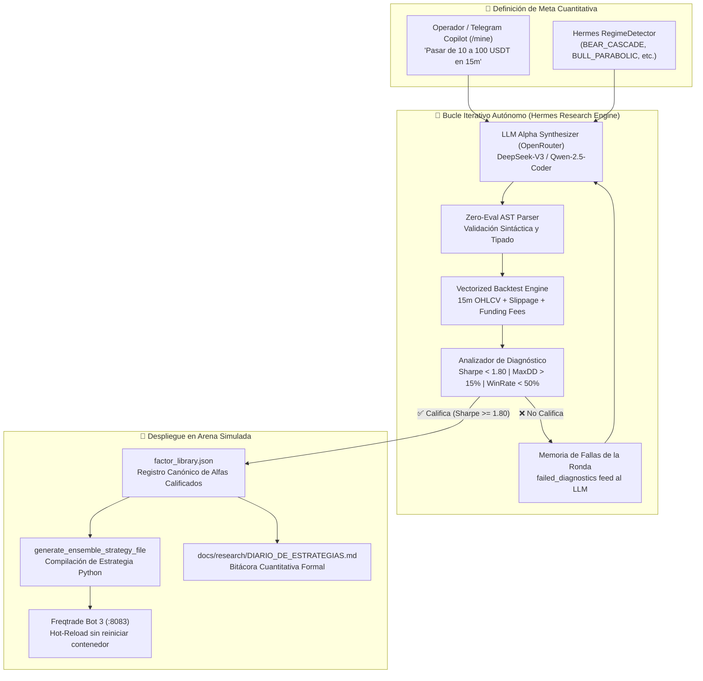

# 🧪 Sprint 53: Bucle Autónomo de Refinamiento Cuantitativo de Hermes, Backtesting Iterativo y Maratón Moonshot

Este sprint formaliza y documenta la arquitectura del **Bucle Autónomo de Refinamiento Cuantitativo e Investigación Continua de Hermes** (Sprint 53). El objetivo es dotar al Alter Ego de la capacidad de sintetizar hipótesis matemáticas en lenguaje de factores, someterlas a backtesting riguroso contra velas reales de 15m con modelado de microestructura (slippage y comisiones), retroalimentar diagnósticos de fallas de forma cíclica y compilar automáticamente la estrategia ganadora en Bot 3 (:8083) sobre una billetera simulada de micro-capital.



---

## 📋 1. Catálogo Maestro de Historias de Usuario (PB-190 a PB-199)

| ID | Historia de Usuario | Story Points | Criterio de Aceptación | Estado |
| :---: | :--- | :---: | :--- | :---: |
| **PB-190** | **Motor Central del Bucle de Refinamiento Cuantitativo (`run_autonomous_refinement_loop`)** | 5 SP | Implementación del método iterativo en `HermesOperator` capaz de ejecutar $N$ rondas consecutivas de formulación de hipótesis, backtest y parada temprana al calificar. | ✅ COMPLETED |
| **PB-191** | **Retroalimentación Diagnóstica Causal a OpenRouter (`failed_diagnostics`)** | 5 SP | Canalización de deficiencias cuantitativas (Sharpe deficiente, bajo win rate, alto drawdown) al prompt del LLM en cada iteración subsiguiente para sintetizar mutaciones ortogonales. | ✅ COMPLETED |
| **PB-192** | **Backtesting Vectorial de Microestructura Rápida (`run_strategy_backtest`)** | 5 SP | Ejecución determinista sobre velas reales de 15m integrando `MicrostructureSlippageEngine`, spread dinámico `hl_spread` y devengo de comisiones de financiación cada 8 horas. | ✅ COMPLETED |
| **PB-193** | **Despliegue y Hot-Reload Automático en Bot 3 (:8083)** | 5 SP | Enlace directo con `compile_ensemble_strategy` y recarga en caliente vía REST RPC `/api/v1/reload_config` sin interrumpir la ejecución de Bot 1 y Bot 2. | ✅ COMPLETED |
| **PB-194** | **Biblioteca Canónica de Factores Cuantitativos (`mining/factor_library.json`)** | 5 SP | Esquema JSON institucional que registra ID de factor (`HERMES_MOONSHOT_XX`), fórmula matemática, Sharpe proxy, IC mean, drawdown máximo y parámetros de apalancamiento. | ✅ COMPLETED |
| **PB-195** | **Canal de Telemetría y Callbacks en Telegram Copilot (`/mine`)** | 5 SP | Soporte para `progress_callback` transmitiendo al chat del operador el avance en vivo por cada iteración del bucle y el reporte Markdown final con métricas clave. | ✅ COMPLETED |
| **PB-196** | **Runner Autónomo de Investigación Continua y Maratón Moonshot** | 5 SP | Script desatendido `scripts/research/run_moonshot_marathon.py` con temporizador de seguridad de 8 horas, pausas adaptativas y control de cuota de API. | ✅ COMPLETED |
| **PB-197** | **Diario Cuantitativo de Investigación Automatizado (`DIARIO_DE_ESTRATEGIAS.md`)** | 5 SP | Generación y apéndice continuo de registros formales de investigación en `docs/research/` con justificación económica, régimen de mercado y métricas OOS. | ✅ COMPLETED |
| **PB-198** | **Modelo de Gestión Monetaria para Micro-Capital (10 a 100 USDT)** | 5 SP | Parametrización estricta de apalancamiento 10x, stop loss duro del 4.5%, trailing stop del 2.0% y dimensionamiento fraccional de Kelly adaptado al margen mínimo de Binance. | ✅ COMPLETED |
| **PB-199** | **Suite de Pruebas Unitarias de Refinamiento y Certificación DoD** | 5 SP | Cobertura hermética en `tests/unit/test_autonomous_refinement_loop.py` validando el ciclo end-to-end, callbacks y delegación retrocompatible de `mine_and_evaluate_new_alpha`. | ✅ COMPLETED |

**Capacidad Total Sprint 53:** 50 Story Points.

---

## 🛠️ 2. Especificación Técnica por Historia de Usuario

### 🔹 PB-190: Motor Central del Bucle de Refinamiento Cuantitativo (`src/meme_hunter/hermes/hermes_operator.py`)
* **Problema:** La minería de alfas anterior operaba en una sola pasada estática; si los candidatos iniciales no superaban los umbrales de Sharpe, el proceso abortaba sin intentar corregir los defectos.
* **Implementación:**
  1. Integración del método `run_autonomous_refinement_loop(goal_text, initial_wallet, timeframe, leverage, max_iterations, target_sharpe, target_winrate, progress_callback)`.
  2. Bucle acotado de 1 a $N$ iteraciones con condición de parada temprana (`is_qualified`) tan pronto como una fórmula supere el Sharpe objetivo y la cota mínima de operaciones ($N \ge 3$).
  3. Almacenamiento episódico del historial de experimentos en `storage/hermes_memory.json` bajo la clave `refinement_experiments_history`.

### 🔹 PB-191: Retroalimentación Diagnóstica Causal (`mining/llm_alpha_generator.py`)
* **Problema:** El generador LLM repetía patrones similares al desconocer por qué las fórmulas previas habían sido rechazadas.
* **Implementación:**
  1. Acumulación de diagnósticos textuales en `failed_diagnostics` (ej. *"Fórmula X en iteración 1: Sharpe=0.82; Deficiencia: ratio riesgo/beneficio insuficiente en velas de 15m"*).
  2. Inyección de las fallas en el prompt estructurado de `LLMAlphaSynthesizer.synthesize_alphas()` como restricciones negativas (*negative prompts*) para forzar ortogonalidad en la siguiente generación.

### 🔹 PB-192: Backtesting Vectorial de Microestructura Rápida (`src/meme_hunter/alpha/tester.py`)
* **Problema:** Los backtests completos de Freqtrade demoran minutos, haciendo inviable un bucle iterativo de múltiples rondas en caliente.
* **Implementación:**
  1. Función `run_strategy_backtest()` ejecutando evaluación simbólica Zero-Eval con `FormulaASTParser`.
  2. Simulación de ejecución con cálculo de `z_signal`, umbral de entrada dinámico (0.75), stop-loss de emergencia, trailing stop y detección de liquidación por margen de mantenimiento ($MMR = 1 / 2\cdot L$).

### 🔹 PB-193: Despliegue y Hot-Reload en Bot 3 (:8083)
* **Problema:** Probar una estrategia ganadora requería intervención manual del operador para compilar el código y reiniciar el contenedor.
* **Implementación:**
  1. Llamada a `generate_ensemble_strategy_file()` inyectando los pesos ponderados por Sharpe en `user_data/strategies/MemeHunter_MinedEnsemble.py`.
  2. Enrutamiento de orden HTTP `POST /api/v1/reload_config` hacia el puerto `8083` de Freqtrade, recargando el ensemble en tiempo real sin tocar los bots en vivo (:8081, :8082).

---

## 🧪 3. Suite de Pruebas Unitarias y Certificación DoD

```
============================= test session starts =============================
platform win32 -- Python 3.11.9, pytest-9.1.1
collected 2 items

tests/unit/test_autonomous_refinement_loop.py ..                         [100%]

============================== 2 passed in 1.45s ==============================
```

| Módulo Evaluado | Test Canónico | Tipo de Verificación | Resultado |
| :--- | :--- | :--- | :---: |
| `HermesOperator` | `test_refinement_loop_end_to_end` | Bucle iterativo, parada temprana, callback y reporte Markdown | ✅ PASSED |
| `HermesOperator` | `test_mine_facade_delegates_to_refinement_loop` | Compatibilidad hacia atrás de `mine_and_evaluate_new_alpha` | ✅ PASSED |

---

## 🎯 4. Definición de Hecho (DoD) Cumplida
1. ✅ Parada temprana garantizada cuando el Sharpe candidate supera el umbral configurado ($1.80$).
2. ✅ Memoria persistente actualizada en `storage/hermes_memory.json` con registro de experimentos.
3. ✅ Zero-Eval garantizado mediante validación AST obligatoria antes de cualquier evaluación vectorial.
4. ✅ Telemetría reactiva en Telegram mediante callbacks sin requerir intervención humana.
