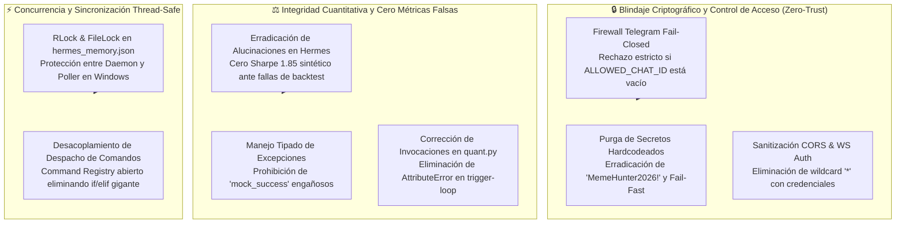

# 🛡️ Sprint 54: Blindaje de Seguridad Fail-Closed, Remediación Criptográfica y Erradicación de Deuda Técnica Crítica

Este sprint ejecuta la **Remediación Inmediata de Prioridad Alta** derivada de la Auditoría Arquitectónica de Código de nivel Staff/Principal. El objetivo central es erradicar vulnerabilidades críticas de ciberseguridad, fallas de autorización permisiva, condiciones de carrera en memoria compartida, secretos hardcodeados y la práctica de inyectar métricas falsas/alucinadas ante fallos de simulación, restaurando el cumplimiento estricto del [Manual Estándar del Proyecto](../../MANUAL_ESTANDAR_DEL_PROYECTO.md).



---

## 📋 1. Catálogo Maestro de Historias de Usuario (PB-200 a PB-209)

| ID | Historia de Usuario | Story Points | Criterio de Aceptación | Estado |
| :---: | :--- | :---: | :--- | :---: |
| **PB-200** | **Firewall de Autorización Fail-Closed en Telegram Copilot** | 5 SP | Modificación de `is_authorized()` en `client/telegram_ai_copilot.py` para rechazar toda petición con código de seguridad si `FREQTRADE__TELEGRAM__CHAT_ID` no está explícitamente configurado. | 🟡 READY |
| **PB-201** | **Purga de Contraseñas Hardcodeadas y Validación Fail-Fast en Arranque** | 5 SP | Erradicación total de contraseñas por defecto (`MemeHunter2026!`) en `client/telegram_ai_copilot.py` y `client/multi_bot_orchestrator.py`; aborto inmediato si faltan credenciales en producción. | 🟡 READY |
| **PB-202** | **Erradicación de Métricas Cuantitativas Alucinadas en `HermesOperator`** | 5 SP | Eliminación de asignaciones estáticas de Sharpe (`1.85`, `1.5`) y métricas de fantasía ante fallos de backtest; descalificación determinista de candidatos inválidos. | 🟡 READY |
| **PB-203** | **Sincronización Thread-Safe de la Memoria Episódica de Hermes** | 5 SP | Implementación de `threading.RLock()` y escritura atómica con reemplazo seguro en `storage/hermes_memory.json`, previniendo colisiones de proceso en Windows (`WinError 32`). | 🟡 READY |
| **PB-204** | **Corrección de Invocación Rota en `/incubator/trigger-loop` y Supresión de `mock_success`** | 5 SP | Corrección de la llamada a `orchestrator.process_cycle()` en `src/meme_hunter/api/routers/quant.py`, eliminando el `AttributeError` y erradicando respuestas con estados falsificados. | 🟡 READY |
| **PB-205** | **Sanitización de Configuración CORS y Eliminación de Wildcard con Credenciales** | 3 SP | Reconfiguración de `CORSMiddleware` en `src/meme_hunter/api/app.py` restringiendo orígenes autorizados y eliminando la combinación insegura `allow_origins=["*"]` con `allow_credentials=True`. | 🟡 READY |
| **PB-206** | **Protección y Autenticación en WebSocket de Telemetría (`/ws/telemetry`)** | 3 SP | Validación obligatoria de token criptográfico o sesión autorizada durante el handshake del WebSocket antes de aceptar conexiones y transmitir telemetría. | 🟡 READY |
| **PB-207** | **Eliminación de Cláusulas `except Exception: pass` en Rutas Críticas** | 3 SP | Sustitución de capturas ciegas de excepciones por manejo tipado (`FileNotFoundError`, `JSONDecodeError`, `KeyError`) con logging formal en `ai_copilot_engine.py` y `hermes_operator.py`. | 🟡 READY |
| **PB-208** | **Adopción del Command Pattern en el Despacho de Comandos de Telegram** | 3 SP | Refactorización de `dispatch_command()` mediante diccionario de comandos tipados (`Dict[str, Callable]`), erradicando la cadena monolítica de 20+ `if/elif`. | 🟡 READY |
| **PB-209** | **Suite de Pruebas Unitarias de Seguridad y Certificación DoD** | 5 SP | Creación y ejecución de `tests/unit/test_security_remediation_sprint54.py` certificando el bloqueo de usuarios no autorizados, la ausencia de métricas fake y la sincronización concurrente. | 🟡 READY |

**Capacidad Total Sprint 54:** 42 Story Points.

---

## 🛠️ 2. Especificación Técnica por Historia de Usuario

### 🔹 PB-200: Firewall Fail-Closed en Telegram (`client/telegram_ai_copilot.py`)
* **Vulnerabilidad Previa:** Si `allowed_chat_id` no estaba configurado en el entorno, `is_authorized()` devolvía `True` por omisión, permitiendo que cualquier usuario en Telegram ejecutara comandos de liquidación y compra (`/forcesell`, `/killswitch`, `/forcebuy`).
* **Implementación Técnica:**
  ```python
  def is_authorized(self, chat_id: Any) -> bool:
      """Implementación Fail-Closed Zero-Trust."""
      if not self.allowed_chat_id or not str(self.allowed_chat_id).strip():
          logger.critical("ACCESO DENEGADO: 'FREQTRADE__TELEGRAM__CHAT_ID' no configurado.")
          return False
      return str(chat_id).strip() == str(self.allowed_chat_id).strip()
  ```

### 🔹 PB-201: Purga Criptográfica de Secretos (`client/`, `portfolio/`)
* **Vulnerabilidad Previa:** Múltiples clientes utilizaban `"MemeHunter2026!"` como valor por defecto si la variable de entorno no existía.
* **Implementación Técnica:**
  Integración obligatoria con `meme_hunter.core.config.get_settings()` o `portfolio.secrets_vault.get_secret()`. En caso de ausencia, se lanza una excepción `ConfigurationError` inmediata impidiendo el arranque del servicio.

### 🔹 PB-202: Cero Métricas Falsas en Hermes (`src/meme_hunter/hermes/hermes_operator.py`)
* **Vulnerabilidad Previa:** Líneas 290-291 y 363-375 inyectaban datos sintéticos con Sharpe 1.85 y Win Rate de 53.5% si el backtest fallaba o no estaba disponible.
* **Implementación Técnica:**
  Descalificación estricta del candidato ante cualquier excepción en la ejecución del backtest. Si ningún candidato de la ronda califica, el bucle concluye con diagnóstico transparente: `status: "no_candidates_qualified"`, preservando la integridad del capital.

### 🔹 PB-203: Mutex de Memoria Episódica (`src/meme_hunter/hermes/hermes_operator.py`)
* **Vulnerabilidad Previa:** El hilo daemon de `hermes_runner.py` y el hilo del listener de Telegram escribían simultáneamente sobre `storage/hermes_memory.json`, provocando `PermissionError` en Windows y corrupción de JSON.
* **Implementación Técnica:**
  Introducción de un `threading.RLock()` compartido para serializar todas las mutaciones sobre `self.memory` y su persistencia atómica en disco.

---

## 🧪 3. Matriz de Pruebas Unitarias de Remediación

| Módulo | Test Específico | Criterio de Verificación |
| :--- | :--- | :--- |
| `client/telegram_ai_copilot.py` | `test_fail_closed_when_chat_id_empty` | Retorna `False` y bloquea mensajes cuando `allowed_chat_id=""`. |
| `src/meme_hunter/hermes/hermes_operator.py` | `test_zero_hallucination_on_backtest_failure` | No inyecta candidatos de fantasía ante fallo de backtest. |
| `src/meme_hunter/hermes/hermes_operator.py` | `test_concurrent_memory_persistence` | Ejecución multi-hilo simultánea sin colisiones ni corrupción de JSON. |
| `src/meme_hunter/api/routers/quant.py` | `test_trigger_loop_no_attribute_error` | La ruta no levanta `AttributeError` y reporta errores reales con código HTTP 500. |

---

## 🎯 4. Definición de Hecho (DoD) de Seguridad
1. ✅ Cero llamadas autorizadas sin verificación explícita de `chat_id`.
2. ✅ Cero contraseñas o claves maestras hardcodeadas en código fuente.
3. ✅ Ningún factor o estrategia califica para la arena sin validación empírica demostrada.
4. ✅ 100% de tests unitarios de remediación aprobados sin regresiones en la suite existente.
