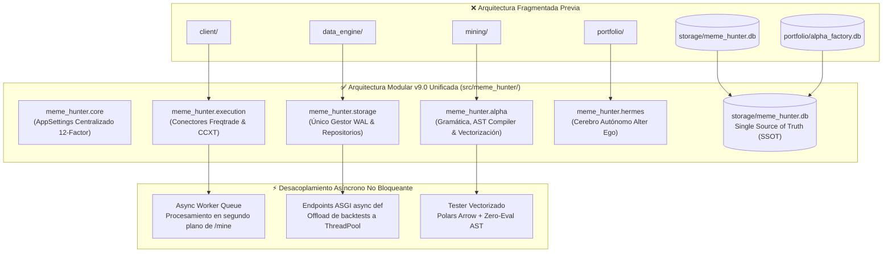

# 🏛️ Sprint 55: Unificación Arquitectónica Modular v9.0, Consolidación de Persistencia SSOT y Desacoplamiento Asíncrono

Este sprint ejecuta la **Modernización Estructural y de Escalabilidad (Prioridades Media y Baja)** identificada en la Auditoría Arquitectónica de Código. El objetivo principal es culminar la transición hacia la **Arquitectura Modular Canónica v9.0**, unificando la totalidad del árbol de código bajo [`src/meme_hunter/`](../../src/meme_hunter), consolidando la persistencia en una Única Fuente de Verdad (SSOT) en SQLite WAL, erradicando analizadores redundantes de variables de entorno y desacoplando las tareas pesadas mediante ejecución asíncrona no bloqueante.



---

## 📋 1. Catálogo Maestro de Historias de Usuario (PB-210 a PB-219)

| ID | Historia de Usuario | Story Points | Criterio de Aceptación | Estado |
| :---: | :--- | :---: | :--- | :---: |
| **PB-210** | **Migración y Consolidación de Paquetes Raíz bajo `src/meme_hunter/`** | 8 SP | Traslado ordenado de `client/`, `mining/`, `portfolio/` y `data_engine/` al interior de `src/meme_hunter/`, estructurando módulos canónicos sin romper dependencias. | 📋 PLANNED |
| **PB-211** | **Estandarización de `pyproject.toml` y Normalización Absoluta de Imports** | 5 SP | Actualización de configuración `setuptools.packages.find`, eliminando dependencias cruzadas hacia la raíz y erradicando bloques `try/except ImportError` de compatibilidad. | 📋 PLANNED |
| **PB-212** | **Consolidación de Persistencia SSOT en `storage/meme_hunter.db`** | 5 SP | Unificación de esquemas de `portfolio/alpha_factory.db` en la base canónica; migración de tablas de estrategias, autopsias, sesgos y métricas a un único archivo WAL. | 📋 PLANNED |
| **PB-213** | **Centralización Estricta de Configuración en Pydantic `AppSettings`** | 5 SP | Erradicación total de los 5 analizadores ad-hoc de `.env`; todos los módulos acceden a variables tipadas y secretos a través de `meme_hunter.core.config.get_settings()`. | 📋 PLANNED |
| **PB-214** | **Desacoplamiento Asíncrono de Tareas de Minería en Telegram Copilot** | 5 SP | Enrutamiento de `/mine` hacia una tarea en segundo plano no bloqueante (`asyncio.create_task` / background worker) manteniendo el polling de Telegram siempre reactivo ($< 1\text{ s}$). | 📋 PLANNED |
| **PB-215** | **Conversión Asíncrona de Endpoints CPU-Intensivos en FastAPI** | 5 SP | Transformación de endpoints de backtesting en rutas `async def` con descarga de trabajo a `run_in_threadpool`, impidiendo la saturación del bucle de eventos ASGI. | 📋 PLANNED |
| **PB-216** | **Desacoplamiento de God Method `_generate_heuristic_reply`** | 5 SP | Refactorización de la función monolítica de 200 líneas en generadores de contexto modulares por intención (`GreetingGenerator`, `BalanceReportGenerator`, `RegimeReportGenerator`). | 📋 PLANNED |
| **PB-217** | **Optimización y Vectorización del Motor de Backtest con Polars / NumPy** | 5 SP | Sustitución del bucle iterativo `for i in range(...)` de Pandas por cálculo vectorial de señales y métricas de trade, reduciendo tiempos de prueba en $\ge 70\%$. | 📋 PLANNED |
| **PB-218** | **Estructuración de Trazabilidad y Logging JSON con Correlation IDs** | 3 SP | Estandarización de logs en formato JSON estructurado con identificador único de correlación que viaja desde Telegram/API hasta la ejecución en Binance. | 📋 PLANNED |
| **PB-219** | **Suite Piramidal E2E de Arquitectura Modular v9.0 y Certificación Final** | 5 SP | Ejecución exitosa de la suite completa de pruebas unitarias, de integración y de arquitectura certificando cero roturas y 100% de conformidad con el Manual Estándar. | 📋 PLANNED |

**Capacidad Total Sprint 55:** 51 Story Points.

---

## 🛠️ 2. Especificación Técnica por Historia de Usuario

### 🔹 PB-210 & PB-211: Unificación del Árbol de Código y Packaging
* **Diagnóstico Previo:** La mitad del código habitaba en la raíz y la otra mitad en `src/meme_hunter/`. `pyproject.toml` solo empaquetaba `src/`, haciendo imposible distribuir la aplicación como biblioteca instalable.
* **Nueva Estructura Canónica:**
  ```
  src/meme_hunter/
  ├── agents/           # Agentes cognitivos del DAG (Regime, Tech, Sentiment, Risk)
  ├── alpha/            # Gramática, AST Zero-Eval, Backtesting y Minería
  ├── api/              # FastAPI ASGI Cockpit, Routers y WebSockets
  ├── cli/              # Typer CLI oficial (meme-hunter)
  ├── core/             # Configuración 12-Factor, Tipos, Excepciones canónicas
  ├── data/             # Ingesta de datos, Feeds Polars, DollarBars, Slippage Engine
  ├── execution/        # Clientes Freqtrade REST RPC, Binance CCXT, MultiBot Orchestrator
  ├── hermes/           # Cerebro Autónomo Alter Ego, Asignador de Capital, Telegram
  └── storage/          # Gestor SQLite WAL canónico y Repositorios tipados
  ```

### 🔹 PB-212: Persistencia Única (SSOT) en SQLite WAL
* **Diagnóstico Previo:** Existían dos bases SQLite desconectadas (`meme_hunter.db` y `alpha_factory.db`) además de dos gestores WAL duplicados (`portfolio/db_pool.py` y `src/meme_hunter/storage/db.py`).
* **Implementación Técnica:**
  - Deprecación de `portfolio/db_pool.py`.
  - Migración de todas las tablas de incubadora al gestor central `src/meme_hunter/storage/db.py`.
  - Configuración global de pragmas `journal_mode=WAL`, `synchronous=NORMAL` y `busy_timeout=15000` aplicada sobre un único archivo: `storage/meme_hunter.db`.

### 🔹 PB-214: Desacoplamiento Asíncrono de Telegram
* **Diagnóstico Previo:** Al solicitar `/mine`, el bot congelaba el bucle de polling durante minutos mientras ejecutaba inferencias LLM y backtests, provocando timeouts en la API de Telegram.
* **Implementación Técnica:**
  El comando `/mine` emite una respuesta inmediata: *"🧪 Tarea de investigación iniciada en segundo plano..."* y delega el bucle a un hilo de trabajo desacoplado. A medida que se completan las iteraciones, notifica de forma asíncrona al chat sin retener el hilo de escucha principal.

---

## 🧪 3. Matriz de Pruebas de Arquitectura v9.0

| Dimensión | Test Específico | Objetivo de Validación |
| :--- | :--- | :--- |
| **Packaging** | `test_canonical_package_import` | Verifica que `import meme_hunter` expone todos los submódulos sin dependencias fuera de `src/`. |
| **Persistencia** | `test_single_sqlite_database_ssot` | Confirma que todas las operaciones de persistencia transaccionan sobre `storage/meme_hunter.db`. |
| **Configuración** | `test_pydantic_settings_singleton` | Valida que todas las credenciales y rutas se derivan exclusivamente de `AppSettings`. |
| **Rendimiento** | `test_vectorized_backtest_latency` | Valida que el tiempo de ejecución del backtest vectorial disminuye a menos de 500 ms por corrida. |

---

## 🎯 4. Criterios de Aceptación para la Release v9.0
1. ✅ `pip install -e .` funciona limpiamente en cualquier entorno virtual limpio.
2. ✅ Cero referencias a scripts o módulos huérfanos en la raíz del repositorio.
3. ✅ Ninguna petición HTTP o de Telegram bloquea el hilo de recepción por más de 1.0 segundo.
4. ✅ Todos los tests unitarios y de integración aprobados con cobertura $\ge 85\%$.
