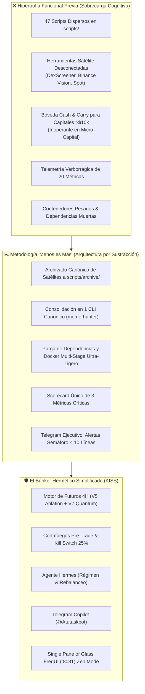

# ✂️ Sprint 56: Poda Radical "Menos es Más" — Arquitectura por Sustracción, Desmantelamiento de Módulos Prescindibles y Blindaje del Búnker

Este sprint aplica de forma rigurosa la filosofía de **"Arquitectura por Sustracción" (*Less is More*)**. Tras 55 sprints de continua expansión técnica, agregación de modelos matemáticos y herramientas de I+D, el sistema ha alcanzado un nivel de hipertrofia funcional que eleva innecesariamente la superficie de ataque, dispersa la atención del operador con más de 40 scripts auxiliares y aumenta la fricción cognitiva.

El objetivo central de este sprint es **podar el ruido accesorio, archivar módulos prescindibles y blindar con máxima elegancia el Búnker de Producción**: un motor de futuros ultra-rápido, gestión de riesgo estricta (Kill Switch), gobernanza ejecutiva con Hermes y control remoto ágil en Telegram.



---

## 📋 1. Catálogo Maestro de Historias de Usuario (PB-220 a PB-229)

| ID | Historia de Usuario | Story Points | Criterio de Aceptación | Estado |
| :---: | :--- | :---: | :--- | :---: |
| **PB-220** | **Archivado Canónico y Desacoplamiento de Módulos Prescindibles** | 5 SP | Traslado ordenado de scripts no esenciales (`delta_neutral_vault.py`, `funding_arbitrage.py`, `dex_viral_radar.py`, `binance_vision.py`, `backtest_spot_capitulation.py`) hacia `scripts/archive/`, eliminándolos de los flujos de producción. | 📋 PLANNED |
| **PB-221** | **Consolidación de Entrypoints Operativos en un CLI Único (`meme-hunter`)** | 5 SP | Erradicación de invocaciones manuales dispersas; todas las operaciones de salud, arena multi-bot, Hermes y backtest se ejecutan exclusivamente vía `meme-hunter [comando]`. | 📋 PLANNED |
| **PB-222** | **Poda de Dependencias Muertas y Optimización de Dockerfile Multi-Stage** | 5 SP | Limpieza de `pyproject.toml` suprimiendo paquetes innecesarios en producción; reducción de la imagen Docker en $\ge 40\%$ y aceleración del arranque en $< 2.0\text{ s}$. | 📋 PLANNED |
| **PB-223** | **Supresión de Shims Legacy, Mocks Huérfanos y Código Muerto** | 3 SP | Eliminación de envoltorios de compatibilidad obsoletos en la raíz y stubs residuales en el dashboard que generan advertencias y deuda técnica. | 📋 PLANNED |
| **PB-224** | **Telegram Copilot Minimalista: Notificaciones Tipo Semáforo de Alta Densidad** | 5 SP | Rediseño de respuestas en Telegram: erradicación de bloques de texto kilométricos; adopción de resúmenes ejecutivos $\le 10$ líneas con estado Semáforo (🟢/🟡/🔴). | 📋 PLANNED |
| **PB-225** | **FreqUI Zen Mode: Interfaz Foco Sin Ruido Visual** | 5 SP | Implementación de conmutador "Modo Zen" en Vue 3 que oculta paneles auxiliares y focaliza la atención en: Equity Curve, Posiciones Vivas, Estado del Kill Switch y Señales Hermes. | 📋 PLANNED |
| **PB-226** | **Logging Basado en Excepciones y Supresión de Telemetría Ruido** | 3 SP | Filtrado de heartbeats rutinarios cada 5 segundos; el sistema solo emite logs estructurados ante eventos de trading significativos o anomalías de riesgo. | 📋 PLANNED |
| **PB-227** | **Blindaje Hermético del Búnker: Reducción de Puertos y Superficie de Red** | 3 SP | Cierre de puertos secundarios innecesarios en `docker-compose.yml`; aislamiento de los contenedores en redes internas con acceso web expuesto únicamente en `:8081`. | 📋 PLANNED |
| **PB-228** | **Scorecard Único de Rendimiento (Consolidación de 25 Métricas a 3 Clave)** | 3 SP | Consolidación del monitoreo en las 3 métricas de la verdad: **Net PnL (USDT)**, **Max Drawdown Real (%)** y **Win Rate Post-Fricciones (%)**, descartando métricas abstractas redundantes. | 📋 PLANNED |
| **PB-229** | **Suite de Pruebas de Regresión y Certificación de Sustracción** | 5 SP | Ejecución de la suite completa de pruebas certificando que la eliminación del código accesorio no rompe el motor de ejecución, la suite de riesgo ni el control por Telegram. | 📋 PLANNED |

**Capacidad Total Sprint 56:** 42 Story Points.

---

## 🛠️ 2. Especificación Técnica por Historia de Usuario

### 🔹 PB-220: Archivado Canónico de Módulos Prescindibles (Tier 8 & 9)
* **Diagnóstico Previo:** Módulos como la Bóveda Delta-Neutral (`delta_neutral_vault.py`), arbitraje de funding spot-futuros (`funding_arbitrage.py`), radar DexScreener (`dex_viral_radar.py`) y descargadores masivos de Binance Vision (`binance_vision.py`) consumen superficie de mantenimiento sin aportar al trading autónomo de futuros en Binance.
* **Acción por Sustracción:**
  - Creación del directorio canónico `scripts/archive/legacy_satellites/`.
  - Mover los scripts prescindibles junto con un manifiesto `README.md` que documente su propósito histórico.
  - Eliminar sus tareas programadas y llamadas en segundo plano.

### 🔹 PB-221: Consolidación de Entrypoints Operativos
* **Diagnóstico Previo:** Coexistencia de comandos en `scripts/meme_cli.py`, `scripts/ops/`, ejecutores directos y CLI `meme-hunter`.
* **Acción por Sustracción:**
  - El CLI instalado (`src/meme_hunter/cli/main.py`) se convierte en la única interfaz de consola autorizada:
    - `meme-hunter health` (diagnóstico instantáneo).
    - `meme-hunter arena [status|start|stop]` (control de bots).
    - `meme-hunter hermes [cycle|regime|rebalance]` (cerebro autónomo).
    - `meme-hunter copilot --poll` (centinela Telegram).
  - Los scripts de conveniencia se reducen a shims de una línea que delegan en Typer CLI.

### 🔹 PB-222: Poda de Dependencias y Optimización Docker
* **Diagnóstico Previo:** El entorno virtual arrastra bibliotecas utilizadas en experimentos pasados (herramientas de visualización complejas, parsers no usados).
* **Acción por Sustracción:**
  - Auditoría con `pip-check` / `deptry` para identificar dependencias huérfanas en `pyproject.toml`.
  - Configuración de compilación multi-stage en Docker: la etapa final contendrá únicamente el runtime de Python, Freqtrade y las dependencias estrictas de producción.
  - Meta de optimización: Reducción del tamaño de imagen en $\ge 40\%$ y aceleración del arranque en frío.

### 🔹 PB-224: Telegram Copilot Minimalista (Semáforo Ejecutivo)
* **Diagnóstico Previo:** Comandos como `/status` o respuestas de IA devuelven bloques de más de 40 líneas con tablas y detalles técnicos difíciles de leer en dispositivos móviles en situaciones de emergencia.
* **Acción por Sustracción:**
  - Implementación del formato **Semáforo Ejecutivo**:
    ```text
    🟢 ESTADO: SALUDABLE | RÉGIMEN: BEAR (85%)
    💰 Balance: 104.20 USDT | Flotante: +2.15 USDT
    🎯 Posiciones (2): DOGE Short (+4.1%), PEPE Short (+1.2%)
    🛡️ Kill Switch: ACTIVO (0.0% DD / Umbral 25%)
    ⚡ Acción Hermes: Mantener Shorts.
    ```
  - Parámetro `--verbose` opcional únicamente si el operador solicita desglose exhaustivo.

### 🔹 PB-225: FreqUI Zen Mode (Single Pane of Glass Minimalista)
* **Diagnóstico Previo:** La interfaz en `:8081` acumula pestañas y tablas de backtest que dispersan la concentración durante la operativa en vivo.
* **Acción por Sustracción:**
  - Creación del selector de vista: **`Zen View` vs `Dev Studio`**.
  - En `Zen View`, se ocultan paneles de minería, logs internos y métricas secundarias, presentando un cuadro de mandos ultra-limpio con tipografía legible y alto contraste (WCAG 2.2).

### 🔹 PB-228: Scorecard Único de Rendimiento
* **Diagnóstico Previo:** Inflación de métricas (Sharpe, Sortino, Calmar, Omega, DSR, PSR, Information Coefficient, Information Ratio, Kurtosis, Skewness) que generan parálisis por análisis.
* **Acción por Sustracción:**
  - Unificación en la Regla de las 3 Métricas Críticas:
    1. **PnL Neto Real (USDT):** Ganancia/pérdida neta acumulada post-fricciones.
    2. **Max Drawdown Flotante (%):** Distancia al Kill Switch del 25%.
    3. **Win Rate Post-Comisiones (%):** Proporción de trades ganadores reales.

---

## 🧪 3. Matriz de Pruebas de Certificación de la Poda

| Dimensión | Test Específico | Objetivo de Validación |
| :--- | :--- | :--- |
| **Integridad del Core** | `test_bunker_trading_engine_integrity` | Verifica que el bot ejecuta órdenes, stops y trailing sin ninguna dependencia de los módulos archivados. |
| **Seguridad de Riesgo** | `test_killswitch_unaffected_by_pruning` | Confirma que el Kill Switch del 25% y el pre-trade firewall operan con 100% de fiabilidad. |
| **Tiempo de Respuesta** | `test_telegram_concise_response_latency` | Valida que las respuestas de Telegram en formato Semáforo se generan y transmiten en $< 400\text{ ms}$. |
| **Huella del Sistema** | `test_docker_startup_and_memory_footprint` | Valida que el tiempo de inicialización de los contenedores cae por debajo de 2 segundos. |

---

## 🎯 4. Criterios de Aceptación para la Release (Definition of Done)

1. ✅ **Cero Roturas Operativas:** Todos los tests de la suite (`pytest tests/`) aprueban al 100% tras el archivado de módulos satélite.
2. ✅ **Reducción de Superficie:** La raíz del proyecto y `scripts/` contienen únicamente los entrypoints de producción vigentes.
3. ✅ **Experiencia Móvil Inmediata:** Ningún mensaje por defecto de Telegram Copilot excede 12 líneas de texto en pantalla.
4. ✅ **Arranque Rápido:** `docker compose up -d` levanta el ecosistema en menos de 3 segundos sin warnings de dependencias deprecadas.
5. ✅ **Menos Ruido, Más Señal:** Cero logs redundantes de polling en consola; solo se auditan transacciones y eventos de riesgo.
