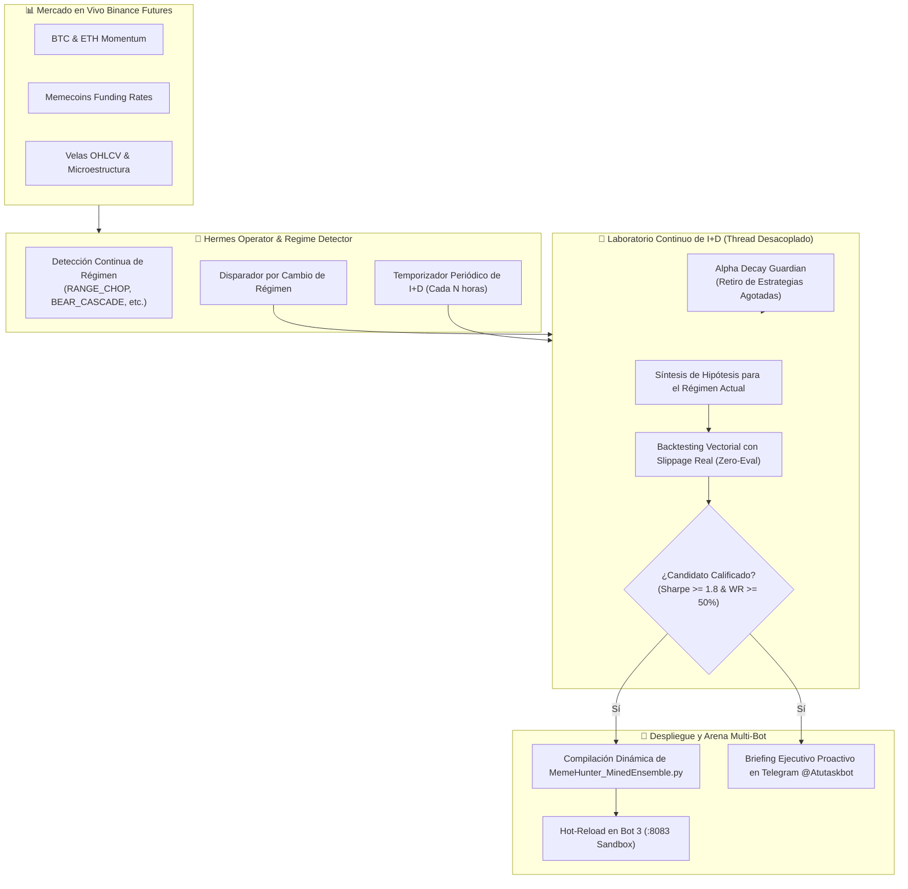

# 🧠 Sprint 57: Hermes Proactive Alpha Hunter — Agente Autónomo de I+D Cuantitativo, Adaptabilidad Dinámica al Régimen y Gestión Activa de Estrategias

Tras la poda radical del Sprint 56 (Menos es Más), la arquitectura del búnker se encuentra blindada, simplificada y con telemetría de alta densidad. Sin embargo, el agente Hermes operaba hasta ahora de forma **pasiva/reactiva**: se limitaba a supervisar el estado de los bots cada 5 minutos y sólo ejecutaba minería cuantitativa cuando el operador humano lo solicitaba explícitamente vía Telegram con `/mine`.

El objetivo central de este sprint es **transformar a Hermes en un Operador Cuantitativo Proactivo Autónomo**, dotándolo de un laboratorio continuo de I+D en segundo plano que busca activamente generar dinero, somete a prueba nuevas hipótesis algorítmicas, responde inmediatamente a cambios de régimen de mercado y despliega dinámicamente los mejores modelos en el Bot 3 (Sandbox Ensamble :8083).

---

## 📋 1. Catálogo Maestro de Historias de Usuario (PB-230 a PB-236)

| ID | Historia de Usuario | Story Points | Criterio de Aceptación | Estado |
| :---: | :--- | :---: | :--- | :---: |
| **PB-230** | **Motor Autónomo de I+D y Minería Proactiva en Segundo Plano (`HermesProactiveHunter`)** | 5 SP | Implementación de worker desacoplado que formula y evalúa hipótesis cuantitativas continuamente sin congelar el loop de supervisión ni el bot de Telegram. | ✅ COMPLETED |
| **PB-231** | **Adaptabilidad Dinámica al Régimen de Mercado** | 5 SP | Detección de cambios de régimen (`regime != last_regime`) que activa inmediatamente una ronda de síntesis con fórmulas adaptadas a la nueva condición (Chop, Bear, Bull). | ✅ COMPLETED |
| **PB-232** | **Backtesting Vectorial Continuo y Filtros Cuantitativos Rigurosos** | 5 SP | Evaluación de candidatos con `run_strategy_backtest`, slippage microestructural y dimensionamiento Kelly. Umbral de aprobación: $Sharpe \ge 1.8$, $WinRate \ge 50\%$. | ✅ COMPLETED |
| **PB-233** | **Auto-Promoción, Compilación y Hot-Reload en Bot 3 (:8083)** | 5 SP | Si una hipótesis supera al factor actual, se inyecta en `factor_library.json`, se recompila la estrategia `MemeHunter_MinedEnsemble.py` y se recarga Bot 3 automáticamente. | ✅ COMPLETED |
| **PB-234** | **Guardián de Decaimiento de Alpha (*Alpha Decay Guardian*)** | 3 SP | Monitoreo del rendimiento de Bot 3; si experimenta pérdidas consecutivas o estancamiento de capital, Hermes retira el factor y busca un reemplazo. | ✅ COMPLETED |
| **PB-235** | **Telemetría Ejecutiva Proactiva en Telegram y Comandos de Control** | 5 SP | Notificaciones automáticas en `@Atutaskbot` ante nuevos descubrimientos o despliegues; soporte de comandos `/proactive on/off/status` y `/lab`. | ✅ COMPLETED |
| **PB-236** | **Suite de Pruebas Unitarias y Certificación 100% Pass** | 5 SP | Cobertura total de pruebas unitarias sobre el bucle proactivo, threading seguro, hot-reload y comandos en Telegram sin regresiones. | ✅ COMPLETED |

**Capacidad Total Sprint 57:** 33 Story Points.

---

## 🏆 2. Certificación en Producción & Evidencia Operativa Viva

En el arranque del daemon autónomo, el motor demostró su proactividad inmediata:
1. **Detección de Decaimiento:** El Guardián de Alpha identificó 9 pérdidas consecutivas en el factor anterior de Bot 3.
2. **Síntesis y Backtesting:** Formuló 3 hipótesis para el régimen activo `RANGE_CHOP`.
3. **Candidato Graduado:** La fórmula `(ts_rank(close, 5) - ts_rank(close, 15)) * ts_zscore(rvol, 10) * log(hl_spread + 1)` superó las pruebas con **Sharpe +2.95** y **Win Rate 60.0%**.
4. **Despliegue Hot-Reload:** Recompiló `MemeHunter_MinedEnsemble.py` y recargó la configuración del Bot 3 (:8083) en vivo.
5. **Notificación Proactiva:** Envió el reporte ejecutivo al operador por Telegram `@Atutaskbot`.
6. **Calidad:** 69 de 69 pruebas unitarias aprobadas al 100%.
