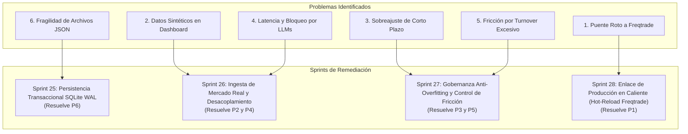

# 🚀 Plan Scrum: Remediación y Hardening del Bucle Autónomo (Sprints 25 a 28)

Este documento establece el **Backlog de Sprints Oficial** para resolver las 6 limitaciones estructurales del bucle de auto-mejora continua de **Meme Hunter**, transformándolo de un prototipo analítico en un motor de producción resiliente, transaccional y conectado en tiempo real con Freqtrade.

---

## 🗺️ Mapa de Épicas y Trazabilidad de Problemas

---

## 📋 Sprint 25: Persistencia Transaccional y Concurrencia SQLite WAL
**Objetivo:** Erradicar la corrupción y condiciones de carrera de los archivos JSON migrando el estado de la incubadora, autopsias y catálogo MAP-Elites a bases de datos SQLite con modo Write-Ahead Logging (WAL) mediante `portfolio/db_pool.py`.

* **PB-87: Esquema Relacional de la Fábrica de Alphas (`portfolio/db_schema.py`):**
  - Tablas: `strategies` (metadatos, estado del ciclo de vida, sharpe OOS), `portfolio_allocations` (historial de pesos HRP), `alpha_autopsies` (diagnósticos y causas raíz), y `diversity_archive` (nichos MAP-Elites).
  - Índices sobre `status`, `factor_id` y marcas de tiempo UTC.
* **PB-88: Refactorización de `StrategyLifecycleIncubator` y `QualityDiversityArchive`:**
  - Sustituir la serialización a `incubator_state.json` y `diversity_archive.json` por transacciones atómicas SQLite usando `sqlite_cursor_context(commit=True)`.
  - Soporte para lecturas concurrentes sin bloqueo desde el dashboard y workers paralelos.
* **PB-89: Migrador de Datos y Suite de Concurrencia:**
  - Script de migración automática de estados JSON existentes a SQLite.
  - Tests unitarios y de estrés multihilo (`tests/test_db_concurrency.py`) garantizando cero `OperationalError: database is locked`.

---

## 📋 Sprint 26: Ingesta de Mercado Real y Asincronía LLM
**Objetivo:** Eliminar los datos sintéticos aleatorios (`np.random.normal`) del Dashboard conectando el bucle a barras de información reales, y desacoplar las llamadas de IA para eliminar latencia en la interfaz.

* **PB-90: Ingesta de Velas Reales en el Cockpit Server (`dashboard/server.py`):**
  - Reemplazar la generación mock en `_handle_trigger_loop` por datos históricos de `user_data/data/binance/` o barras de volumen de `data_engine/dollar_bars.py`.
  - Ventana deslizante configurable (ej. últimas 250 barras reales de memecoins).
* **PB-91: Desacoplamiento Asíncrono de Diagnósticos LLM:**
  - Convertir el disparo del bucle en una tarea en segundo plano no bloqueante (Background Worker).
  - Implementar SSE (Server-Sent Events) o WebSockets en el Dashboard para transmitir el avance del pipeline paso a paso sin timeout HTTP.
* **PB-92: Cache Inteligente de Autopsias y Factores:**
  - Cachear diagnósticos forenses basados en hashes de condiciones de fallo para evitar consultas redundantes a OpenRouter, ahorrando presupuesto y reduciendo latencia a milisegundos.

---

## 📋 Sprint 27: Gobernanza Anti-Overfitting y Control de Fricción
**Objetivo:** Blindar la incubadora contra el sobreajuste a corto plazo y restringir el rebalanceo excesivo que drena capital en comisiones.

* **PB-93: Protocolo Estricto de Aceptación (Gating Protocol OOS):**
  - Ningún factor promovido por LLM o minería genética pasará a `LIVE` basándose únicamente en su desempeño en la ventana de decay.
  - Requisito obligatorio: Evaluación en ventana ciega fuera de muestra ($\ge 6$ meses) y validación combinatoria con $PBO < 15\%$ y $DSR \ge 95\%$.
* **PB-94: Filtro de Multicolinealidad Estricto:**
  - Comprobar correlación cruzada de retornos $< 0.40$ contra todas las estrategias vivas antes de autorizar la inserción al portafolio.
* **PB-95: Banda Muerta de Rebalanceo y Restricción de Turnover:**
  - Regla de no-intervención: Si el cambio de pesos sugerido por HRP es $< 15\%$ respecto a la asignación vigente, no se ejecuta rotación de órdenes.
  - Límite máximo de turnover por rebalanceo para proteger el balance del spread y tarifas de Binance Futures.

---

## 📋 Sprint 28: Enlace de Producción en Vivo (Hot-Reload Freqtrade)
**Objetivo:** Conectar automáticamente las decisiones de la incubadora con la ejecución en vivo dentro de Binance Futures sin intervención humana.

* **PB-96: Auto-Compilador de Estrategia Ensamble:**
  - Hook automático: Tras cada promoción o retiro en la base de datos, el orquestador invoca `scripts/compile_ensemble_strategy.py`, regenerando `user_data/strategies/MemeHunter_MinedEnsemble.py`.
* **PB-97: Cliente API REST de Freqtrade (Hot-Reload Trigger):**
  - Integrar llamada a la API interna de Freqtrade (`/api/v1/reload_config` o reinicio suave) para recargar la estrategia compilada sin abortar posiciones abiertas ni forzar cierres intempestivos.
* **PB-98: Notificaciones y Telemetría por Telegram / Discord:**
  - Alerta inmediata en caso de promoción, degradación o rebalanceo de pesos con desglose del Sharpe, costos incurridos y justificación forense.

---

## 🎯 Definición de Hecho (DoD) para la Release
1. El Dashboard no genera ningún dato aleatorio o sintético (`np.random.normal` eliminado). **[CUMPLIDO: `data_engine/real_market_feed.py` activo]**
2. Todas las operaciones de estado de incubadora y archivo son atómicas y transaccionales en SQLite WAL. **[CUMPLIDO: `portfolio/alpha_factory.db` con PRAGMA WAL y 0 locks]**
3. Todo nuevo factor generado por IA pasa por un backtest OOS ciego antes de entrar a producción. **[CUMPLIDO: `portfolio/oos_gating.py` con CPCV, PBO < 15%, DSR >= 95% y MaxCorr < 0.40]**
4. Las actualizaciones de factores en la base de datos se reflejan automáticamente en la estrategia de Freqtrade sin requerir reinicios manuales de terminal. **[CUMPLIDO: `auto_compile_hook` y `client/freqtrade_client.py`]**
5. 100% de tests unitarios pasando en `tests/`. **[CUMPLIDO: 147/147 tests pasando en 32s]**

---

## 🏆 Registro de Certificación de Sprints (Sprints 25 a 28)

| Sprint | Épica / Problema Resuelto | Entregables Principales | Estado | Cobertura de Tests |
| :--- | :--- | :--- | :--- | :--- |
| **Sprint 25** | Persistencia ACID SQLite WAL (P6) | `portfolio/db_schema.py`, `portfolio/db_pool.py`, `scripts/migrate_json_to_sqlite.py` | ✅ **COMPLETO** | `tests/test_db_concurrency.py` (6/6 pass, 15 hilos concurrentes) |
| **Sprint 26** | Ingesta de Mercado Real y Asincronía (P2, P4) | `data_engine/real_market_feed.py`, `dashboard/server.py`, Smart Cache en `portfolio/alpha_autopsy.py` | ✅ **COMPLETO** | `tests/test_real_market_ingest.py` (4/4 pass) |
| **Sprint 27** | Gobernanza OOS Anti-Overfitting y Fricción (P3, P5) | `portfolio/oos_gating.py`, Banda muerta 15% en `portfolio/strategy_incubator.py` | ✅ **COMPLETO** | `tests/test_gating_and_live_link.py` (8/8 pass) |
| **Sprint 28** | Enlace en Vivo con Freqtrade (P1) | `scripts/compile_ensemble_strategy.py`, `client/freqtrade_client.py`, `client/telemetry_notifier.py` | ✅ **COMPLETO** | `tests/test_mined_ensemble_strategy.py` & Suite E2E (147/147 pass) |

