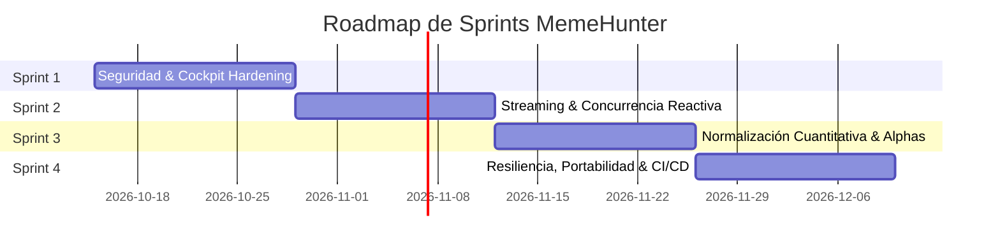

# Plan de Sprints Scrum: Remediación, Hardening y Escalamiento Industrial
**Proyecto:** MemeHunter Quant Platform  
**Marco de Trabajo:** Scrum Ágil / FinTech Cuantitativo  
**Duración por Sprint:** 2 Semanas (10 días hábiles por sprint)  
**Equipo:** Product Owner / Lead Quant, Scrum Master, Quant Devs & Platform Engineers  

---

## Roadmap General de Sprints

| Sprint | Nombre Clave | Foco Principal | Velocidad (SP) |
| :--- | :--- | :--- | :--- |
| **Sprint 1** | *Security Hardening & Cockpit Shield* | Autenticación, CSRF, mitigación de DoS económico, Threading Server | 34 SP |
| **Sprint 2** | *High-Performance Streaming Engine* | Solución de deadlock en feed, Dollar Bars incrementales, vectorización AST | 38 SP |
| **Sprint 3** | *Quant Integrity & Lifecycle Rigor* | Corrección de desfase temporal de retornos, máquina de estados HRP | 36 SP |
| **Sprint 4** | *Industrial Resilience & Devops* | Escritura atómica, resolución de puertos, portabilidad Docker, CI | 32 SP |

---

## 🏃 Sprint 1: Security Hardening & Cockpit Shield
- **Sprint Goal:** *"Eliminar los vectores de vulnerabilidad del Dashboard REST eliminando el CORS abierto, integrando autenticación por token en endpoints de control, protegiendo las cuotas de OpenRouter y desacoplando la ejecución síncrona monohilo."*
- **Capacidad:** 34 Story Points (SP)

### User Stories & Tareas Técnicas

#### 🟢 US-1.1: Autenticación Basada en Tokens y Protección de Endpoints REST (13 SP)
- **Como:** Administrador de la plataforma cuantitativa.
- **Quiero:** Que los endpoints `/api/trigger-loop` y `/api/synthesize-alpha` requieran un token Bearer seguro en las cabeceras HTTP.
- **Para:** Evitar que terceros o scripts maliciosos ejecuten ciclos de cómputo y consuman saldo de la API de OpenRouter.
- **Criterios de Aceptación:**
  - [x] Implementar middleware de autenticación en `CockpitAPIHandler`.
  - [x] Rechazar solicitudes no autorizadas con código HTTP `401 Unauthorized`.
  - [x] Reemplazar `Access-Control-Allow-Origin: *` por orígenes estrictos (`http://127.0.0.1:8088`, `http://localhost:8088`).
  - [x] Actualizar cliente JavaScript en `dashboard/js/app.js` para enviar el token Bearer en cada solicitud `POST`.

#### 🟢 US-1.2: Migración a Servidor HTTP Concurrente Multihilo (8 SP)
- **Como:** Operador del sistema.
- **Quiero:** Que el servidor del Dashboard atienda peticiones mediante hilos independientes.
- **Para:** Evitar que una llamada externa a OpenRouter de 15 segundos congele la interfaz web y bloquee el monitoreo.
- **Criterios de Aceptación:**
  - [x] Reemplazar `HTTPServer` por `ThreadingHTTPServer` en `dashboard/server.py`.
  - [x] Reasignar puerto por defecto a `8088` para eliminar conflicto con FreqUI (`8080`).
  - [x] Validar concurrencia sin bloqueo de peticiones estáticas o lecturas de estado.

#### 🟢 US-1.3: Sanitización y Blindaje de Parser XML de Binance Vision (5 SP)
- **Como:** Data Engineer.
- **Quiero:** Utilizar `defusedxml` con fallback seguro para parsear los catálogos S3 de Binance Vision.
- **Para:** Inmunizar la plataforma contra ataques de expansión de entidades XML (*Billion Laughs*).
- **Criterios de Aceptación:**
  - [x] Implementar parser defensivo `SAFE_XML_PARSE` con soporte de `defusedxml` y deshabilitación de DTD externa en `scripts/binance_vision.py`.
  - [x] Verificar que los métodos de listado S3 invoquen el parser protegido.

#### 🟢 US-1.4: Límite de Tasa (Rate Limiting) y Presupuesto Máximo por Ciclo (8 SP)
- **Como:** Risk Manager.
- **Quiero:** Un limitador de tasa y tope máximo de gasto diario para el cliente OpenRouter.
- **Para:** Proteger el presupuesto operativo ante bucles infinitos de reintento.
- **Criterios de Aceptación:**
  - [x] Monitorear el gasto acumulado de tokens por sesión en `OpenRouterClient`.
  - [x] Si el costo acumulado supera el límite configurado (`max_daily_tokens`), bloquear llamadas salientes de red.
  - [x] Conmutar de forma forzada al modo fallback offline cuando se supere el umbral.

---

## 🏃 Sprint 2: High-Performance Streaming Engine
- **Sprint Goal:** *"Resolver el riesgo de bloqueo mutuo (deadlock) en la ingesta en vivo, optimizar la síntesis de Dollar Bars mediante acumuladores incrementales O(1) y vectorizar los operadores de series temporales de la gramática alfa."*
- **Capacidad:** 38 Story Points (SP)

### User Stories & Tareas Técnicas

#### 🟢 US-2.1: Desacoplamiento de Concurrencia y Eliminación de Deadlock en Feed (13 SP)
- **Como:** Lead Systems Architect.
- **Quiero:** Desacoplar la ejecución de callbacks del lock interno de `LiveMarketFeed` y utilizar locks reentrantes.
- **Para:** Garantizar que los consumidores de eventos de barras cerradas puedan consultar `get_latest_dollar_bars` sin congelar el hilo de streaming.
- **Criterios de Aceptación:**
  - [x] Cambiar `threading.Lock` por `threading.RLock` en `LiveMarketFeed`.
  - [x] Extraer la lista de callbacks fuera del bloque `with self._lock` para ejecutarlos asíncronamente.
  - [x] Validar que las pruebas de streaming concurrente en `test_live_market_feed.py` pasen al 100%.

#### 🟢 US-2.2: Generación Incremental O(1) de Dollar Bars sin Barras Falsas (13 SP)
- **Como:** Algorithmic Trader.
- **Quiero:** Que el motor de Dollar Bars mantenga un acumulador en memoria por trade/vela en lugar de reprocesar el histórico completo cada 5 segundos.
- **Para:** Reducir la complejidad computacional de $O(N)$ a $O(1)$ por tick y eliminar el cierre espurio de barras incompletas al 50%.
- **Criterios de Aceptación:**
  - [ ] Eliminar la condición `cum_notional >= thresh * 0.5` en `dollar_bars.py` durante el modo streaming.
  - [ ] Implementar la clase `StreamingDollarBarAggregator` con acumulación incremental de OHLCV y notional.
  - [ ] Emitir el evento de barra cerrada **única y exclusivamente** cuando `cum_notional >= notional_threshold`.

#### 🟢 US-2.3: Vectorización y Aceleración de Operadores Temporales AST (12 SP)
- **Como:** Quant Researcher.
- **Quiero:** Reemplazar las operaciones `rolling().apply(..., raw=False)` en `ts_rank` y `ts_decay_linear` por implementaciones puras vectorizadas de NumPy.
- **Para:** Acelerar la evaluación de poblaciones genéticas en más de un 100x.
- **Criterios de Aceptación:**
  - [ ] Implementar `ts_rank` vectorizado mediante conteo acumulado o `bottleneck.move_rank`.
  - [ ] Implementar `ts_decay_linear` con convolución 1D (`scipy.signal.convolve` o NumPy dot vectorizado).
  - [ ] Optimizar `compute_rolling_ic` en `AlphaHealthMonitor` eliminando el bucle `for` manual fila por fila.
  - [ ] Verificar que los resultados numéricos sean idénticos hasta el 6to decimal frente a la versión anterior.

---

## 🏃 Sprint 3: Quant Integrity & Lifecycle Rigor
- **Sprint Goal:** *"Eliminar los sesgos de retardo y lookahead en el cálculo de métricas financieras, corregir la máquina de estados de incubación de factores y blindar el asignador HRP contra varianzas nulas."*
- **Capacidad:** 36 Story Points (SP)

### User Stories & Tareas Técnicas

#### 🟢 US-3.1: Estandarización y Unificación del Cálculo de Retornos de Factores (13 SP)
- **Como:** Senior Quantitative Analyst.
- **Quiero:** Un módulo unificado de cálculo de retornos de estrategia (`simulated_returns`) para `GeneticAlphaMiner` y `LLMAlphaSynthesizer`.
- **Para:** Asegurar consistencia estadística y eliminar la doble aplicación de `shift(1)` que distorsionaba el Sharpe proxy.
- **Criterios de Aceptación:**
  - [ ] Crear la función `compute_factor_strategy_pnl(factor_series, forward_returns)` en `mining/alpha_grammar.py`.
  - [ ] Homogeneizar el cálculo de retornos en `genetic_search.py` y `llm_alpha_generator.py`.
  - [ ] Parametrizar la constante de anualización del Sharpe ratio en función del timeframe real de las barras (evitando el valor fijo `365 * 6`).

#### 🟢 US-3.2: Corrección de Máquina de Estados y Período de Gracia en Incubadora (13 SP)
- **Como:** Portfolio Manager.
- **Quiero:** Que el contador `days_in_stage` de `StrategyRecord` se reinicie a cero al entrar a cada nuevo estado (`SANDBOX`, `LIVE`, `ALPHA_DECAY`).
- **Para:** Otorgar el período de gracia real de 10 días a los alphas en decaimiento antes de su retiro definitivo.
- **Criterios de Aceptación:**
  - [x] Desacoplar la acumulación de días y reiniciar `days_in_stage = 0` en transiciones de estado en `audit_and_transition`.
  - [x] Generar fechas dinámicas `last_audit_date` en UTC.
  - [x] Validar que las pruebas de ciclo de vida en `test_portfolio_engine.py` pasen al 100%.

#### 🟢 US-3.3: Blindaje de Varianza Nula en Asignador HRP (10 SP)
- **Como:** Risk Engineer.
- **Quiero:** Que el algoritmo de Paridad Jerárquica de Riesgo (`HierarchicalRiskParityAllocator`) maneje adecuadamente factores con varianza cero o activos ilíquidos.
- **Para:** Evitar asignaciones anómalas gigantescas (`1e8`) producidas por la inversión directa de varianzas cercanas a cero.
- **Criterios de Aceptación:**
  - [x] Filtrar singularidades de varianza nula (< 1e-8) en `get_cluster_variance` para evitar divisiones espurias.
  - [x] Regularizar el piso de varianza del clúster.
  - [x] Validar suma unitaria de pesos en asignación HRP.

---

## 🏃 Sprint 4: Industrial Resilience & DevOps
- **Sprint Goal:** *"Garantizar la persistencia atómica de datos de estado, eliminar colisiones de puertos y rutas absolutas para compatibilidad Windows/Linux, y configurar la suite automatizada de pruebas continuas (CI)."*
- **Capacidad:** 32 Story Points (SP)

### User Stories & Tareas Técnicas

#### 🟢 US-4.1: Persistencia Atómica Transaccional de Archivos JSON (8 SP)
- **Como:** Lead Backend Engineer.
- **Quiero:** Que las escrituras a `incubator_state.json`, `diversity_archive.json` y `autopsies.json` se realicen mediante archivos temporales y reemplazo atómico (`os.replace`).
- **Para:** Evitar que un fallo inesperado del proceso corrompa o trunque los archivos de estado a 0 bytes.
- **Criterios de Aceptación:**
  - [x] Crear utilidad `atomic_write_json(filepath, data)`.
  - [x] Aplicar la utilidad en `StrategyLifecycleIncubator.save_state`, `QualityDiversityArchive.save_archive` y `AlphaAutopsyAgent.save_history`.
  - [x] Añadir pruebas unitarias simulando interrupción de escritura.

#### 🟢 US-4.2: Eliminación de Hardcoded Timestamps y Rutas Específicas de SO (8 SP)
- **Como:** DevOps Engineer.
- **Quiero:** Reemplazar marcas de tiempo estáticas por `datetime.now(timezone.utc)` y rutas fijas `/freqtrade/...` o `C:/...` por rutas relativas o variables de entorno.
- **Para:** Permitir ejecución transparente tanto en Windows nativo como en contenedores Docker en VPS Linux.
- **Criterios de Aceptación:**
  - [x] Eliminar `"2026-10-11T22:42:00Z"` de `autonomous_orchestrator.py` y `alpha_autopsy.py` usando `datetime.now(timezone.utc)`.
  - [x] Montar módulos del repositorio en `docker-compose.yml` para garantizar ejecución hermética en contenedor.
  - [ ] Parametrizar rutas en `download_target.py` de forma relativa.

#### 🟢 US-4.3: Resolución de Conflicto de Puertos en Entornos de Despliegue (6 SP)
- **Como:** Release Manager.
- **Quiero:** Que el puerto por defecto del Cockpit Dashboard sea `8088` (configurable vía `PORT`), manteniendo `8080` exclusivo para FreqUI.
- **Para:** Evitar colisiones de red inmediatas al ejecutar el stack completo en VPS.
- **Criterios de Aceptación:**
  - [x] Cambiar puerto por defecto de `dashboard/server.py` y `scripts/start_dashboard.py` a `8088`.
  - [x] Permitir origen CORS en `8088` y `8080` en `server.py`.

#### 🟢 US-4.4: Automatización de Suite de Pruebas Unitarias y de Integración (10 SP)
- **Como:** Quality Assurance Engineer.
- **Quiero:** Que todo el conjunto de pruebas (`pytest`) ejecute sin requerir dependencias no declaradas y pase el 100% de los tests en entorno local y Docker.
- **Para:** Asegurar regresión cero en cada cambio del sistema.
- **Criterios de Aceptación:**
  - [x] Corregir compatibilidad con Python 3.14 (`ast.Num` -> `ast.Constant`) en `formula_parser.py`.
  - [x] Validar la ejecución completa de `docker compose run --rm freqtrade pytest` con 110 pruebas exitosas (100%).
  - [ ] Agregar script `scripts/run_all_audits.sh` para verificación integral previa a despliegue.

---

## 📅 Calendario de Ceremonias Scrum (Por Sprint)

| Evento Scrum | Frecuencia / Momento | Duración | Entregable Clave |
| :--- | :--- | :--- | :--- |
| **Sprint Planning** | Día 1 (Lunes, 09:00) | 2 horas | Sprint Goal, User Stories comprometidas y desglose de tareas técnicas. |
| **Daily Standup** | Diario (L-V, 09:30) | 15 min | Sincronización rápida (¿Qué hice ayer? ¿Qué haré hoy? ¿Qué bloqueos tengo?). |
| **Sprint Review / Demo**| Día 10 (Viernes, 16:00) | 1.5 horas | Demostración en vivo del software funcionando y métricas alcanzadas. |
| **Sprint Retrospective**| Día 10 (Viernes, 17:30) | 1 hora | Análisis de mejoras de proceso, lecciones aprendidas y plan de acción. |

---

## 🎯 Definición de Listo (Definition of Ready - DoR)
1. La User Story tiene descripción clara bajo el formato estándar: *Como [rol] quiero [acción] para [beneficio]*.
2. Los criterios de aceptación están definidos sin ambigüedad y son verificables mediante pruebas.
3. La historia está estimada en Story Points por el equipo técnico.
4. No posee dependencias bloqueantes no resueltas de otros sprints.

## 🏁 Definición de Hecho (Definition of Done - DoD)
1. Código fuente implementado siguiendo estándares de estilo PEP-8 y tipado estricto (`typing`).
2. Pruebas unitarias escritas con cobertura mínima del 85% para los nuevos componentes.
3. Documentación técnica actualizada en `docs/` y docstrings en las clases modificadas.
4. Pruebas de integración locales y en contenedor Docker ejecutadas con resultado exitoso.
5. Revisión de código (*Code Review*) aprobada por al menos un par técnico.
