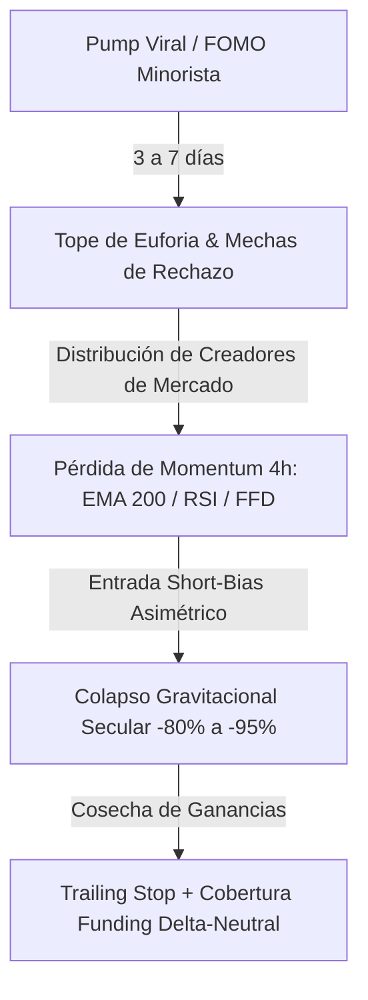
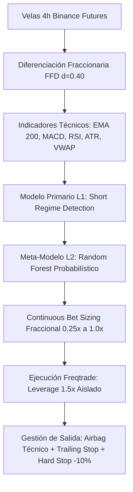
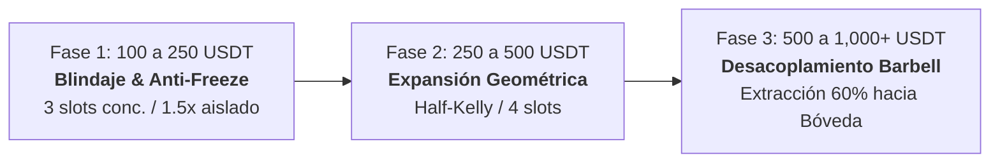

# 🏛️ Compendio Maestro de Estrategia Cuantitativa (STRAT-MASTER-001)

Este documento constituye la **referencia canónica unificada** para el diseño, modelado matemático, validación estadística y gestión de riesgo de las estrategias de **Meme Hunter**. Consolida y armoniza la hipótesis del edge, la genealogía de estrategias (V1 a V7 Quantum), el modelo de escalado de micro-capital, la arquitectura Híbrida Barbell con trinquete de ganancias y el protocolo anti-overfitting.

---

## 🗺️ Índice General

1. [Fundamento Teórico y Microestructura del Edge Asimétrico](#1-fundamento-teórico-y-microestructura-del-edge-asimétrico)
2. [Taxonomía y Evolución Genealógica de Estrategias (V1 a V7)](#2-taxonomía-y-evolución-genealógica-de-estrategias-v1-a-v7)
3. [Estrategia Canónica de Producción: MemeHunterFuturesV7_Quantum](#3-estrategia-canónica-de-producción-memehunterfuturesv7_quantum)
4. [Trayectoria de Escalado de Micro-Capital (100 USDT $\to$ 1,000+ USDT)](#4-trayectoria-de-escalado-de-micro-capital-100-usdt-to-1000-usdt)
5. [Arquitectura Híbrida Barbell y Válvula de Trinquete (Profit Ratchet)](#5-arquitectura-híbrida-barbell-y-válvula-de-trinquete-profit-ratchet)
6. [Marco de Validación Cuantitativa y Certificación Anti-Overfitting](#6-marco-de-validación-cuantitativa-y-certificación-anti-overfitting)
7. [Matriz de Trazabilidad y Catálogo Documental](#7-matriz-de-trazabilidad-y-catálogo-documental)

---

## 1. Fundamento Teórico y Microestructura del Edge Asimétrico

### 1.1 La Naturaleza de las Memecoins
A diferencia de los activos tradicionales o protocolos Layer-1 con flujos de caja y utilidad técnica:
- **Cero Flujo de Caja y Desinflación Gravitacional:** Las memecoins son vehículos de pura atención social y especulación reflexiva. Tras un evento de *pump* viral (3 a 7 días), el interés decae y entran en un régimen secular de distribución y desinflado continuo (-80% a -95% de pérdida de valor).
- **Inviabilidad del Long Simétrico:** Comprar rebotes o rupturas alcistas en memecoins expone el capital a trampas de liquidez (*bull traps*), mechas de barrido y sangrado progresivo.
- **La Ventaja Estadística en Corto (Short-Bias Puro):** Apostar por la ley gravitacional del mercado vendiendo en corto tras la confirmación de quiebre estructural ofrece un factor de asimetría favorable.



### 1.2 Reglas Microestructurales de Ejecución
1. **Timeframe Macro (4 Horas):** Aísla el ruido microestructural de 1m-15m y captura tendencias sostenidas de distribución institucional.
2. **Apalancamiento Dinámico Aislado (1.0x a 2.0x):** Elimina cualquier posibilidad de liquidación ante mechas intradiarias de volatilidad mediante stoploss duro del 10% (liquidación técnica requeriría un salto de +50% a +100% instantáneo).
3. **Filtro Anti-Freeze Micro-Capital:** En cuentas pequeñas (ej. 100 USDT), se asignan slots concentrados de 3 a 4 posiciones concurrentes para superar holgadamente el umbral mínimo notional de Binance Futures ($5 USDT).

---

## 2. Taxonomía y Evolución Genealógica de Estrategias (V1 a V7)

El sistema ha transitado por 6 iteraciones de investigación y desarrollo cuantitativo, documentadas en el Backlog de Sprints:

| Versión | Enfoque Principal | Edge / Hallazgo Clave | Estatus Actual |
|---|---|---|---|
| **V1 (Spot)** | Momentum Trend Following en L1s/Altcoins | Vulnerable a mercados bajistas y choppiness prolongado | 📦 Deprecada |
| **V2 (Futures)** | Estrategia Long/Short bidireccional | Los Longs perdieron capital sistemáticamente (-48.11 USDT) | 📦 Deprecada |
| **V3 (Short Sniper)** | Short-Only sobre Memecoins en 4h | Descubrimiento del edge asimétrico: +63.24% de retorno neto | 🏛️ Predecesora |
| **V4 / V5 (Leverage)** | Apalancamiento dinámico (1.5x - 2.0x) y filtro de días | Retorno acelerado (+96.2%), pero alta sensibilidad de calendario | 🏛️ Auditada |
| **V6 (Apex)** | Eliminación de salidas técnicas (`use_exit_signal = False`) | **Refutada:** Suprimir salidas técnicas triplica pérdidas en stops duros | ❌ Descartada (ADR-004) |
| **V7 (Quantum)** | Diferenciación Fraccionaria + Meta-Labeling + Triple Barrier + Airbag | DSR 100%, PBO 6.67%, Bet Sizing continuo y salidas técnicas ágiles | 🚀 **CANÓNICA DE PRODUCCIÓN** |

> [!WARNING]
> ### Por qué V6 Apex fue Descartada (Post-Mortem Técnico)
> La hipótesis de V6 Apex sugería que salir por señales técnicas prematuras recortaba las ganancias de caídas profundas. Sin embargo, la auditoría cuantitativa demostró que **desactivar las salidas técnicas transformó rebotes menores en pérdidas completas del -10% por stop duro**, deteriorando el Profit Factor y aumentando el Drawdown. La arquitectura canónica V7 restituyó el **Airbag de Salida Técnica** como orden a mercado inmediata ([ADR-004](../architecture/decisions/ADR-004_airbag_technical_exit_market_orders.md)).

---

## 3. Estrategia Canónica de Producción: MemeHunterFuturesV7_Quantum

La estrategia canónica implementada en `user_data/strategies/MemeHunterFuturesV7_Quantum.py` sintetiza las finanzas cuantitativas modernas (López de Prado) y microestructura de futuros:



### 3.1 Pilares Matemáticos de V7 Quantum
1. **Diferenciación Fraccionaria (FFD con $d=0.40$):**
   - Transforma series de precios no estacionarias en estacionarias preservando la memoria histórica a largo plazo (test Augmented Dickey-Fuller superado con $p < 0.05$).
2. **Triple Barrier Method & Meta-Labeling (Nivel 2):**
   - La barrera horizontal superior (+10% stoploss), barrera horizontal inferior (-12% target dinámico) y barrera vertical temporal (18 velas = 72h) eliminan el sesgo de path-dependency.
   - Un clasificador Random Forest filtra las operaciones de baja convicción.
3. **Continuous Bet Sizing Fraccional:**
   - La posición no es binaria; escala continuamente entre $0.25 \times \text{stake}$ y $1.00 \times \text{stake}$ en función de la probabilidad condicional del meta-modelo.
4. **Airbag Técnico de Salida:**
   - Si la microestructura indica giro alcista prematuro (cruce MACD o RSI > 58), la posición se liquida inmediatamente a mercado, protegiendo el capital de tocar el stop duro del 10%.

---

## 4. Trayectoria de Escalado de Micro-Capital (100 USDT $\to$ 1,000+ USDT)

El plan de escalado ([STRAT-002](PLAN_ESCALADO_100_A_1000_USDT.md)) establece la hoja de ruta para multiplicar por 10x una cuenta pequeña mitigando las restricciones de capital:



### 4.1 Fases Cuantitativas de Crecimiento
- **Fase 1: Blindaje de Capital ($100 \to $250 USDT):**
  - Enfoque: Superar la barrera de Min Notional de Binance ($5 USDT).
  - Configuración: 3 slots concurrentes (~$33 USDT cada uno), apalancamiento 1.5x aislado, riesgo por trade controlado ($\le 5\%$ del capital total).
- **Fase 2: Expansión Geométrica ($250 \to $500 USDT):**
  - Enfoque: Acelerar el interés compuesto mediante el criterio de Half-Kelly:
    $$f^* = \frac{p(b+1) - 1}{b} \times 0.5$$
    Donde $p = 0.534$ (Win Rate empírico) y $b = 1.36$ (Payoff Ratio), resultando en una asignación óptima de 12% a 15% por slot.
- **Fase 3: Consolidación y Desacoplamiento ($500 \to $1,000+ USDT):**
  - Activación de la **Válvula de Trinquete**: Una vez alcanzados los hitos de balance, se inicia la extracción metódica de utilidades hacia la Bóveda Delta-Neutral.

---

## 5. Arquitectura Híbrida Barbell y Válvula de Trinquete (Profit Ratchet)

Para cumplir la visión de largo plazo sin arriesgar el capital acumulado a una quiebra catastrófica, el sistema implementa la filosofía de *Antifragilidad de Taleb* ([STRAT-003](PLAN_IMPLEMENTACION_HIBRIDO_BARBELL.md) y [ADR-002](../architecture/decisions/ADR-002_hybrid_barbell_cash_and_carry.md)):

```mermaid
graph TD
    subgraph Generador Alpha (Extremo Agresivo)
        A[Capital de Riesgo en Futuros] --> B[MemeHunterFuturesV7_Quantum]
        B --> C[Utilidades Generadas en Futuros]
    end

    subgraph Válvula de Trinquete (Risk Isolation)
        C --> D{Disparador de Hito: Equity >= Hito +100%}
        D -->|Extracción del 60%| E[Transferencia Interna a Spot]
        D -->|Drawdown >= 25%| KS[Kill-Switch Inmediato]
    end

    subgraph Bóveda Segura Delta-Neutral (Extremo Conservador)
        E --> F[Bóveda Cash & Carry: scripts/delta_neutral_vault.py]
        F --> G[Short Futuros 1x + Long Spot]
        G --> H[Cobro Pasivo de Funding Rates: 15% a 40% APR]
        H --> I[Crecimiento Acumulado Sin Riesgo Direccional]
    end
```

### 5.1 Reglas del Trinquete de Ganancias
1. **Regla de Cosecha 60/40:** Al duplicar el capital en futuros, el 60% de los beneficios se transfieren irrevocablemente a la Bóveda Spot Delta-Neutral. El 40% restante permanece en futuros para continuar el interés compuesto.
2. **Kill-Switch de Drawdown al 25%:** Si la cuenta de futuros experimenta un retroceso $\ge 25\%$, todas las posiciones se cierran a mercado y el bot entra en pausa preventiva durante 48 horas.
3. **Bóveda Delta-Neutral Cash & Carry:** El capital cosechado financia posiciones de arbitraje de tasa de financiación (Long Spot + Short 1x Futuros) operadas mediante `scripts/delta_neutral_vault.py`, generando un flujo de caja pasivo inmune a colapsos del mercado cripto.

---

## 6. Marco de Validación Cuantitativa y Certificación Anti-Overfitting

Para evitar las trampas de sobreajuste y minería de datos, el sistema ha sido certificado bajo los estándares más exigentes ([STRAT-004](PLAN_DESMITIFICACION_RIESGOS.md) e [INFORME_METRICAS_AVANZADAS_DSR_PBO](../reports/INFORME_METRICAS_AVANZADAS_DSR_PBO.md)):

### 6.1 Métricas Avanzadas Oficiales
- **DSR (Deflated Sharpe Ratio):** **100.0%** ($p < 0.0001$). El Sharpe ratio observado (+2.21 anualizado) no es fruto de la varianza por probar múltiples estrategias ($N=6$).
- **PBO (Probability of Backtest Overfitting):** **6.67%** (umbral de seguridad $< 30\%$). Evaluado mediante Combinatorial Purged Cross-Validation (CPCV) sobre 16 combinaciones de datos particionados.
- **Validación Cross-Asset Fuera de Muestra (OOS):** Probada sobre 4 activos ciegos (SOL, SUI, TIA, WLD) con $N=955$ trades, logrando +104.27% neto y $p=0.0234$, confirmando que la ventaja matemática es transferible y estructural.
- **Block Bootstrap y Mechas de Shock:** Certificó que sin Kill-Switch, las colas de volatilidad generan drawdowns del 73.4%, ratificando la indispensabilidad del corte al 25%.

---

## 7. Matriz de Trazabilidad y Catálogo Documental

La siguiente matriz conecta los documentos estratégicos especializados de la carpeta `docs/strategy/` con las decisiones arquitectónicas y reportes de validación:

| ID Documental | Archivo | Propósito / Alcance | Estatus | Referencia Relacionada |
|---|---|---|---|---|
| **STRAT-MASTER-001** | [ESTRATEGIA_MAESTRA_UNIFICADA.md](ESTRATEGIA_MAESTRA_UNIFICADA.md) | Compendio canónico integral de estrategia | 🟢 ACTIVE | [DOC-MASTER-001](../MANUAL_UNIFICADO_DEL_SISTEMA.md) |
| **STRAT-PLAN-MINING-001** | [PLAN_SCRUM_MINERIA_Y_BACKTESTING.md](PLAN_SCRUM_MINERIA_Y_BACKTESTING.md) | Plan Scrum: Minería de Alphas y Backtesting Industrial (Sprints 21-24) | 🟢 ACTIVE | [SCRUM_PLAN](SCRUM_PLAN.md) |
| **STRAT-001** | [HYPOTHESIS.md](HYPOTHESIS.md) | Hipótesis causal del Edge Short-Bias 4h | 🟢 ACTIVE | [ADR-001](../architecture/decisions/ADR-001_asymmetric_short_only_bias.md) |
| **STRAT-002** | [PLAN_ESCALADO_100_A_1000_USDT.md](PLAN_ESCALADO_100_A_1000_USDT.md) | Modelo 10X de micro-capital y Half-Kelly | ✅ CONSOLIDADO | [INFORME_FUTUROS_100_USDT](../reports/INFORME_FUTUROS_100_USDT.md) |
| **STRAT-003** | [PLAN_IMPLEMENTACION_HIBRIDO_BARBELL.md](PLAN_IMPLEMENTACION_HIBRIDO_BARBELL.md) | Especificación Barbell y Profit Ratchet | 🟢 ACTIVE | [ADR-002](../architecture/decisions/ADR-002_hybrid_barbell_cash_and_carry.md) |
| **STRAT-004** | [PLAN_DESMITIFICACION_RIESGOS.md](PLAN_DESMITIFICACION_RIESGOS.md) | Protocolo de auditoría y pruebas OOS | ✅ CERTIFICADO | [INFORME_METRICAS_AVANZADAS](../reports/INFORME_METRICAS_AVANZADAS_DSR_PBO.md) |
| **STRAT-EXP-001** | [PLAN_IMPLEMENTACION_V6_APEX.md](PLAN_IMPLEMENTACION_V6_APEX.md) | Experimento de supresión de señales técnicas | ❌ SUPERSEDED | [ADR-004](../architecture/decisions/ADR-004_airbag_technical_exit_market_orders.md) |
| **STRAT-SPOT-001** | [ESTRATEGIA_DEFINITIVA_MEME_HUNTER_SPOT_CAPITULATION.md](ESTRATEGIA_DEFINITIVA_MEME_HUNTER_SPOT_CAPITULATION.md) | Estrategia Definitiva Spot: Caza de Capitulación y Blindaje de Capital | 🟢 ACTIVE | [MemeHunterSpot_CapitulationAlpha.py](../../user_data/strategies/MemeHunterSpot_CapitulationAlpha.py) |
| **STRAT-ROADMAP-001** | [SCRUM_PLAN.md](SCRUM_PLAN.md) | Product Backlog y Sprints 1 a 20 | 🟢 ACTIVE | [OPERATIONAL_RUNBOOK](../operations/OPERATIONAL_RUNBOOK.md) |

---
*Compendio generado y auditado bajo el marco formal de Ingeniería Cuantitativa de Meme Hunter v7.4.*
