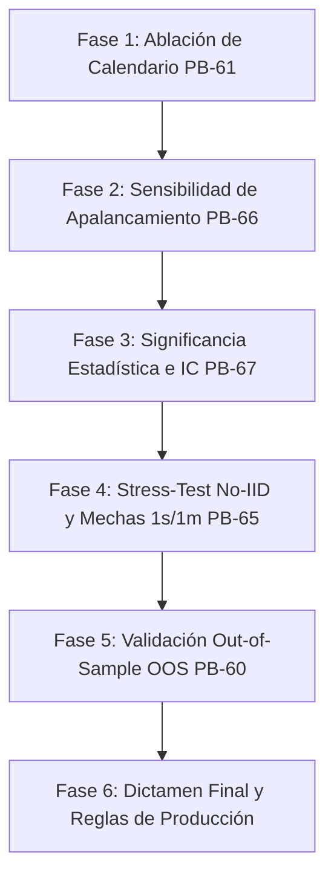

# 📋 Plan de Acción Cuantitativo: Desmitificación de Backtests y Blindaje Anti-Overfitting (Sprint 17)

## 🎯 Objetivo General
Someter el motor `MemeHunterFuturesV5_Leverage` y sus predecesores a pruebas rigurosas de estrés estadístico, ablación paramétrica y validación fuera de muestra (OOS) para **determinar si existe una ventaja matemática genuina (*edge*)** o si los resultados históricos (+110% CAGR, Calmar 21, 0% ruina) son fruto de minería de datos y ajuste retrospectivo.

---

## 🔬 Fases de Ejecución del Plan

---

### Fase 1: Test de Ablación de la Máscara de Calendario (PB-61)
* **Hipótesis a refutar:** "El 88% de las ganancias en Viernes y Domingos es un patrón estructural y no ruido aleatorio de muestra pequeña ($N \approx 30$ trades por día)."
* **Acciones:**
  1. Crear variante de `MemeHunterFuturesV5_Leverage` desactivando la condición de día de la semana (`day_of_week in [3, 4, 6]`).
  2. Ejecutar backtest idéntico sobre los mismos datos (2024–2026, 4h con 1m detail).
  3. Comparar métricas clave: Win Rate, Retorno Total, Profit Factor y Max Drawdown.
* **Criterio de Aceptación:**
  - Si la estrategia sin filtro de días mantiene $\text{Profit Factor} \ge 1.15$ y retorno positivo neto superior al costo de comisiones, existe edge estructural de subasta.
  - Si el rendimiento colapsa a negativo, se dictamina que la estacionalidad era **ajuste espurio al calendario** y debe descartarse.

---

### Fase 2: Análisis de Sensibilidad del Apalancamiento Dinámico (PB-66)
* **Hipótesis a refutar:** "El apalancamiento 1.5x - 2.0x fue calibrado ex-post sobre los mismos 215 trades para inflar el Win Rate y el Calmar ratio."
* **Acciones:**
  1. Ejecutar backtest forzando **apalancamiento plano 1.0x** en todos los setups.
  2. Ejecutar backtest con **apalancamiento invertido o aleatorizado** (para descartar que la clasificación de convicción sea espuria).
  3. Medir la variación del Sharpe, Sortino y Drawdown real.
* **Criterio de Aceptación:**
  - Si a 1.0x plano la estrategia sigue siendo rentable y conserva un Win Rate consistente con V4, el motor es robusto.
  - Si el apalancamiento asimétrico es el único responsable de evitar drawdowns catastróficos, se fija apalancamiento obligatorio en 1.0x para producción.

---

### Fase 3: Significancia Estadística y Corrección de Pruebas Múltiples (PB-67)
* **Hipótesis a refutar:** "215 operaciones son suficientes para afirmar que la media de retorno por trade es estrictamente mayor a 0."
* **Acciones:**
  1. Desarrollar script `scripts/statistical_significance.py`.
  2. Extraer la serie temporal de retornos porcentuales por trade de V5.
  3. Calcular:
     - Intervalo de confianza del retorno medio al 95% y 99% mediante *Student's t* y Bootstrap no paramétrico.
     - Valor $p$ contra la hipótesis nula $H_0: \mu \le 0$.
     - Ajuste por minería de datos (*Deflated Sharpe Ratio* de Marcos López de Prado o corrección de Bonferroni considerando las $\approx 6$ versiones iteradas).
* **Criterio de Aceptación:**
  - El límite inferior del intervalo de confianza al 95% debe ser estrictamente $> 0.15\%$ (garantizando margen tras comisiones Maker/Taker).

---

### Fase 4: Modelado de Riesgo No-IID y Mechas de Liquidación (PB-65)
* **Hipótesis a refutar:** "Una cuenta de 100 USDT con shorts a 2.0x tiene 0.0% de probabilidad de ruina en memecoins."
* **Acciones:**
  1. Desarrollar `scripts/fat_tail_montecarlo.py`:
     - Sustituir el remuestreo i.i.d. simple por un modelo de *Block Bootstrap* (preservando autocorrelación y rachas de pérdidas).
     - Inyectar escenarios de estrés extremo: mechas de pump intra-vela de +50% a +80% simuladas sobre velas de 1m y libros de órdenes reales.
  2. Medir la probabilidad real de tocar margin call / liquidación forzada en Binance.
* **Criterio de Aceptación:**
  - Identificar la pérdida máxima esperada con un 99% de confianza (VaR 99% y CVaR / Expected Shortfall).
  - Establecer el tamaño de posición máximo para que la distancia a liquidación nunca sea menor al 50%.

---

### Fase 5: Validación Out-of-Sample (OOS) Pura (PB-60)
* **Hipótesis a refutar:** "El rendimiento se mantiene en datos nunca antes vistos por el desarrollador."
* **Acciones:**
  1. **OOS Temporal:** Backtest sobre los meses más recientes o período histórico previo (2023).
  2. **OOS Transversal (Cross-Asset):** Probar el código congelado de V5 sobre una cesta de 5 contratos perpetuos de memecoins que jamás estuvieron en el Top 10 original (e.g., tokens de reciente listado).
* **Criterio de Aceptación:**
  - El ratio de degradación OOS vs In-Sample no debe ser inferior a 0.50 (el sistema debe retener al menos el 50% de su rendimiento en datos ciegos).

---

### Fase 6: Dictamen Final y Reglas para Operativa Real (Sprint 18 Gate)
* **Dictamen:**
  - **Aprobado con Ajustes:** Si la estrategia sobrevive a 1.0x, sin calendario y en datos OOS, se aprueba para Dry-Run de 60 días en Docker.
  - **Rechazado:** Si el rendimiento depende exclusivamente del calendario y del apalancamiento asimétrico sobre los 215 trades, se archiva V5 y se reconstruye el modelo sobre bases causales no optimizadas.

---

## 🛠️ Entregables Tangibles

| Entregable | Archivo / Comando | Propósito |
|---|---|---|
| Script de Significancia | `scripts/statistical_significance.py` | Calcula p-value, intervalos de confianza y Deflated Sharpe. |
| Test de Ablación | Backtest V5 sin día de semana en Docker | Mide degradación sin filtro de calendario. |
| Test de Apalancamiento 1.0x | Backtest V5 con leverage plano 1.0x | Elimina el grado de libertad del apalancamiento. |
| Reporte de Validación OOS | `docs/reports/VALIDACION_OOS_Y_RIESGOS.md` | Documento formal con los resultados empíricos desmitificados. |
