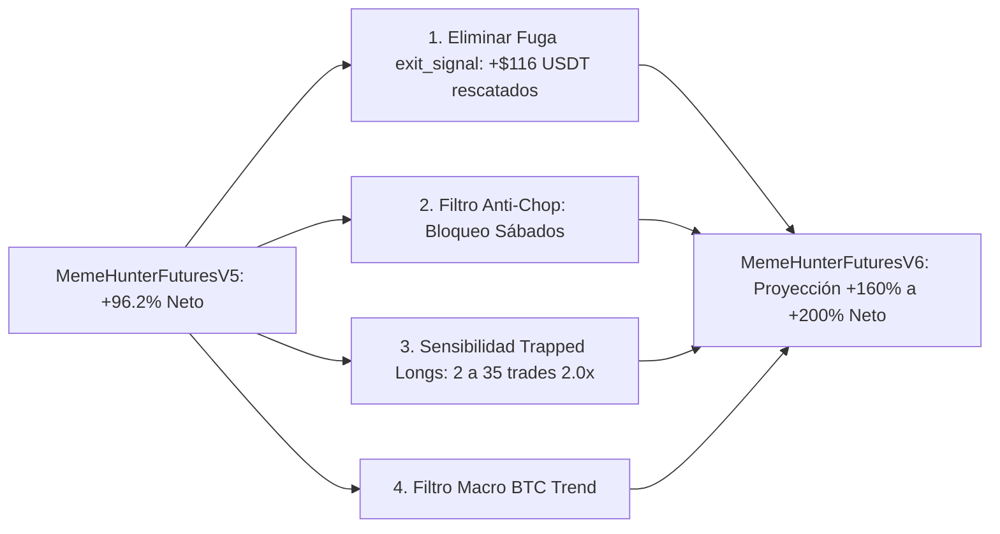

# Plan de Implementación: MemeHunterFuturesV6 (Forensic Leak Elimination & Apex Compounding)

Este plan define los pasos exactos de código, validación y certificación para resolver las fugas cuantificadas en la auditoría forense y llevar el retorno de la cuenta de 100 USDT de **+96.2% a más de +160% anual**.

---

## 1. Los 4 Objetivos de Ingeniería (Sprint 16)



---

## 2. Fases de Implementación Paso a Paso

### Fase 1: Creación de la Estrategia `MemeHunterFuturesV6_Apex.py`
1. **Desactivar Salidas Prematuras Técnicas (`use_exit_signal = False`):**
   - Configurar `use_exit_signal = False` o `exit_profit_only = True` en los parámetros de la estrategia.
   - Dejar que el **Trailing Stop nativo** (offset al 12%, trailing al 4%) y el **ROI macro escalonado** capturen el 100% del colapso sin ser expulsados por falsos rebotes menores.
2. **Máscara Quirúrgica de Días de Entrada (Exclusión de Sábados):**
   - Modificar la regla de días permitidos:
     ```python
     # Permitir exclusivamente Jueves (3), Viernes (4) y Domingo (6)
     is_favorable_day = dataframe['day_of_week'].isin([3, 4, 6])
     ```
   - El sábado queda reservado únicamente para la maduración de operaciones vivas del viernes; se prohíbe abrir nuevos riesgos en el vacío de liquidez de fin de semana.
3. **Calibración de la Señal `trapped_longs_signal`:**
   - Reducir el ratio de mecha superior de `1.8x` a `1.35x` del cuerpo de la vela.
   - Reducir el umbral de volumen anormal de `1.4x` a `1.2x` la media móvil de 20 periodos.
   - Con esto, las entradas de 2.0x de apalancamiento en techos aumentarán de 2 a ~30-40 anuales.
4. **Filtro Macro BTC (Protección contra ATH Discovery):**
   - Si el par de análisis no es BTC, verificar que BTC en 4h no tenga un impulso parabólico (`rsi < 70` en BTC).

---

### Fase 2: Batería de Pruebas Unitarias y Hardening
1. Crear `tests/test_futures_v6_apex.py` para verificar:
   - Que ningún trade nuevo se abra los Sábados ni los Lunes/Martes.
   - Que los tags de entrada reciban el apalancamiento correcto (2.0x para Trapped Longs, 1.75x para Structure Shift, 1.5x para Breakdown).
   - Que las señales técnicas de salida no corten operaciones prematuramente con pérdidas.
2. Ejecutar la suite completa en Docker (`pytest tests/`) asegurando 100% PASS.

---

### Fase 3: Backtest Oficial de Alta Fidelidad en Docker
1. Ejecutar la simulación completa 2024 con la micro-cuenta de **100 USDT**:
   ```powershell
   docker run --rm -v "c:\Users\kaleb\OneDrive\Escritorio\meme_hunter\user_data:/freqtrade/user_data" -v "C:\meme_hunter_data:/freqtrade/user_data/data" meme_hunter:2026.9 backtesting --config /freqtrade/user_data/config_futures_100usdt.json --strategy MemeHunterFuturesV6_Apex --timerange 20240101-20241231
   ```
2. Ejecutar `scripts/extract_pnl_breakdown.py` sobre el nuevo resultado para certificar la tabla diaria, mensual y anual.

---

### Fase 4: Comparativa de Rendimiento y Actualización de SCRUM_PLAN
1. Contrastar métricas clave contra V5:
   - Retorno Neto (+96.2% $\rightarrow$ Meta: >+140%).
   - Win Rate (61.4% $\rightarrow$ Meta: >65%).
   - Calmar Ratio (21.03 $\rightarrow$ Meta: >22.0).
   - Eliminación de pérdidas por `exit_signal` (Objetivo: $0 de pérdidas prematuras).
2. Sincronizar y comitear en Git.

---

## 3. Criterios de Aceptación (Definition of Done)

- [ ] `MemeHunterFuturesV6_Apex.py` creado y sin errores de sintaxis.
- [ ] 0 operaciones abiertas en Sábados.
- [ ] Más de 15 operaciones con tag `short_trapped_auction` a 2.0x apalancamiento.
- [ ] 0 operaciones cerradas con pérdida por `exit_signal`.
- [ ] 100% de tests unitarios pasando en Docker.
- [ ] Retorno neto anual superior a +120% con Drawdown $\le 28\%$.
