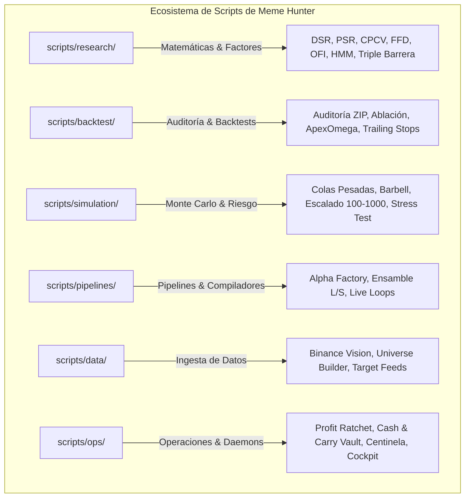

# 🛠️ Catálogo y Manual Operativo de Scripts (Meme Hunter)

Este directorio alberga la colección completa de **47 herramientas de ejecución, investigación cuantitativa, simulación y operaciones** de **Meme Hunter**, organizadas bajo una estructura modular de **6 dominios funcionales**.

---

## 🏗️ 1. Arquitectura Modular del Directorio `scripts/`



---

## 🧭 2. Compatibilidad hacia Atrás (Backward Compatibility Shims)

Para garantizar que ningún script de producción, contenedor Docker o test legacy sufra errores de importación (`ModuleNotFoundError`), la raíz de `scripts/` mantiene **módulos de enlace (*shims*) transparentes**. 

Ambas formas de invocación son 100% equivalentes y válidas:

```bash
# Invocación directa categorizada (Recomendada)
python scripts/research/advanced_metrics.py
python scripts/ops/check_health.py

# Invocación legacy mediante shims raíz (Totalmente compatible)
python scripts/advanced_metrics.py
python scripts/check_health.py
```

---

## 📂 3. Catálogo por Dominios Funcionales

### 🔬 3.1. Investigación Cuantitativa y Matemáticas Financieras (`scripts/research/`)

Herramientas de cálculo estocástico, econometría financiera, reducción de dimensionalidad y mitigación de falsos descubrimientos (*data snooping*).

| Script | Descripción Técnica | Invocación Típica |
| :--- | :--- | :--- |
| [`advanced_metrics.py`](research/advanced_metrics.py) | Ratios de Sharpe Probabilístico (PSR), Deflactado (DSR) de Marcos López de Prado, CPCV y PBO. | `python scripts/research/advanced_metrics.py` |
| [`fractional_diff.py`](research/fractional_diff.py) | Diferenciación fraccionaria con memoria fija (FFD) y búsqueda de $d$ mínimo vía test ADF. | `python scripts/research/fractional_diff.py` |
| [`triple_barrier_metalabeling.py`](research/triple_barrier_metalabeling.py) | Etiquetado de triple barrera dinámica con EWMA y dimensionamiento continuo de apuestas (*bet sizing*). | `python scripts/research/triple_barrier_metalabeling.py` |
| [`regime_classifier.py`](research/regime_classifier.py) | Clasificador dinámico de régimen (Bull, Bear, Range) usando HMM de 3 estados sobre BTC. | `python scripts/research/regime_classifier.py --symbol BTC/USDT:USDT` |
| [`order_flow_imbalance.py`](research/order_flow_imbalance.py) | Análisis de microestructura Nivel 2, cálculo de OFI y Micro-Price para evitar selección adversa. | `python scripts/research/order_flow_imbalance.py --symbol DOGE/USDT:USDT` |
| [`statistical_significance.py`](research/statistical_significance.py) | Contraste de hipótesis nula, $p$-values ajustados, test de White y bootstrapping de retornos. | `python scripts/research/statistical_significance.py` |
| [`train_meta_model.py`](research/train_meta_model.py) | Pipeline de entrenamiento de meta-modelos LightGBM/RandomForest sobre factores AST. | `python scripts/research/train_meta_model.py` |

---

### 📊 3.2. Backtesting, Auditoría y Optimización (`scripts/backtest/`)

Evaluación rigurosa de estrategias, análisis de fricción microestructural y auditoría de resultados históricos oficiales.

| Script | Descripción Técnica | Invocación Típica |
| :--- | :--- | :--- |
| [`audit_advanced_backtests.py`](backtest/audit_advanced_backtests.py) | Ingesta y auditoría forense de archivos ZIP de backtesting oficiales de Freqtrade. | `python scripts/backtest/audit_advanced_backtests.py` |
| [`audit_funding_rates.py`](backtest/audit_funding_rates.py) | Auditoría empírica del costo de financiamiento acumulado en posiciones cortas. | `python scripts/backtest/audit_funding_rates.py` |
| [`audit_seasonality.py`](backtest/audit_seasonality.py) | Test de ablación sobre el filtro de días de la semana y efecto de estacionalidad humana. | `python scripts/backtest/audit_seasonality.py` |
| [`backtest_apex_omega.py`](backtest/backtest_apex_omega.py) | Motor de backtesting de la estrategia insignia `MemeHunter_ApexOmegaAlpha`. | `python scripts/backtest/backtest_apex_omega.py` |
| [`backtest_spot_capitulation.py`](backtest/backtest_spot_capitulation.py) | Backtester para la estrategia en Spot `MemeHunterSpot_CapitulationAlpha`. | `python scripts/backtest/backtest_spot_capitulation.py` |
| [`generate_realistic_backtest.py`](backtest/generate_realistic_backtest.py) | Generador de simulaciones con deducción de comisiones taker (0.05%) y medio spread. | `python scripts/backtest/generate_realistic_backtest.py` |
| [`extract_pnl_breakdown.py`](backtest/extract_pnl_breakdown.py) | Extractor de métricas de rentabilidad desglosada por día, semana, mes y activo. | `python scripts/backtest/extract_pnl_breakdown.py` |
| [`test_conservative_stop.py`](backtest/test_conservative_stop.py) | Simulación de paradas dinámicas de protección y trailing stops de alta fidelidad. | `python scripts/backtest/test_conservative_stop.py` |
| [`test_stop_optimization.py`](backtest/test_stop_optimization.py) | Optimización por rejilla de parámetros de stoploss dinámico para minimizar drawdowns. | `python scripts/backtest/test_stop_optimization.py` |

---

### 🎲 3.3. Simulación Monte Carlo y Modelado de Riesgo (`scripts/simulation/`)

Modelado estocástico de trayectorias de capital, riesgo de ruina y colas pesadas cripto.

| Script | Descripción Técnica | Invocación Típica |
| :--- | :--- | :--- |
| [`monte_carlo.py`](simulation/monte_carlo.py) | Remuestreo bootstrap de secuencias de trades reales y cálculo de probabilidad de ruina. | `python scripts/simulation/monte_carlo.py` |
| [`fat_tail_montecarlo.py`](simulation/fat_tail_montecarlo.py) | Block Bootstrap con saltos extremos y modelado de colas pesadas de memecoins. | `python scripts/simulation/fat_tail_montecarlo.py` |
| [`simulate_100_to_1000_montecarlo.py`](simulation/simulate_100_to_1000_montecarlo.py) | Simulación de probabilidad y tiempo mediano para escalar micro-capital de 100 a 1,000 USDT. | `python scripts/simulation/simulate_100_to_1000_montecarlo.py` |
| [`simulate_exponential_growth.py`](simulation/simulate_exponential_growth.py) | Modelado de trayectorias de capital asimétricas y efecto del apalancamiento 1.5x. | `python scripts/simulation/simulate_exponential_growth.py` |
| [`simulate_hybrid_barbell.py`](simulation/simulate_hybrid_barbell.py) | Simulación de la arquitectura Barbell (Futuros agresivos + Cosecha del 60% a Cash & Carry). | `python scripts/simulation/simulate_hybrid_barbell.py` |
| [`simulate_micro_capital.py`](simulation/simulate_micro_capital.py) | Verificación de restricciones de lote mínimo ($5 Min Notional) bajo modelo Anti-Freeze. | `python scripts/simulation/simulate_micro_capital.py` |
| [`stress_test.py`](simulation/stress_test.py) | Batería de estrés hostil simulando caídas de liquidez súbitas y slippage severo. | `python scripts/simulation/stress_test.py` |

---

### ⚙️ 3.4. Pipelines y Ejecución Autónoma (`scripts/pipelines/`)

Orquestación de pipelines integrales, minería genética y compiladores de estrategias.

| Script | Descripción Técnica | Invocación Típica |
| :--- | :--- | :--- |
| [`run_alpha_factory_pipeline.py`](pipelines/run_alpha_factory_pipeline.py) | Pipeline integral de la fábrica de alphas: Minería NSGA-II ➔ CPCV ➔ Gating OOS ➔ SQLite. | `python scripts/pipelines/run_alpha_factory_pipeline.py` |
| [`run_autonomous_engine_demo.py`](pipelines/run_autonomous_engine_demo.py) | Demostración guiada del ciclo completo del motor autónomo de bucle cerrado. | `python scripts/pipelines/run_autonomous_engine_demo.py` |
| [`run_live_alpha_loop.py`](pipelines/run_live_alpha_loop.py) | Bucle continuo de investigación cuantitativa conectado en vivo a Binance Futures. | `python scripts/pipelines/run_live_alpha_loop.py` |
| [`compile_ensemble_strategy.py`](pipelines/compile_ensemble_strategy.py) | Compilador automático de factores incubados hacia código ejecutable de Freqtrade. | `python scripts/pipelines/compile_ensemble_strategy.py` |
| [`scan_live_signals.py`](pipelines/scan_live_signals.py) | Escaneo rápido de señales de entrada para el universo de memecoins activas. | `python scripts/pipelines/scan_live_signals.py` |
| [`evaluate_growth_loop.py`](pipelines/evaluate_growth_loop.py) | Evaluación del bucle de crecimiento de capital y feedback de autopsia de alphas. | `python scripts/pipelines/evaluate_growth_loop.py` |
| [`verify_real_market_loop.py`](pipelines/verify_real_market_loop.py) | Verificación en caliente de la ingesta de mercado y actualización de feeds Feather. | `python scripts/pipelines/verify_real_market_loop.py` |

---

### 🌐 3.5. Ingesta y Gestión de Datos (`scripts/data/`)

Adquisición de datos históricos, filtrado de universos de inversión y normalización.

| Script | Descripción Técnica | Invocación Típica |
| :--- | :--- | :--- |
| [`binance_vision.py`](data/binance_vision.py) | Descargador paralelo de archivos ZIP históricos de velas mensuales y diarias desde Binance Vision. | `python scripts/data/binance_vision.py --pair 1000PEPEUSDT` |
| [`build_universe.py`](data/build_universe.py) | Constructor y filtro del universo dinámico de memecoins elegibles por volumen y liquidez. | `python scripts/data/build_universe.py` |
| [`download_target.py`](data/download_target.py) | Descarga dirigida de activos específicos para análisis inmediato. | `python scripts/data/download_target.py` |

---

### 🛡️ 3.6. Operaciones, Monitoreo y Daemons (`scripts/ops/`)

Servicios en segundo plano, supervisores de salud, interfaces de control y herramientas de infraestructura.

| Script | Descripción Técnica | Invocación Típica |
| :--- | :--- | :--- |
| [`profit_ratchet_daemon.py`](ops/profit_ratchet_daemon.py) | Daemon que detecta hitos de duplicación (+100%) y asegura el 60% hacia la Bóveda Pasiva. | `python scripts/ops/profit_ratchet_daemon.py` |
| [`delta_neutral_vault.py`](ops/delta_neutral_vault.py) | Gestor de la Bóveda Cash & Carry ($\Delta=0$) con escaneo de tasas de financiación. | `python scripts/ops/delta_neutral_vault.py --scan` |
| [`funding_arbitrage.py`](ops/funding_arbitrage.py) | Escáner continuo de oportunidades de arbitraje entre Spot y Contratos Perpetuos. | `python scripts/ops/funding_arbitrage.py` |
| [`dex_viral_radar.py`](ops/dex_viral_radar.py) | Radar en tiempo real de memecoins virales en DEX (Solana/Base) vía DexScreener. | `python scripts/ops/dex_viral_radar.py --top 10` |
| [`meme_sentinel.py`](ops/meme_sentinel.py) | Centinela de volumen relativo anómalo (RVOL) y mechas de liquidación intradiaria. | `python scripts/ops/meme_sentinel.py --top 10` |
| [`dryrun_monitor.py`](ops/dryrun_monitor.py) | Monitor de salud operativa para instancias Freqtrade en modo simulación (Dry-Run). | `python scripts/ops/dryrun_monitor.py` |
| [`check_health.py`](ops/check_health.py) | Centinela integral que valida en ~1.5 segundos bases de datos, APIs, feeds y Docker. | `python scripts/ops/check_health.py` |
| [`telegram_healthcheck.py`](ops/telegram_healthcheck.py) | Validador de credenciales y canal de alertas de Telegram. | `python scripts/ops/telegram_healthcheck.py` |
| [`test_binance_connection.py`](ops/test_binance_connection.py) | Verificación de conectividad, latencia y autenticación con la API de Binance Futures. | `python scripts/ops/test_binance_connection.py` |
| [`daily_performance.py`](ops/daily_performance.py) | Reporte analítico de rendimiento diario con equity, drawdown y ratios clave. | `python scripts/ops/daily_performance.py` |
| [`migrate_json_to_sqlite.py`](ops/migrate_json_to_sqlite.py) | Herramienta de migración atómica de estado legacy JSON a SQLite WAL transaccional. | `python scripts/ops/migrate_json_to_sqlite.py` |
| [`deploy_vps.sh`](ops/deploy_vps.sh) | Script Bash de aprovisionamiento automatizado en servidores VPS Ubuntu 22.04 LTS. | `bash scripts/ops/deploy_vps.sh` |
| [`meme_cli.py`](ops/meme_cli.py) | CLI histórico unificado para control rápido de operaciones, salud y pruebas. | `python scripts/ops/meme_cli.py health` |

---

## ⚡ 4. Equivalencias con el CLI Canónico `meme-hunter`

En la Arquitectura Modular v8.0, muchas tareas operativas pueden ejecutarse también a través del CLI nativo del paquete instalado:

| Tarea Operativa | Comando con Script | Comando Canónico con CLI `meme-hunter` |
| :--- | :--- | :--- |
| Diagnóstico de Salud | `python scripts/ops/check_health.py` | `meme-hunter db check` |
| Lanzar FreqUI (Single Pane of Glass) | `freqtrade webserver` | `meme-hunter serve --port 8081` |
| Minería de Alphas | `python scripts/pipelines/run_alpha_factory_pipeline.py` | `meme-hunter mine run --generations 50` |
| Backtesting Vectorial | `python scripts/backtest/backtest_apex_omega.py` | `meme-hunter backtest run --strategy ApexOmega` |
| Simulación Monte Carlo | `python scripts/simulation/monte_carlo.py` | `meme-hunter sim run --runs 1000` |
